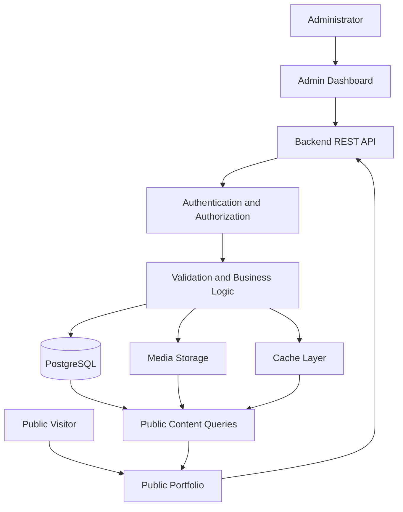

# Personal Portfolio — Luxury Edition

A modern, responsive, and professionally designed personal portfolio with a secure Admin Dashboard for managing portfolio content dynamically.

The project follows a luxury editorial design direction, combining refined typography, generous whitespace, subtle animations, and a consistent visual system. Portfolio content is managed through the administrative interface and delivered to the public website through a backend API.

> **Project status:** This README describes the intended architecture and requirements. Verify setup commands, environment variables, routes, and feature availability against the actual implementation before using them in production.

---

## Table of Contents

- [Project Overview](#project-overview)
- [Project Goals](#project-goals)
- [Design Direction](#design-direction)
- [Core Features](#core-features)
- [Technology Stack](#technology-stack)
- [System Architecture](#system-architecture)
- [Project Structure](#project-structure)
- [Getting Started](#getting-started)
- [Environment Configuration](#environment-configuration)
- [Development Workflow](#development-workflow)
- [Security](#security)
- [Testing and Quality Assurance](#testing-and-quality-assurance)
- [Deployment and Maintenance](#deployment-and-maintenance)
- [Documentation](#documentation)
- [Implementation Principles](#implementation-principles)
- [License](#license)

## Project Overview

This project consists of two connected applications.

### Public Portfolio

The public-facing website presents professional information through a refined, responsive interface.

Expected sections include:

- Home and professional introduction, including the admin-managed portrait with a restrained interactive depth effect and a static fallback.
- About and profile.
- Projects and project categories.
- Skills and technical expertise.
- Professional experience.
- Education.
- Certifications.
- Contact form.
- SEO and social-sharing metadata.

Content should be retrieved dynamically from the backend rather than hardcoded into page components, except for intentional static interface elements and safe fallback content.

### Admin Dashboard

The administrative interface allows authorized users to manage portfolio content without modifying application source code for routine updates.

Expected capabilities include:

- Profile and homepage content management, including hero portrait uploads with draft, preview, and publish, plus section ordering, visibility, and featured project selection.
- Project and category management.
- Skills and skill-category management.
- Experience, education, and certification management.
- Media uploads and media-library management.
- Draft, preview, publish, and unpublish workflows.
- Bulk publish, unpublish, and trash actions across content lists.
- Trash with restore and permanent deletion, plus revision history with one-click restore.
- SEO and site settings: site title, default description, canonical URL, and social sharing image.
- Contact-message inbox.
- Search, filtering, sorting, and pagination.
- Revision history and content recovery.
- Administrative audit logs and session management.

Advanced capabilities are implemented: scheduled publishing with an automatic publish worker, page-view analytics, a read-only system health panel, and multiple administrator accounts with Owner and Editor roles enforced on the server. Owner-only areas (administrators, site settings, sessions, health, analytics, activity log) are hidden from editors and rejected by the API.

## Project Goals

1. Build a luxury-style personal portfolio that feels professional and distinctive.
2. Maintain consistent typography, colour, spacing, and interaction patterns.
3. Support responsive layouts across desktop, tablet, and mobile devices.
4. Provide accessible navigation, forms, and interactive components.
5. Keep public content dynamic and centrally manageable.
6. Protect unpublished content and administrative operations.
7. Make the application testable, maintainable, and deployable.
8. Document architecture and implementation decisions clearly.

## Design Direction

### Visual Identity

| Design element | Specification |
|---|---|
| Primary background | Charcoal `#111110` |
| Light surface | Ivory `#F4F0E8` |
| Accent | Champagne gold `#C6AA78` |
| Headings | Refined serif typography |
| Body text | Readable sans-serif typography |
| Layout | Editorial grids and generous whitespace |
| Motion | Subtle, purposeful transitions |
| Overall style | Luxury, minimal, professional |

Gold should be used as a restrained accent rather than applied to every component.

### Animation Principles

Animations should enhance the content rather than distract from it.

- Subtle hero and text entrances.
- Restrained scroll-triggered reveals.
- Smooth navigation and hover transitions.
- Lightweight project-card interactions.
- Reduced-motion support.
- No unnecessary continuous animations.
- No animation that blocks access to important content.

Refer to `docs/04-animation-guidelines.md` for the full motion specification.

## Core Features

### Public Website

- Responsive page layouts.
- Dynamic content rendering.
- Project cards and project details.
- Accessible contact form.
- Search-engine metadata.
- Optimized image delivery.
- Loading, empty, and error states.
- Reduced-motion support.

### Content Management

- Create, read, update, and delete supported content.
- Draft and publication controls.
- Authenticated draft preview.
- Category and relationship validation.
- Media selection and alternative-text management.
- Public content filtering.
- Cache invalidation after relevant changes.

### Administration and Operations

- Protected administrative routes.
- Server-side authentication and authorization.
- Search, filtering, and pagination.
- Safe bulk actions where implemented.
- Revision history and recovery where implemented.
- Audit logs for significant events.
- Session management.
- Optional analytics and system-health information.

## Technology Stack

The proposed stack is:

| Layer | Technology |
|---|---|
| Frontend | React, TypeScript, Vite |
| Styling | Tailwind CSS |
| Backend | Node.js, Express, TypeScript |
| API | REST API, versioned under `/api/v1` |
| Database | PostgreSQL |
| ORM | Prisma |
| Validation | Zod |
| Authentication | Server-side sessions and Argon2id password hashing |
| Testing | Vitest, React Testing Library, Playwright |
| Containers | Docker and Docker Compose |
| CI/CD | GitHub Actions |

Confirm actual package versions and installed dependencies from the repository's package manifests and lockfiles. Do not install or upgrade dependencies solely because they are listed in this document.

## System Architecture



### Architecture Responsibilities

**Frontend**
- Displays public content and administrative interfaces.
- Handles user interactions and client-side validation.
- Uses typed API clients.
- Provides responsive and accessible components.

**Backend**
- Enforces authentication and authorization.
- Validates incoming requests.
- Applies business and publication rules.
- Coordinates database and media operations.
- Produces safe, documented API responses.

**Database**
- Stores portfolio content and administrative data.
- Enforces relationships and constraints.
- Supports publication states and relevant audit or revision records.

**Media Storage**
- Stores approved images and other supported assets.
- Uses safe generated storage keys.
- Separates public and restricted assets when required.

**Cache Layer**
- Improves performance where appropriate.
- Must never bypass authorization or publication rules.
- Must be invalidated when relevant content changes.

## Project Structure

The exact directory structure must match the repository. The following is a suggested high-level layout:

```text
personal-portfolio/
├── frontend/
│   ├── src/
│   │   ├── @types/
│   │   ├── api/
│   │   ├── assets/
│   │   ├── components/
│   │   ├── hooks/
│   │   ├── pages/
│   │   ├── routes/
│   │   ├── templates/
│   │   ├── themes/
│   │   ├── utils/
│   │   └── validators/
│   └── package.json
├── backend/
│   ├── src/
│   │   ├── @types/
│   │   ├── config/
│   │   ├── controllers/
│   │   ├── helpers/
│   │   ├── middlewares/
│   │   ├── models/
│   │   ├── routes/
│   │   ├── services/
│   │   ├── validators/
│   │   ├── integrations/
│   │   └── jobs/
│   ├── prisma/
│   └── package.json
├── docs/
│   ├── 01-project-overview.md
│   ├── 02-portfolio-requirements.md
│   ├── 03-design-system.md
│   ├── 04-animation-guidelines.md
│   ├── 05-system-architecture.md
│   ├── 06-frontend-architecture.md
│   ├── 07-backend-api.md
│   ├── 08-database-schema.md
│   ├── 09-admin-dashboard.md
│   ├── 10-security.md
│   ├── 11-testing-and-qa.md
│   ├── 12-deployment-and-maintenance.md
│   ├── 13-admin-advanced-features.md
│   └── 14-dynamic-content-and-media-management.md
├── .github/
│   └── workflows/
│       └── ci.yml
├── backend/
│   └── Dockerfile
├── frontend/
│   ├── Dockerfile
│   └── nginx.conf
├── docker-compose.yml
├── docker-compose.prod.yml
├── .env.example
├── .gitignore
└── README.md
```

This is a reference layout, not a command to restructure an existing repository. Keep the established folder names and package boundaries unless a deliberate architectural change is approved.

## Getting Started

### Prerequisites

Install and configure the versions required by the actual project:

- Node.js and npm.
- PostgreSQL.
- Git.
- Docker and Docker Compose, if containerized development is configured.

Use the `engines` field and package lockfiles to determine the required Node.js version.

### 1. Clone the Repository

```bash
git clone <YOUR_REPOSITORY_URL>
cd <YOUR_PROJECT_DIRECTORY>
```

Replace the placeholders with the actual repository URL and directory.

### 2. Configure Environment Variables

Create environment files from the project's example files if they exist.

```bash
cp .env.example .env
```

Repeat for frontend or backend-specific example files if the project defines them. Never overwrite an existing environment file without preserving its current configuration.

### 3. Install Dependencies

Run commands in the directory containing each actual `package.json`.

```bash
npm ci
```

If the frontend and backend are separate npm packages, install dependencies separately in each package directory. Run `npm ci` only when a compatible lockfile exists.

### 4. Configure the Database

Create the development database and configure the connection string.

Use the Prisma CLI version pinned by the project. A typical migration workflow is:

```bash
npx prisma generate
npx prisma migrate dev
```

These commands are examples for a project using the corresponding Prisma CLI version and migration setup. Verify the installed CLI's supported commands and follow the existing migration history. Do not run development migrations against production.

### 5. Start Development Servers

Use the scripts defined in each package's `package.json`.

Typical examples:

```bash
npm run dev
```

Run this from the appropriate frontend or backend package directory. Actual script names may differ.

### 6. Start with Docker Compose

If the repository includes a working Compose configuration:

```bash
docker compose config
docker compose up -d --build
docker compose ps
```

Inspect service health and logs before using the application:

```bash
docker compose logs --tail=100
```

Container names, ports, health checks, and available services depend on the actual Compose file.

## Environment Configuration

Use `.env.example` to document required variable names without real credentials.

Typical configuration categories include:

| Category | Purpose |
|---|---|
| Application | Environment name and server port |
| Database | PostgreSQL connection URL |
| Session | Session secret and cookie settings |
| Security | Allowed origins and security-related settings |
| Media | Storage provider and bucket configuration, if used |
| Email | SMTP connection and sender settings, if used |
| Cache | Cache connection, if used |
| Observability | Logging and monitoring configuration, if used |

Example variable names:

```dotenv
NODE_ENV=development
PORT=4000
DATABASE_URL=
SESSION_SECRET=
FRONTEND_ORIGIN=http://localhost:5173
```

This is a naming example, not a complete or verified environment template. Match the actual application's configuration schema.

### Environment Security

- Never commit `.env` files containing secrets.
- Use different credentials for development, testing, and production.
- Generate strong, unpredictable session secrets.
- Restrict production database permissions.
- Do not expose backend secrets through frontend-prefixed variables.
- Rotate compromised credentials immediately.
- Store production secrets in an appropriate secrets manager or deployment platform.

## Development Workflow

1. Read the relevant architecture and requirements documentation.
2. Confirm the current code and database schema before changing them.
3. Implement the smallest coherent change.
4. Update validation, API contracts, and migrations where needed.
5. Add or update automated tests.
6. Run linting, formatting, type checking, and relevant tests.
7. Review security and accessibility impacts.
8. Update documentation to reflect actual behaviour.
9. Review the Git diff before committing.

### Example Git Workflow

```bash
git status
git diff
git add <specific-files>
git commit -m "Describe the change"
```

Use specific file paths instead of blindly staging generated files, secrets, or unrelated changes.

## Security

Security is a core requirement for both the public website and Admin Dashboard.

Required controls include:

- Server-side authentication and authorization.
- Secure password hashing.
- Secure session management.
- CSRF protection when applicable.
- Input validation and safe output rendering.
- Protection against SQL injection and stored XSS.
- Rate limiting and abuse prevention.
- Secure file-upload validation.
- Publication filtering on the backend.
- Restricted administrative endpoints.
- Safe error handling and secret redaction.
- Dependency and container scanning where configured.
- Database backup and recovery procedures.
- Audit logging for sensitive administrative actions.

Public API endpoints must never expose drafts, private messages, session information, or administrative records.

Refer to `docs/10-security.md` for the full security specification.

## Testing and Quality Assurance

Testing should cover both individual components and complete user workflows.

### Recommended Checks

Run only commands that exist in the relevant package's scripts.

Typical checks include:

```bash
npm run lint
npm run typecheck
npm test
npm run build
```

Formatting checks may also be available, for example:

```bash
npm run format:check
```

Verify actual script names before running these commands.

### Important Test Areas

- Unit and component tests.
- API validation and authorization.
- Database constraints and migrations.
- Draft, preview, publish, and unpublish workflows.
- Media upload and deletion safety.
- Contact form validation and abuse protection.
- Administrative session revocation.
- Accessibility and responsive behaviour.
- SEO metadata and public content visibility.
- End-to-end workflows.
- Performance and security checks.

A successful build alone does not prove that authentication, publication rules, database integrity, or deployment behaviour are correct.

## Deployment and Maintenance

Production deployment should follow a documented release process.

### Before Deployment

- Review the release changes.
- Run relevant automated tests.
- Check dependency and security findings.
- Verify production environment variables.
- Confirm database migrations.
- Confirm HTTPS and secure cookies.
- Verify media storage access.
- Check backups and recovery procedures.
- Confirm health checks and operational logging.

### After Deployment

- Verify public pages and administrative login.
- Test a representative content-management workflow.
- Confirm that drafts remain private.
- Verify media delivery and contact submissions.
- Check service health and application logs.
- Monitor errors and performance.
- Confirm rollback or recovery options.

Do not run destructive database commands or development migrations against production without a reviewed migration and recovery plan.

### Container Deployment

`docker-compose.prod.yml` runs PostgreSQL, the API, and an nginx web container that serves the built SPA and proxies `/api` to the API on a single origin:

```bash
POSTGRES_PASSWORD=<db-password> \
SESSION_SECRET=<at-least-32-characters> \
PUBLIC_ORIGIN=https://example.com \
  docker compose -f docker-compose.prod.yml up -d --build
```

The API applies committed migrations on start, and uploads plus database data live on named volumes (`portfolio-media`, `portfolio-db`) that must be backed up together. The web container publishes `WEB_PORT` (default `8080`); terminate TLS in front of it, because production sessions use `Secure` cookies and will not work over plain HTTP. Container, proxy, and CI details are in `docs/12-deployment-and-maintenance.md` §32; CI checks are in `docs/11-testing-and-qa.md` §24.1.

See `docs/12-deployment-and-maintenance.md` for the detailed deployment and operations guide.

## Documentation

The `docs/` directory contains the project's design, architecture, implementation, and operational specifications.

| File | Description |
|---|---|
| `01-project-overview.md` | Project vision, scope, goals, and acceptance criteria |
| `02-portfolio-requirements.md` | Public website requirements and user experience |
| `03-design-system.md` | Colours, typography, spacing, components, and visual consistency |
| `04-animation-guidelines.md` | Motion principles, transitions, performance, and reduced-motion support |
| `05-system-architecture.md` | System components, data flow, boundaries, and architectural decisions |
| `06-frontend-architecture.md` | React application structure, routing, components, and state management |
| `07-backend-api.md` | REST endpoints, request validation, response formats, and authorization |
| `08-database-schema.md` | Data entities, relationships, constraints, and migration guidance |
| `09-admin-dashboard.md` | Administrative screens, content workflows, and dashboard requirements |
| `10-security.md` | Threat model, authentication, authorization, privacy, and security controls |
| `11-testing-and-qa.md` | Test strategy, quality gates, release checks, and defect handling |
| `12-deployment-and-maintenance.md` | Deployment, monitoring, backups, recovery, and maintenance |
| `13-admin-advanced-features.md` | Bulk actions, revision history, trash/recovery, scheduled publishing, administrator roles, audit logs, and sessions |
| `14-dynamic-content-and-media-management.md` | Dynamic content delivery, publishing, uploads, storage, optimization, and caching |

The documentation is intended to guide implementation. Update it when architectural or behavioural decisions change, and distinguish planned features from verified functionality.

## Implementation Principles

- **Consistency:** Use shared design tokens and reusable components.
- **Security:** Enforce sensitive rules on the server.
- **Accessibility:** Support keyboard navigation, readable contrast, and reduced motion.
- **Performance:** Optimize database access, network requests, and images.
- **Reliability:** Handle partial failures and provide clear recovery paths.
- **Maintainability:** Keep responsibilities separated and code testable.
- **Privacy:** Collect and retain only necessary personal data.
- **Accuracy:** Keep documentation aligned with actual code and configuration.

## License

Add the chosen license before publicly distributing or reusing the project. Until a license is explicitly selected and included in the repository, do not assume that the project is licensed for unrestricted reuse.
