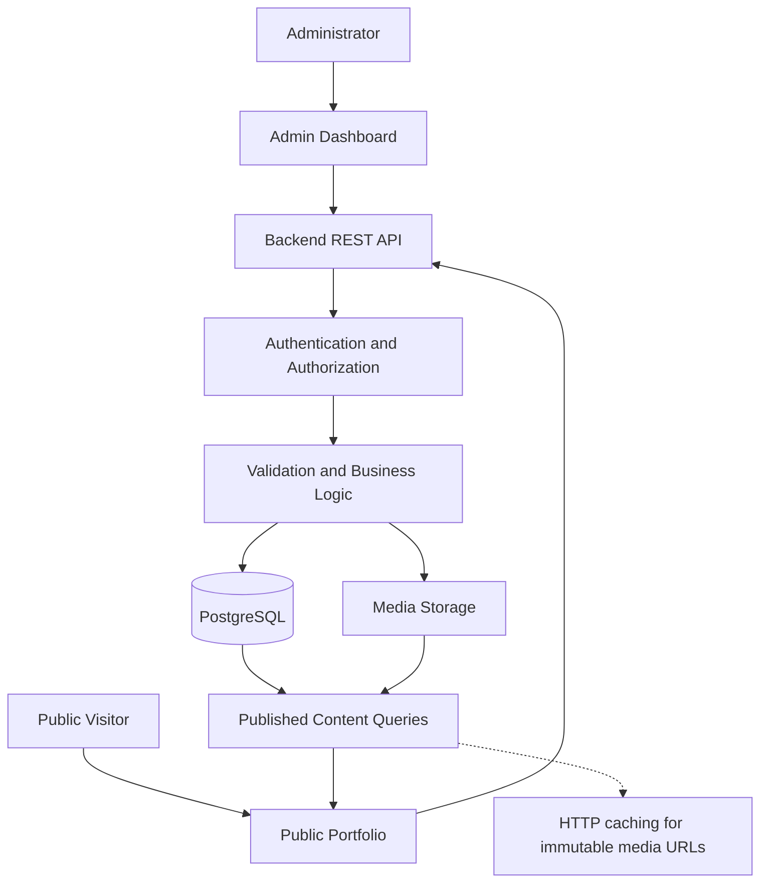

# Personal Portfolio — Luxury Edition

A modern, responsive, and professionally designed personal portfolio with a secure Admin Dashboard for managing portfolio content dynamically.

The project follows a luxury editorial design direction, combining refined typography, generous whitespace, subtle animations, and a consistent visual system. Portfolio content is managed through the administrative interface and delivered to the public website through a backend API.

> **Project status:** Implemented and verified. The public site, admin dashboard, API, database migrations, media pipeline, and test suites exist in this repository. Backend typecheck/tests/build, frontend lint/tests/build, and the Playwright verifiers all pass. Not built: blog, downloadable CV, general import/export, responsive image variants, object storage, and automated backup monitoring. See `docs/01-project-overview.md` §15 for the full implemented/not-implemented split.

---

## Table of Contents

- [Project Overview](#project-overview)
- [Project Goals](#project-goals)
- [Design Direction](#design-direction)
- [Core Features](#core-features)
- [Technology Stack](#technology-stack)
- [System Architecture](#system-architecture)
- [Project Structure](#project-structure)
- [Getting Started](#getting-started)
- [Environment Configuration](#environment-configuration)
- [Development Workflow](#development-workflow)
- [Security](#security)
- [Testing and Quality Assurance](#testing-and-quality-assurance)
- [Deployment and Maintenance](#deployment-and-maintenance)
- [Documentation](#documentation)
- [Implementation Principles](#implementation-principles)
- [License](#license)

## Project Overview

This project consists of two connected applications.

### Public Portfolio

The public-facing website presents professional information through a refined, responsive interface.

Implemented routes:

| Route | Page |
|---|---|
| `/` | Home: introduction, admin-managed hero portrait with a restrained depth effect and a static fallback, featured work, skills, experience, credentials, contact call to action |
| `/about` | Profile, biography, skills, education, and certifications |
| `/projects` | All published projects |
| `/projects/:slug` | Project detail with description, technologies, links, and gallery |
| `/experience` | Professional experience |
| `/contact` | Contact information and the validated contact form |
| `*` | Not-found page |

Skills, education, and certifications share the About page instead of each taking a top-level route. Content is retrieved from the backend API rather than hardcoded in page components, and each page sets its own title, description, and Open Graph metadata.

### Admin Dashboard

The administrative interface allows authorized users to manage portfolio content without modifying application source code for routine updates.

Implemented capabilities:

- Profile and homepage content management, including hero portrait uploads with draft, preview, and publish, plus section ordering, visibility, and featured project selection.
- Project and project-category management, with covers chosen from the media library or an external URL.
- Skills and skill-category management.
- Experience, education, and certification management.
- Media uploads and media-library management, with search, alt-text editing, and reference-safe deletion; project covers and the profile portrait are picked from the library.
- Draft, preview, publish, and unpublish workflows, plus scheduled publishing.
- Bulk publish, unpublish, and trash actions across content lists.
- Trash with restore and permanent deletion, and revision history with comparison and one-click restore.
- Site settings: site title, default description, canonical URL, and social sharing image.
- Contact-message inbox with status filters and CSV export.
- Search, filtering, sorting, and pagination on every collection.
- Owner/Editor administrator accounts, session management, and an append-only audit log with a failed-login monitoring summary.

Advanced capabilities are implemented: scheduled publishing with an automatic publish worker, page-view analytics, and a read-only system health panel. Owner-only areas (administrators, site settings, sessions, health, analytics, activity log) are hidden from editors and rejected by the API.

## Project Goals

1. Build a luxury-style personal portfolio that feels professional and distinctive.
2. Maintain consistent typography, colour, spacing, and interaction patterns.
3. Support responsive layouts across desktop, tablet, and mobile devices.
4. Provide accessible navigation, forms, and interactive components.
5. Keep public content dynamic and centrally manageable.
6. Protect unpublished content and administrative operations.
7. Make the application testable, maintainable, and deployable.
8. Document architecture and implementation decisions clearly.

## Design Direction

### Visual Identity

| Design element | Specification |
|---|---|
| Primary background | Charcoal `#111110` |
| Light surface | Ivory `#F4F0E8` |
| Accent | Champagne gold `#C6AA78` |
| Headings | Refined serif typography |
| Body text | Readable sans-serif typography |
| Layout | Editorial grids and generous whitespace |
| Motion | Subtle, purposeful transitions |
| Overall style | Luxury, minimal, professional |

Gold should be used as a restrained accent rather than applied to every component.

### Animation Principles

Animations should enhance the content rather than distract from it.

- Subtle hero and text entrances.
- Restrained scroll-triggered reveals.
- Smooth navigation and hover transitions.
- Lightweight project-card interactions.
- Reduced-motion support.
- No unnecessary continuous animations.
- No animation that blocks access to important content.

Refer to `docs/04-animation-guidelines.md` for the full motion specification.

## Core Features

### Public Website

- Responsive layouts across mobile, tablet, and desktop.
- Content rendered from the API, with ordered and hideable homepage sections.
- Project cards, project detail pages, and gallery screenshots.
- Accessible contact form with server-side validation and rate limiting.
- Per-page titles, descriptions, and social metadata.
- Graceful image fallbacks when an external URL fails, and reserved image dimensions to avoid layout shifts. Responsive `srcset` variants are not generated.
- Loading, empty, and error states.
- Reduced-motion support across animations.

### Content Management

- Create, read, update, and delete supported content.
- Draft and publication controls, including scheduled publishing.
- Authenticated draft preview for homepage configuration.
- Category and relationship validation.
- Media selection and alternative-text management, including project gallery screenshots and the homepage portrait uploaded or picked from the library.
- Public content filtering: only published, non-deleted records reach public endpoints.
- Immutable caching for uploaded media URLs. There is no server-side content cache, so publication changes are visible immediately.

### Administration and Operations

- Protected administrative routes.
- Server-side authentication and authorization, with Owner and Editor roles.
- Optional two-factor authentication per administrator: TOTP authenticator apps, one-time recovery codes, and a self-service security page.
- Search, filtering, and pagination.
- Bulk publish, unpublish, and trash actions.
- Revision history, comparison, and recovery.
- Audit logs for significant events.
- Session listing and revocation.
- Page-view analytics and a read-only system health panel.

## Technology Stack

| Layer | Technology |
|---|---|
| Frontend | React 19, TypeScript, Vite 8, React Router 7 |
| Styling | Tailwind CSS 4 with design tokens in `frontend/src/themes/tokens.css` |
| Backend | Node.js 24, Express 5, TypeScript |
| API | REST under `/api` (no version prefix) |
| Database | PostgreSQL 18 |
| ORM | Prisma 6 with committed migrations |
| Validation | Zod schemas on the API; the forms mirror the same rules |
| Authentication | PostgreSQL-backed server sessions and Argon2id password hashing, with optional TOTP second factor |
| Testing | Vitest, React Testing Library, and Playwright verifier scripts |
| Containers | Dockerfiles for both apps plus `docker-compose.yml` (dev database) and `docker-compose.prod.yml` (single-origin stack) |
| CI | GitHub Actions (`.github/workflows/ci.yml`) on Node 24 |

Versions are pinned in `backend/package.json`, `frontend/package.json`, and their lockfiles. CI is the reference environment for the Node version.

## System Architecture



### Architecture Responsibilities

**Frontend**
- Displays public content and administrative interfaces.
- Handles user interactions and client-side validation.
- Uses typed API clients.
- Provides responsive and accessible components.

**Backend**
- Enforces authentication and authorization.
- Validates incoming requests.
- Applies business and publication rules.
- Coordinates database and media operations.
- Produces safe, documented API responses.

**Database**
- Stores portfolio content and administrative data.
- Enforces relationships and constraints.
- Supports publication states and relevant audit or revision records.

**Media Storage**
- Stores approved images and other supported assets.
- Uses safe generated storage keys.
- Separates public and restricted assets when required.

**Caching**
- Uploaded media is served from immutable, content-addressed URLs with long-lived `Cache-Control` headers.
- Public content responses are marked `no-store`, so publishing is visible immediately; there is no cache to invalidate.

## Project Structure

```text
.
├── backend/
│   ├── src/
│   │   ├── config/        # validated environment configuration
│   │   ├── db/            # Prisma client singleton
│   │   ├── lib/           # errors, validation, audit, images, media URLs, revisions
│   │   ├── middleware/    # session guard, role guard, CSRF verification
│   │   ├── routes/
│   │   │   ├── admin/     # authenticated content and settings endpoints
│   │   │   └── public/    # published content, hero, media, contact, analytics
│   │   ├── schemas/       # Zod request schemas
│   │   ├── scripts/       # create-admin
│   │   ├── services/      # business logic, publishing, media, revisions, scheduling
│   │   ├── types/         # Express session augmentation
│   │   ├── app.ts
│   │   └── index.ts
│   ├── prisma/            # schema.prisma, migrations, test-database init
│   ├── tests/             # Vitest integration tests against PostgreSQL
│   ├── storage/media/     # uploaded files in development (git-ignored)
│   ├── Dockerfile
│   └── package.json
├── frontend/
│   ├── src/
│   │   ├── @types/        # API and admin type contracts
│   │   ├── api/           # typed fetch clients
│   │   ├── auth/          # session context
│   │   ├── components/    # admin, forms, layout, navigation, portfolio, ui, feedback
│   │   ├── content/       # static navigation definitions
│   │   ├── hooks/         # data loading, bulk selection, reduced motion
│   │   ├── pages/         # admin, public, and error pages
│   │   ├── portfolio/     # published content provider and hooks
│   │   ├── routes/        # public and admin route trees
│   │   ├── templates/     # PublicLayout and AdminLayout
│   │   ├── themes/        # design tokens
│   │   ├── utils/         # payload builders, formatting, metadata, CSV, diffs
│   │   ├── global.css
│   │   └── main.tsx
│   ├── scripts/           # Playwright verifiers and screenshot capture
│   ├── Dockerfile
│   ├── nginx.conf
│   └── package.json
├── docs/                  # 14 numbered specifications
├── .github/workflows/     # ci.yml
├── docker-compose.yml     # local PostgreSQL only
├── docker-compose.prod.yml # database, API, and nginx web container
└── README.md
```

Development commands run from `backend/` and `frontend/`; there is no root `package.json`.

## Getting Started

### Prerequisites

- Node.js 24 and npm. CI pins Node 24; no `engines` field enforces it locally.
- Docker with Compose, for the development PostgreSQL container.
- Git.

### 1. Clone the Repository

```bash
git clone <repository-url>
cd <project-directory>
```

### 2. Install Dependencies

The two applications are separate npm packages with committed lockfiles:

```bash
cd backend && npm ci
cd ../frontend && npm ci
```

### 3. Start PostgreSQL

The development Compose file runs PostgreSQL only:

```bash
docker compose up -d db
docker compose ps
```

The database listens on `127.0.0.1:5433` (port 5433 avoids clashing with a local PostgreSQL on 5432). On first initialization its init script also creates `portfolio_test`, which the backend test suite uses.

### 4. Configure the Backend Environment

```bash
cp backend/.env.example backend/.env
```

Replace `SESSION_SECRET` with a generated value (`openssl rand -hex 32`) and set the `ADMIN_*` values used when creating the first administrator. The frontend needs no environment file: Vite proxies `/api` to `http://127.0.0.1:4000`, so the browser sees a single origin and session cookies behave as they do in production.

### 5. Apply Migrations and Create an Administrator

```bash
cd backend
npx prisma generate
npx prisma migrate dev
npm run create-admin
```

`create-admin` reads `ADMIN_EMAIL`, `ADMIN_PASSWORD`, and `ADMIN_NAME` from `backend/.env` and is not used by the API at runtime.

### 6. Start Development Servers

Run each in its own terminal:

```bash
cd backend && npm run dev    # http://localhost:4000
cd frontend && npm run dev   # http://localhost:5173
```

Sign in at `http://localhost:5173/admin/login`.

### 7. Production-Shaped Stack (optional)

`docker-compose.prod.yml` builds the API and web images and runs PostgreSQL; see [Container Deployment](#container-deployment).

## Environment Configuration

`backend/.env.example` is the only environment template. The frontend has no environment variables.

| Variable | Purpose |
|---|---|
| `NODE_ENV` | `development`, `test`, or `production` |
| `PORT` | API port (default `4000`) |
| `DATABASE_URL` | PostgreSQL connection string |
| `SESSION_SECRET` | Session signing secret; at least 32 characters. Also derives the AES-256-GCM key that encrypts stored MFA secrets, so rotating it unenrols every second factor |
| `SESSION_COOKIE_NAME` | Session cookie name (default `portfolio.sid`) |
| `FRONTEND_ORIGIN` | Allowed credentialed origin in development |
| `MEDIA_ROOT` | Upload directory, relative to `backend/` |
| `MEDIA_MAX_BYTES` | Maximum upload size (default 8 MB) |
| `MEDIA_UPLOAD_LIMIT_PER_HOUR` | Upload rate limit per client IP |
| `TRUST_PROXY` | Trust `X-Forwarded-For`; enable only behind a trusted proxy |
| `LOGIN_RATE_LIMIT_MAX` | Failed sign-ins allowed per 15 minutes per IP |
| `ADMIN_EMAIL`, `ADMIN_PASSWORD`, `ADMIN_NAME` | Used only by `npm run create-admin` |

`docker-compose.prod.yml` supplies its own values: `POSTGRES_PASSWORD`, `SESSION_SECRET`, `PUBLIC_ORIGIN`, `MEDIA_MAX_BYTES`, `MEDIA_UPLOAD_LIMIT_PER_HOUR`, `LOGIN_RATE_LIMIT_MAX`, and `WEB_PORT`. There are no email, cache, or observability integrations to configure.

### Environment Security

- Never commit `.env` files containing secrets.
- Use different credentials for development, testing, and production.
- Generate strong, unpredictable session secrets.
- Restrict production database permissions.
- Do not expose backend secrets through frontend-prefixed variables.
- Rotate compromised credentials immediately.
- Store production secrets in an appropriate secrets manager or deployment platform.

## Development Workflow

1. Read the relevant architecture and requirements documentation.
2. Confirm the current code and database schema before changing them.
3. Implement the smallest coherent change.
4. Update validation, API contracts, and migrations where needed.
5. Add or update automated tests.
6. Run linting, type checking, the relevant tests, and the build.
7. Review security and accessibility impacts.
8. Update documentation to reflect actual behaviour.
9. Review the Git diff before committing.

### Example Git Workflow

```bash
git status
git diff
git add <specific-files>
git commit -m "Describe the change"
```

Use specific file paths instead of blindly staging generated files, secrets, or unrelated changes.

## Security

Security is enforced for both the public website and Admin Dashboard.

Implemented controls:

- Server-side authentication and authorization.
- Secure password hashing.
- Optional TOTP two-factor authentication with hashed, single-use recovery codes.
- Secure session management.
- CSRF protection when applicable.
- Input validation and safe output rendering.
- Protection against SQL injection and stored XSS.
- Rate limiting and abuse prevention.
- Secure file-upload validation.
- Publication filtering on the backend.
- Restricted administrative endpoints.
- Safe error handling that does not leak stack traces or storage paths.
- Database backup and recovery procedures (documented; run outside the application).
- Audit logging for sensitive administrative actions.

Dependency auditing is a documented release step, not an automated CI job; the container images are built but not scanned in CI.

Public API endpoints must never expose drafts, private messages, session information, or administrative records.

Refer to `docs/10-security.md` for the full security specification.

## Testing and Quality Assurance

Testing should cover both individual components and complete user workflows.

### Commands

Backend:

```bash
cd backend
npm run typecheck   # tsc for src and tests
npm test            # Vitest integration tests against portfolio_test
npm run build
```

Frontend:

```bash
cd frontend
npm run lint        # oxlint
npm test            # Vitest + React Testing Library
npm run build       # tsc -b && vite build
npm run verify      # Playwright: verify-homepage + verify-admin
```

`npm run verify` needs a built bundle (`npm run build`), the API on port 4000, and Vite on port 5173, with a seeded administrator (`ADMIN_EMAIL` / `ADMIN_PASSWORD` in `backend/.env`). It starts `vite preview` on port 4173 itself. There is no formatter script in either package.

### Important Test Areas

- Unit and component tests.
- API validation and authorization.
- Database constraints and migrations.
- Draft, preview, publish, and unpublish workflows.
- Media upload and deletion safety.
- Contact form validation and abuse protection.
- Administrative session revocation.
- Accessibility and responsive behaviour.
- SEO metadata and public content visibility.
- End-to-end workflows.
- Security boundaries: CSRF, authorization, upload validation, and session revocation.

A successful build alone does not prove that authentication, publication rules, database integrity, or deployment behaviour are correct.

## Deployment and Maintenance

Production deployment should follow a documented release process.

### Before Deployment

- Review the release changes.
- Run relevant automated tests.
- Check dependency and security findings.
- Verify production environment variables.
- Confirm database migrations.
- Confirm HTTPS and secure cookies.
- Verify media storage access.
- Check backups and recovery procedures.
- Confirm health checks and operational logging.

### After Deployment

- Verify public pages and administrative login.
- Test a representative content-management workflow.
- Confirm that drafts remain private.
- Verify media delivery and contact submissions.
- Check service health and application logs.
- Monitor errors and performance.
- Confirm rollback or recovery options.

Do not run destructive database commands or development migrations against production without a reviewed migration and recovery plan.

### Container Deployment

`docker-compose.prod.yml` runs PostgreSQL, the API, and an nginx web container that serves the built SPA and proxies `/api` to the API on a single origin:

```bash
POSTGRES_PASSWORD=<db-password> \
SESSION_SECRET=<at-least-32-characters> \
PUBLIC_ORIGIN=https://example.com \
  docker compose -f docker-compose.prod.yml up -d --build
```

The API applies committed migrations on start, and uploads plus database data live on named volumes (`portfolio-media`, `portfolio-db`) that must be backed up together. The web container publishes `WEB_PORT` (default `8080`); terminate TLS in front of it, because production sessions use `Secure` cookies and will not work over plain HTTP. Container, proxy, and CI details are in `docs/12-deployment-and-maintenance.md` §32; CI checks are in `docs/11-testing-and-qa.md` §24.1.

See `docs/12-deployment-and-maintenance.md` for the detailed deployment and operations guide.

## Documentation

The `docs/` directory contains the project's design, architecture, implementation, and operational specifications.

| File | Description |
|---|---|
| `01-project-overview.md` | Project vision, scope, goals, and acceptance criteria |
| `02-portfolio-requirements.md` | Public website requirements and user experience |
| `03-design-system.md` | Colours, typography, spacing, components, and visual consistency |
| `04-animation-guidelines.md` | Motion principles, transitions, performance, and reduced-motion support |
| `05-system-architecture.md` | System components, data flow, boundaries, and architectural decisions |
| `06-frontend-architecture.md` | React application structure, routing, components, and state management |
| `07-backend-api.md` | REST endpoints, request validation, response formats, and authorization |
| `08-database-schema.md` | Data entities, relationships, constraints, and migration guidance |
| `09-admin-dashboard.md` | Administrative screens, content workflows, and dashboard requirements |
| `10-security.md` | Threat model, authentication, authorization, privacy, and security controls |
| `11-testing-and-qa.md` | Test strategy, quality gates, release checks, and defect handling |
| `12-deployment-and-maintenance.md` | Deployment, monitoring, backups, recovery, and maintenance |
| `13-admin-advanced-features.md` | Bulk actions, revision history, trash/recovery, scheduled publishing, administrator roles, audit logs, and sessions |
| `14-dynamic-content-and-media-management.md` | Dynamic content delivery, publishing, uploads, storage, and caching |

The documentation is intended to guide implementation. Update it when architectural or behavioural decisions change, and distinguish planned features from verified functionality.

## Implementation Principles

- **Consistency:** Use shared design tokens and reusable components.
- **Security:** Enforce sensitive rules on the server.
- **Accessibility:** Support keyboard navigation, readable contrast, and reduced motion.
- **Performance:** Paginate and index database access, reserve image dimensions, and serve uploaded media from immutable URLs.
- **Reliability:** Handle partial failures and provide clear recovery paths.
- **Maintainability:** Keep responsibilities separated and code testable.
- **Privacy:** Collect and retain only necessary personal data.
- **Accuracy:** Keep documentation aligned with actual code and configuration.

## License

Add the chosen license before publicly distributing or reusing the project. Until a license is explicitly selected and included in the repository, do not assume that the project is licensed for unrestricted reuse.
