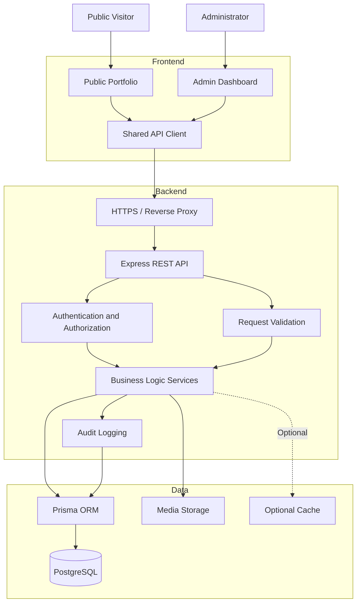
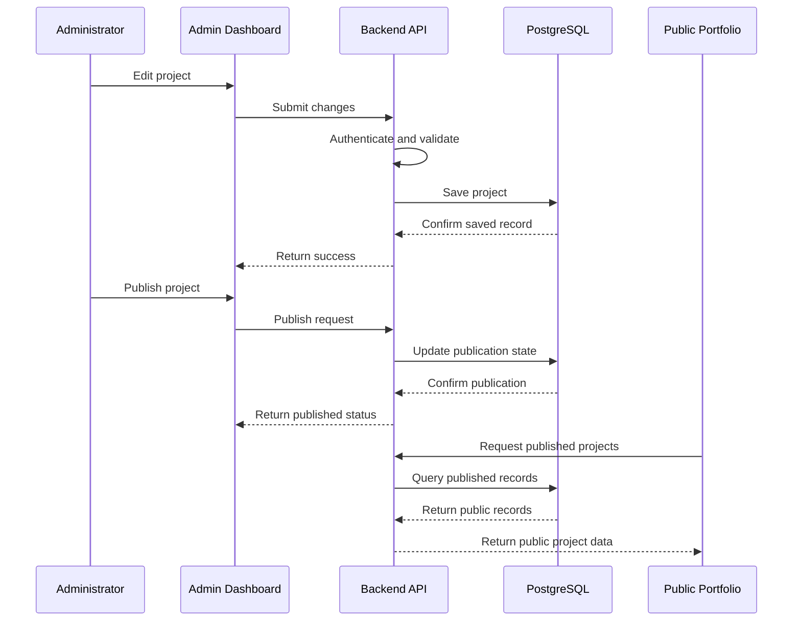

# System Architecture

## 1. Purpose

This document defines the system architecture for the Luxury Personal Portfolio and Admin Dashboard.

The application consists of two connected interfaces:

1. **Public Portfolio** — a professional, responsive portfolio that displays published personal and professional information.
2. **Admin Dashboard** — a protected management interface for creating, editing, reviewing, publishing, and maintaining portfolio content.

The system must be secure, maintainable, accessible, responsive, and suitable for production deployment.

## 2. Architecture Principles

The system must follow these principles:

- Separation of frontend, backend, database, and media storage responsibilities.
- Secure server-side authentication and authorization.
- Server-side validation for every write operation.
- Database-backed content rather than hardcoded portfolio data.
- Clear separation between public content and private administrative data.
- Draft and published content states.
- Consistent API response and error formats.
- Database migrations managed through Prisma.
- Reusable frontend components and backend services.
- Automated testing and security checks.
- Environment-based configuration with no committed secrets.
- Accessible interactions and support for reduced motion.
- Documented backup, recovery, and deployment procedures.

## 3. High-Level Architecture



The reverse proxy, media provider, and cache are deployment choices. They must only be treated as implemented components when they are configured and tested.

## 4. Technology Stack

| Layer | Technology | Responsibility |
|---|---|---|
| Public frontend | React, TypeScript, Vite | Public portfolio interface |
| Admin frontend | React, TypeScript, Vite | Protected content management |
| Styling | Tailwind CSS | Design system and responsive layouts |
| Routing | React Router or the selected router | Public and admin navigation |
| Backend | Node.js, Express, TypeScript | REST API and business logic |
| Validation | Zod | Runtime validation of requests and environment configuration |
| Database | PostgreSQL | Persistent application data |
| ORM | Prisma | Database access and schema migrations |
| Password hashing | Argon2id | Secure administrator password storage |
| Authentication | Server-side sessions | Persistent authenticated browser sessions |
| Testing | Vitest, React Testing Library, Playwright | Unit, component, integration, and end-to-end tests |
| Containers | Docker Compose | Local development and supported deployments |
| CI/CD | GitHub Actions | Automated checks and deployment workflows |

Exact package versions must be pinned and maintained in the project manifests and lockfiles.

## 5. Application Boundaries

### 5.1 Public Portfolio

The public application is responsible for:

- Displaying the administrator's approved profile information.
- Rendering published projects and project categories.
- Displaying experience, education, skills, and certifications.
- Showing approved profile and project media.
- Providing public contact functionality.
- Rendering page titles, descriptions, canonical URLs, and social metadata.
- Providing responsive layouts and accessible interactions.
- Showing loading, empty, and error states.

The public frontend must not contain privileged database credentials, session secrets, administrator-only data, or server-side authorization logic.

### 5.2 Admin Dashboard

The admin dashboard is responsible for:

- Secure administrator login and logout.
- Viewing and editing profile information.
- Managing profile images and other media.
- Creating, reading, updating, and deleting portfolio records.
- Managing project and skill categories.
- Saving drafts and publishing approved content.
- Previewing drafts before publication.
- Managing homepage content and section visibility.
- Managing SEO metadata and relevant site settings.
- Reviewing contact submissions.
- Searching, filtering, sorting, and paginating records.
- Managing revisions and recoverable deleted content where implemented.
- Viewing security events, audit history, and system status where authorized.

The admin frontend is not a security boundary. Every privileged operation must be authorized by the backend.

## 6. Backend Architecture

The backend should use a layered structure.

```text
HTTP Request
    |
    v
Route
    |
    v
Authentication / Authorization Middleware
    |
    v
Request Validation
    |
    v
Controller
    |
    v
Service Layer
    |
    +------> Prisma / PostgreSQL
    |
    +------> Media Storage
    |
    +------> Audit Logging
    |
    v
Standardized HTTP Response
```

### 6.1 Routes

Routes define HTTP methods, URL patterns, and middleware.

Responsibilities:

- Register endpoints.
- Apply appropriate authentication and authorization middleware.
- Apply route-specific rate limits.
- Dispatch validated requests to controllers.

Routes must not contain complex business logic.

### 6.2 Middleware

Middleware handles cross-cutting concerns such as:

- Session loading and authentication.
- Administrator authorization.
- Request validation integration.
- CSRF protection when required by the session-based authentication design.
- Rate limiting.
- Security headers.
- Request IDs and structured logging.
- Centralized error handling.

### 6.3 Controllers

Controllers translate HTTP requests into service calls and map service results into HTTP responses.

Controllers should remain thin and should not directly implement complex database workflows.

### 6.4 Services

Services implement business rules, including:

- Portfolio content management.
- Publication and visibility rules.
- Media association and deletion policies.
- Contact submission handling.
- Homepage configuration.
- Revision and recovery workflows.
- Audit event generation.
- Cache invalidation when a cache is enabled.

### 6.5 Data Access

Prisma provides typed database access. Services should use explicit queries and transactions when multiple related database operations must succeed or fail together.

Avoid exposing raw database errors or internal schema details to public clients.

## 7. API Architecture

Use a versioned REST API, for example:

`/api/v1`

The exact route inventory is maintained in `docs/07-backend-api.md`.

### Public endpoints

Examples:

- `GET /api/v1/portfolio/profile`
- `GET /api/v1/portfolio/projects`
- `GET /api/v1/portfolio/projects/:slug`
- `GET /api/v1/portfolio/skills`
- `GET /api/v1/portfolio/experience`
- `GET /api/v1/portfolio/education`
- `GET /api/v1/portfolio/certifications`
- `POST /api/v1/contact`

### Authentication endpoints

Examples:

- `POST /api/v1/auth/login`
- `POST /api/v1/auth/logout`
- `GET /api/v1/auth/session`

### Administrative endpoints

Examples:

- `GET /api/v1/admin/projects`
- `POST /api/v1/admin/projects`
- `PATCH /api/v1/admin/projects/:id`
- `DELETE /api/v1/admin/projects/:id`
- `POST /api/v1/admin/projects/:id/publish`
- `POST /api/v1/admin/projects/:id/unpublish`

Equivalent administrative endpoints should exist for other supported content types.

These routes are architectural examples. The actual API contract must be documented and implemented consistently.

### API rules

- Public endpoints return only fields intended for public display.
- Public queries exclude drafts, archived records, and unpublished content.
- Admin endpoints require an authenticated and authorized session.
- Input is validated on the server.
- Pagination limits and query parameters are validated.
- Write operations return appropriate HTTP status codes.
- Errors use a consistent response structure.
- Sensitive information is never included in responses or logs.
- Destructive operations use appropriate confirmation and authorization controls.

## 8. Dynamic Content and Publishing

The public portfolio must be driven by persistent backend data.



Requirements:

1. The administrator creates or edits content through the dashboard.
2. The backend authenticates the request and validates all submitted fields.
3. The backend persists valid changes to PostgreSQL.
4. Drafts remain private to authorized administrators.
5. Publishing explicitly changes the content's public visibility.
6. The public API returns only published and otherwise eligible records.
7. The public frontend refreshes the affected data after publication.
8. If caching is enabled, affected cache entries are invalidated or refreshed.
9. A failed save or publish operation must not display a false success state.
10. Public content updates must not require rebuilding the frontend solely because a database record changed.

The detailed content and media rules are defined in `docs/14-dynamic-content-and-media-management.md`.

## 9. Database Architecture

PostgreSQL is the primary persistent data store.

The schema should support the following logical entities as required by the approved feature scope:

- Administrator accounts.
- Authentication sessions.
- Profile information.
- Projects.
- Project categories and technology associations.
- Skills and skill categories.
- Professional experience.
- Education.
- Certifications.
- Homepage and site settings.
- Media metadata.
- Contact messages.
- Audit events.
- Content revisions and recoverable deletion records, if implemented.

### Database rules

- Use Prisma schema definitions and version-controlled migrations.
- Use foreign keys and appropriate constraints.
- Add indexes for frequently filtered, sorted, and joined fields.
- Enforce uniqueness for identifiers such as slugs where appropriate.
- Use transactions for multi-record operations.
- Store timestamps consistently, preferably in UTC.
- Store password hashes, never plaintext passwords.
- Do not store uploaded binary files in ordinary text fields.
- Keep secrets and database connection strings outside source control.
- Apply database permissions using least privilege.
- Do not assume a proposed entity exists until it has been added to the actual Prisma schema and migrated.

See `docs/08-database-schema.md` for the detailed schema.

## 10. Media Storage Architecture

Media files are managed through the admin dashboard, but file storage must be separated from ordinary portfolio content records.

The system should support:

- Profile photographs.
- Project screenshots.
- Project thumbnails.
- Certification images where appropriate.
- Other explicitly approved portfolio assets.

### Upload flow

1. The administrator selects a file.
2. The backend verifies authentication and authorization.
3. The backend validates file size, type, extension, and content.
4. The file is uploaded to configured storage.
5. The backend records metadata and storage references.
6. The administrator associates the media with a content record.
7. The public API exposes media only when it is authorized for public display.

Use generated storage names instead of trusting original filenames. Restrict executable content, prevent path traversal, and avoid serving untrusted uploads from privileged application origins.

Storage may be local during development and use a suitable persistent or object-storage provider in production. The selected deployment must document its actual provider, access policies, backup process, and cleanup strategy.

Deleting a media record must not accidentally remove an asset still referenced by another published record.

## 11. Authentication and Authorization

The admin dashboard requires secure server-side authentication.

### Authentication requirements

- Use Argon2id for password hashing.
- Use opaque, unpredictable session identifiers.
- Store session state server-side.
- Configure session cookies with `HttpOnly`, `Secure` in HTTPS production, and an appropriate `SameSite` policy.
- Rotate session identifiers after authentication and other relevant privilege changes.
- Enforce idle and absolute session expiration.
- Invalidate sessions on logout.
- Apply login rate limits and generic authentication error messages.
- Provide a safe password recovery process if recovery is supported.

### Authorization requirements

- Public users cannot access administrative APIs.
- Unauthenticated users cannot access protected dashboard data.
- Every administrative API operation checks permissions server-side.
- Sensitive settings, session management, audit data, and maintenance functions require appropriate authorization.
- The backend must not trust role or permission values supplied by the browser.

Because browser sessions commonly use cookies, state-changing requests must have suitable CSRF defenses. The exact configuration is documented in `docs/10-security.md`.

## 12. Contact Form Architecture

The public contact form submits messages to the backend.

Expected flow:

1. Validate fields in the browser for usability.
2. Validate all fields again on the server.
3. Apply rate limits and spam-abuse controls.
4. Normalize and safely store accepted submissions.
5. Return a generic success response that does not expose internal information.
6. Make submissions available in the authorized admin inbox.
7. Apply the documented retention and deletion policy.

Email delivery may be integrated as a separate service. A contact message must not be reported as emailed unless delivery was actually confirmed by the configured mail service.

## 13. Error Handling and Observability

The system should provide:

- Centralized error handling.
- Structured application logs.
- Request correlation IDs.
- Health and readiness checks appropriate to the deployment.
- Database connectivity monitoring.
- Error reporting without exposing secrets.
- Audit records for security-sensitive administrative actions.
- Operational alerts for relevant production failures.

Logs must not contain passwords, session tokens, authentication cookies, private keys, or unnecessary personal information.

Public API errors should be safe and understandable. Internal stack traces must not be returned in production responses.

## 14. Security Architecture

Security controls include:

- HTTPS in production.
- Server-side authentication and authorization.
- CSRF protection for cookie-authenticated state changes.
- Strict input validation.
- Parameterized database access through Prisma.
- Output encoding and safe rendering.
- Secure media upload validation.
- Rate limits on authentication and public write endpoints.
- Appropriate CORS allowlists.
- Security headers and a considered Content Security Policy.
- Secret management through environment configuration or a dedicated secret manager.
- Least-privilege database and operating-system permissions.
- Dependency and container vulnerability scanning.
- Audit logging for important administrative operations.
- Backup and recovery procedures.

Security details and acceptance checks are defined in `docs/10-security.md`.

## 15. Performance and Scalability

The initial architecture should prioritize simplicity, reliability, and measurable performance.

### Frontend

- Use route-level code splitting where useful.
- Optimize and appropriately size images.
- Avoid unnecessary JavaScript and repeated rendering.
- Load noncritical content progressively when appropriate.
- Keep animation lightweight and respect reduced-motion preferences.
- Minimize layout shifts.

### Backend

- Use pagination for large collections.
- Avoid N+1 database query patterns.
- Use indexes that match actual query patterns.
- Keep database transactions appropriately scoped.
- Set sensible request and database timeouts.
- Apply endpoint-specific rate limits.
- Cache only where it improves measured performance and preserves correct publication visibility.

### Database connections

Use a suitable connection pool and configure its size for the database's available capacity. Do not add multiple backend instances or increase pool limits without accounting for total database connections.

### Caching

Caching is optional, not a prerequisite for the initial implementation.

If enabled:

- Cache public published content only, unless a separately secured design exists.
- Never serve private admin responses from a shared public cache.
- Invalidate affected content after successful publication or removal.
- Define expiration and failure behavior.
- Test that unpublished content cannot leak through stale cache entries.

### Performance targets

Use `docs/02-portfolio-requirements.md` for public-page performance targets, including Core Web Vitals. Measure actual results rather than claiming targets have been met without evidence.

## 16. Deployment Architecture

A production deployment may consist of:

```text
Internet
   |
   v
HTTPS Reverse Proxy / Hosting Platform
   |
   +------> Public Portfolio Frontend
   |
   +------> Backend REST API
                  |
                  +------> PostgreSQL
                  |
                  +------> Media Storage
                  |
                  +------> Optional Cache
                  |
                  +------> Optional Email Provider
```

The exact topology depends on the selected hosting environment.

### Deployment requirements

- Use separate development and production configuration.
- Enforce HTTPS.
- Keep secrets outside Git.
- Configure database connectivity and access restrictions.
- Persist database and media data.
- Run reviewed Prisma migrations during deployment.
- Build and deploy versioned frontend and backend artifacts.
- Run health checks and smoke tests.
- Maintain a documented rollback procedure.
- Avoid destructive schema changes without a safe migration plan.
- Verify backup and restoration procedures.

Docker Compose can support local development and suitable single-host deployments. It does not by itself guarantee high availability, automated backups, or production resilience.

See `docs/12-deployment-and-maintenance.md`.

## 17. Testing Strategy

The architecture must support multiple test levels.

| Test type | Main purpose |
|---|---|
| Unit tests | Validate individual functions and business rules |
| Component tests | Verify UI behavior and accessible interactions |
| API integration tests | Verify authentication, validation, responses, and database operations |
| Database tests | Verify constraints, relationships, migrations, and transactions |
| End-to-end tests | Verify complete public and administrative workflows |
| Security tests | Check authorization, input handling, uploads, and common vulnerabilities |
| Performance tests | Measure page performance and relevant API behavior |
| Recovery tests | Verify database and media restoration procedures |

Important integration and end-to-end scenarios include:

- Unauthenticated requests cannot modify content.
- Draft content is not visible through public endpoints.
- Published content appears on the public portfolio.
- Unpublishing removes content from public results.
- Invalid data is rejected by the backend.
- Failed operations return errors without false success indicators.
- Contact messages appear in the admin inbox.
- Media cannot be uploaded by unauthorized users.
- Audit records are generated for required sensitive operations.
- Cache invalidation works correctly if caching is enabled.

See `docs/11-testing-and-qa.md`.

## 18. Development and Delivery Workflow

Recommended workflow:

1. Define and review the feature requirements.
2. Update relevant architecture and API documentation.
3. Define or update the database schema and migrations.
4. Implement backend validation, authorization, and services.
5. Implement frontend components and API integration.
6. Add automated tests.
7. Run formatting, linting, type checks, and tests.
8. Run dependency and security checks.
9. Review accessibility and responsive behavior.
10. Merge through the approved Git workflow.
11. Deploy using a documented process.
12. Verify production health and important user journeys.

A feature is not complete merely because its UI is visible. Its persistence, authorization, failure states, and relevant tests must also work.

## 19. Architecture Decisions

The following decisions establish the current baseline.

| Decision | Rationale |
|---|---|
| React and TypeScript | Reusable components and type checking |
| Express and TypeScript | Straightforward REST API architecture |
| PostgreSQL | Relational data integrity and transactional operations |
| Prisma | Typed database access and migrations |
| Zod | Runtime validation for untrusted inputs |
| Server-side sessions | Centralized control over administrator sessions |
| Argon2id | Secure password hashing |
| Database-backed content | Content updates without rebuilding the frontend |
| Explicit publication states | Prevent accidental exposure of drafts |
| Separated media storage | Better upload security and media lifecycle management |
| Layered backend | Easier testing, maintenance, and future changes |

Any change to these decisions should be documented if it materially affects security, operations, compatibility, or maintainability.

## 20. Related Documentation

- `README.md` — Project introduction and development setup.
- `docs/01-project-overview.md` — Overall product scope.
- `docs/02-portfolio-requirements.md` — Public portfolio requirements.
- `docs/03-design-system.md` — Visual system and UI components.
- `docs/04-animation-guidelines.md` — Animation and motion behavior.
- `docs/06-frontend-architecture.md` — Frontend structure and implementation.
- `docs/07-backend-api.md` — API endpoints and contracts.
- `docs/08-database-schema.md` — Database entities and relationships.
- `docs/09-admin-dashboard.md` — Admin dashboard requirements.
- `docs/10-security.md` — Security controls and threat model.
- `docs/11-testing-and-qa.md` — Testing and quality assurance.
- `docs/12-deployment-and-maintenance.md` — Deployment and operational procedures.
- `docs/13-admin-advanced-features.md` — Advanced administrative capabilities.
- `docs/14-dynamic-content-and-media-management.md` — Publishing and media workflows.

## 21. Definition of Done

The architecture is correctly implemented when:

- Public and administrative interfaces use the documented backend.
- Administrative APIs enforce authentication and authorization.
- Database changes are version-controlled through migrations.
- Public endpoints return only eligible published content.
- Content changes persist correctly.
- Media uploads follow documented security rules.
- Errors are handled consistently without exposing sensitive information.
- Required audit events are recorded.
- Automated tests cover critical user journeys.
- Security and accessibility checks are included in the development workflow.
- Deployment, backup, restoration, and rollback procedures are documented.
- Implemented features match the actual repository configuration and are not merely described in documentation.
