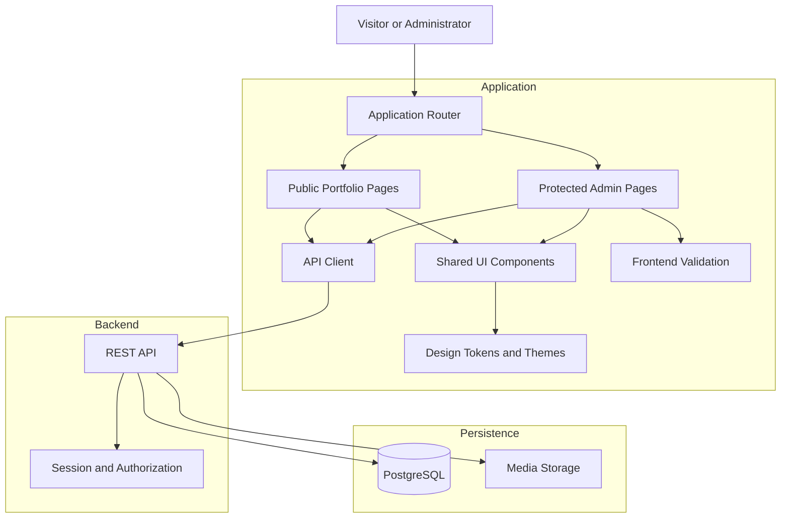

# Frontend Architecture

## 1. Purpose

This document defines the frontend architecture for the Luxury Personal Portfolio and Admin Dashboard.

The frontend consists of two connected experiences:

1. **Public Portfolio** — a polished, responsive website that presents published professional information, projects, skills, experience, education, and certifications.
2. **Admin Dashboard** — a secure management interface for editing portfolio content, controlling publication, managing media, and maintaining supported site settings.

Both experiences should use a shared design system and API client where appropriate, while keeping public-facing and administrative responsibilities clearly separated.

The frontend must be maintainable, accessible, responsive, testable, and consistent with the backend architecture defined in `docs/05-system-architecture.md`.

## 2. Frontend Objectives

The frontend must:

- Deliver a premium, luxury, professional visual experience.
- Use React, TypeScript, Vite, and Tailwind CSS.
- Follow reusable component and page-layout patterns.
- Retrieve portfolio content from the backend API.
- Render only content that the backend identifies as publicly available.
- Provide complete, usable admin content-management workflows.
- Support loading, empty, success, and error states.
- Handle authentication and session expiration safely.
- Support responsive layouts across desktop, tablet, and mobile.
- Meet documented accessibility requirements.
- Respect reduced-motion preferences.
- Avoid exposing secrets or relying on client-side authorization alone.
- Include automated component and end-to-end tests.

## 3. Technology Stack

| Technology | Responsibility |
|---|---|
| React | Component-based user interfaces |
| TypeScript | Type checking and maintainability |
| Vite | Development server and production builds |
| Tailwind CSS | Responsive styling and design tokens |
| React Router or the project's selected router | Page and route navigation |
| Fetch or a selected HTTP client | Backend API communication |
| Zod | Client-side validation and runtime parsing where appropriate |
| Vitest | Unit tests |
| React Testing Library | Component and interaction tests |
| Playwright | End-to-end browser tests |

Use the versions and scripts defined in the actual `package.json` and lockfile. Do not introduce duplicate routing, state-management, animation, or HTTP libraries without a clear requirement.

## 4. Frontend Architecture Overview



The frontend communicates with the backend through defined API contracts. It must not access PostgreSQL or media-storage credentials directly.

## 5. Recommended Folder Structure

Preserve the project's established frontend `src/` directories:

```text
frontend/
├── public/
├── src/
│   ├── @types/
│   ├── api/
│   ├── assets/
│   ├── components/
│   ├── hooks/
│   ├── pages/
│   ├── routes/
│   ├── templates/
│   ├── themes/
│   ├── utils/
│   ├── validators/
│   ├── App.tsx
│   └── main.tsx
├── tests/
├── index.html
├── package.json
├── tsconfig.json
├── vite.config.ts
└── tailwind.config.ts
```

The existing directories must remain intact. New files and nested directories may be added when required.

### 5.1 `@types/`

Shared TypeScript types for API responses, domain models, component props, and application-specific definitions.

Examples:

- `profile.ts`
- `project.ts`
- `skill.ts`
- `experience.ts`
- `education.ts`
- `certification.ts`
- `media.ts`
- `contact.ts`
- `api.ts`

Types must match the actual API contract. Avoid using broad `any` types to bypass errors.

### 5.2 `api/`

Responsible for backend communication.

Suggested structure:

```text
api/
├── client.ts
├── auth.api.ts
├── profile.api.ts
├── projects.api.ts
├── skills.api.ts
├── experience.api.ts
├── education.api.ts
├── certifications.api.ts
├── media.api.ts
├── contact.api.ts
├── settings.api.ts
└── admin.api.ts
```

Split or combine files according to the implemented API. Do not create empty API modules merely to match the proposed structure.

### 5.3 `assets/`

Contains static frontend assets such as local fonts, icons, and approved decorative graphics.

Uploaded portfolio media belongs in the configured media-storage system, not in this directory.

### 5.4 `components/`

Contains reusable interface components.

Suggested organization:

```text
components/
├── ui/
├── layout/
├── navigation/
├── portfolio/
├── projects/
├── forms/
├── media/
├── admin/
├── feedback/
└── seo/
```

Examples include buttons, cards, dialogs, input fields, badges, pagination, confirmation dialogs, image previews, status labels, and error messages.

### 5.5 `hooks/`

Contains reusable React hooks.

Examples:

- `useAuth`
- `useSession`
- `useDebounce`
- `useMediaQuery`
- `useReducedMotion`

Only implement hooks required by the application. Session state should have one authoritative implementation rather than several competing sources.

### 5.6 `pages/`

Contains route-level page components.

Suggested organization:

```text
pages/
├── public/
└── admin/
```

Public pages must remain separate from protected administration pages.

### 5.7 `routes/`

Contains route definitions, route-level layouts, and authentication-aware navigation logic.

Frontend route guards improve the user experience but do not replace backend authorization.

### 5.8 `templates/`

Contains shared page shells and layout templates, such as:

- Public portfolio layout.
- Admin dashboard layout.
- Authentication layout.
- Not-found layout.

### 5.9 `themes/`

Contains shared design tokens, theme configuration, and reusable styling conventions.

### 5.10 `utils/`

Contains framework-independent helpers such as date formatting, URL handling, text formatting, and safe display utilities.

### 5.11 `validators/`

Contains frontend form schemas and validation helpers.

Client-side validation provides immediate feedback, but the backend must independently validate every request.

## 6. Routing Architecture

Use a consistent route hierarchy. The exact routing library must match the installed project dependencies.

### Public routes

| Route | Purpose |
|---|---|
| `/` | Portfolio homepage |
| `/about` | Professional profile and biography |
| `/projects` | Published project listing |
| `/projects/:slug` | Published project details |
| `/skills` | Skills and categories |
| `/experience` | Professional experience |
| `/education` | Education history |
| `/certifications` | Professional credentials |
| `/contact` | Contact form |
| Not-found route | Unknown or unavailable pages |

Additional pages, such as a blog or notes section, should only be added if included in the approved scope.

### Admin routes

| Route | Purpose |
|---|---|
| `/admin/login` | Administrator login |
| `/admin` | Dashboard overview |
| `/admin/profile` | Profile management |
| `/admin/projects` | Project management |
| `/admin/skills` | Skills and skill-category management |
| `/admin/experience` | Experience management |
| `/admin/education` | Education management |
| `/admin/certifications` | Certification management |
| `/admin/media` | Media library |
| `/admin/homepage` | Homepage section and featured-content controls |
| `/admin/messages` | Contact inbox |
| `/admin/settings` | Supported site and SEO settings |
| `/admin/audit-logs` | Authorized audit history |
| `/admin/sessions` | Session management where supported |

Revision history, trash, analytics, backups, and system-health pages should be exposed only when their backend features and permissions exist.

### Route handling requirements

- Unknown routes display a useful not-found page.
- Unauthenticated access to protected pages redirects to login or shows the appropriate authentication state.
- Expired sessions clear protected client state.
- Successful login redirects to an allowed destination.
- Redirect destinations must be validated to avoid open-redirect vulnerabilities.
- Protected page navigation must never be treated as sufficient authorization.

## 7. Shared Design System

The frontend must follow `docs/03-design-system.md`.

### Visual direction

- Luxury professional and minimal editorial design.
- Charcoal: `#111110`.
- Ivory: `#F4F0E8`.
- Champagne gold: `#C6AA78`.
- Elegant serif headings.
- Clean sans-serif body typography.
- Generous whitespace and controlled content widths.
- Restrained borders and subtle shadows.
- Consistent spacing, typography, and interaction states.

Gold should be used selectively for emphasis and important details rather than applied to every interface element.

### Shared components

Reusable components should support consistent styling and behavior:

- Buttons and links.
- Text inputs, textareas, and selects.
- Form labels and validation messages.
- Cards and content panels.
- Modals and confirmation dialogs.
- Tables and pagination.
- Search fields and filters.
- Toasts or inline status messages.
- Loading indicators and skeletons.
- Empty states and error states.
- Accessible menus and navigation.
- Media thumbnails and previews.

Avoid building a second, inconsistent design system inside the admin dashboard. Administrative pages may prioritize data density, but must use the same foundational tokens and accessibility standards.

## 8. Public Portfolio Architecture

The public interface should be composed of reusable sections and page components.

### Homepage sections

1. Site navigation.
2. Hero introduction.
3. Professional profile summary.
4. Featured projects.
5. Skills overview.
6. Experience preview.
7. Education and certification highlights.
8. Contact call to action.
9. Footer.

Section order and visibility may be configurable when the corresponding admin functionality is implemented.

### Public data requirements

- Retrieve content through the public API.
- Display published and eligible records only.
- Use deterministic ordering from the API or an explicit documented ordering field.
- Show a clear loading state while data is being fetched.
- Show a useful empty state when no content exists.
- Show a recoverable error state when requests fail.
- Never present sample or placeholder content as genuine user information.
- Handle missing optional fields without breaking the layout.
- Render project details using safe text and media rendering.
- Avoid rendering untrusted HTML directly.

### Project detail pages

Project detail pages should support the approved project fields, such as:

- Project title.
- Short summary.
- Description.
- Category.
- Technology stack.
- Cover image and approved gallery media.
- Live demonstration URL, when available.
- Source-code URL, when available.
- Relevant dates, where applicable.

Optional fields must not create empty buttons or broken links. External links should use appropriate security attributes when opened in a new tab.

## 9. Admin Dashboard Architecture

The admin dashboard should use a shared shell containing:

- Sidebar or accessible primary navigation.
- Header and account controls.
- Main content region.
- Breadcrumbs where helpful.
- Page title and contextual actions.
- Notifications and feedback.
- Responsive navigation behavior.

### 9.1 Dashboard overview

The dashboard may show:

- Content counts.
- Draft and published record counts.
- Recent administrative activity.
- Recent contact messages.
- Shortcuts to common management tasks.
- Operational status where supported.

Counts and status indicators must come from real API data. Do not fabricate metrics.

### 9.2 Content management

The frontend should provide create, read, update, and delete workflows for:

- Profile details.
- Projects.
- Project categories.
- Skills.
- Skill categories.
- Professional experience.
- Education.
- Certifications.

Each module should support the relevant actions for its content type.

Typical workflows include:

1. Load records from the API.
2. Display records with suitable search, filters, sorting, and pagination.
3. Open a creation or editing form.
4. Validate input on the client.
5. Submit the request to the backend.
6. Display success only after the server confirms the operation.
7. Refresh or update the displayed data.
8. Handle server validation and network errors.
9. Confirm destructive operations.
10. Preserve user input when a recoverable submission error occurs.

### 9.3 Draft and publishing interface

For content that supports publication, the UI should provide:

- Draft status.
- Published status.
- Save-draft action.
- Publish action.
- Unpublish action where allowed.
- Preview before publication.
- Clear feedback when publication succeeds or fails.

The frontend must not mark content as published before the backend confirms the change.

Previewing a draft must use an authorized mechanism. Draft content must not be made publicly accessible merely by hiding a link in the interface.

### 9.4 Media library

The media interface should support the capabilities actually implemented by the backend and storage provider:

- Upload approved files.
- Display upload progress where supported.
- Show file metadata and previews.
- Search or filter assets.
- Associate media with content records.
- Replace media where allowed.
- Remove unused assets according to the documented deletion policy.

Handle file-size, type, and upload failures clearly. Browser-side file checks improve usability but are not security controls.

### 9.5 Contact inbox

The inbox should support:

- Listing contact submissions.
- Viewing message details.
- Searching and filtering.
- Tracking supported statuses.
- Deleting or archiving messages if the backend permits it.

Personal information should only be displayed to authorized administrators. The UI must not expose contact messages through public APIs or publicly cached pages.

### 9.6 Advanced administrative features

The frontend may expose:

- Revision history.
- Restore actions.
- Trash and recovery.
- Bulk actions.
- Analytics.
- Audit logs.
- Session management.
- System health.
- Backup status.

These features must be connected to working backend endpoints and protected by appropriate permissions. See `docs/13-admin-advanced-features.md`.

## 10. API Client Architecture

All backend requests should use a shared API client.

The API client should centralize:

- Base URL configuration.
- Request and response handling.
- JSON parsing.
- Cookie/session request configuration.
- Error normalization.
- Request timeouts or cancellation where appropriate.
- Type-safe API helpers.
- Safe handling of expired sessions.

### Session-based requests

For a same-origin deployment, use the appropriate default cookie behavior. For cross-origin requests, configure credential handling explicitly on both the frontend and backend.

Do not store session identifiers in `localStorage` or `sessionStorage`.

### CSRF protection

If authentication uses cookies, state-changing requests must follow the backend's CSRF protection design. The frontend must send the required CSRF token or header where applicable.

### Error handling

Normalize common error cases:

- Validation failure.
- Unauthenticated session.
- Forbidden action.
- Missing resource.
- Rate-limit response.
- Server error.
- Network failure.
- Request timeout.

Do not expose internal stack traces or sensitive backend details to users.

### Avoid duplicate requests

Use a consistent data-fetching pattern. Do not create multiple competing caches or global stores without a documented reason. When a content mutation succeeds, refresh or invalidate the affected data so the interface reflects the server's authoritative state.

## 11. State Management

Use the simplest state-management approach that meets the requirements.

### Local component state

Use local state for:

- Modal visibility.
- Form fields.
- Temporary UI selections.
- Expanded navigation items.
- Current filter controls.

### Shared application state

Shared state may be appropriate for:

- Current authentication status.
- Session-loading status.
- Global notifications.
- Shared theme settings.
- Other genuinely cross-page concerns.

### Server state

Data loaded from the backend should remain distinguishable from local UI state.

Requirements:

- Avoid keeping contradictory copies of the same server record.
- Update or refresh data after successful mutations.
- Cancel or ignore obsolete requests when appropriate.
- Handle concurrent requests and stale responses safely.
- Clear private cached data when the administrator logs out.
- Never use client state as proof of authorization.

A dedicated server-state library is optional and should only be added if its benefits justify the additional dependency.

## 12. Form Architecture

Forms must be reusable, accessible, and consistent.

### Form requirements

- Visible labels.
- Appropriate input types.
- Required-field indicators where applicable.
- Clear validation messages.
- Keyboard accessibility.
- Server validation error handling.
- Submission loading states.
- Protection against accidental duplicate submissions.
- Preservation of input when possible after recoverable failures.
- Confirmation for destructive actions.

### Validation approach

1. Validate input in the browser for immediate feedback.
2. Submit the request to the API.
3. Validate the request independently on the backend.
4. Display server validation errors against relevant fields.
5. Update the UI only after a successful response.

Use Zod or the project's established validation approach where appropriate. Keep frontend and backend validation rules aligned without treating shared schemas as a substitute for server-side validation.

## 13. Animation and Interaction

Follow `docs/04-animation-guidelines.md`.

Permitted motion includes:

- Subtle hero entrance animation.
- Controlled text and section reveals.
- Refined project-card hover effects.
- Small button and navigation transitions.
- Loading transitions and other functional micro-interactions.

Requirements:

- Use consistent durations and easing.
- Avoid excessive parallax, continuous motion, and distracting effects.
- Do not delay important content or actions unnecessarily.
- Respect `prefers-reduced-motion`.
- Avoid animations that cause layout shifts.
- Maintain keyboard and screen-reader usability.
- Keep animations performant on mobile devices.

The admin dashboard should prioritize clarity and speed over decorative animation.

## 14. Responsive Design

All public and administrative pages must adapt to supported viewport sizes.

### Desktop

- Spacious editorial layout.
- Carefully constrained text widths.
- Balanced grids and project galleries.
- Persistent admin navigation when useful.

### Tablet

- Adapted content grids.
- Responsive typography and spacing.
- Usable forms and tables.
- Navigation that remains easy to operate.

### Mobile

- Compact navigation.
- Single-column content where appropriate.
- Touch-friendly controls.
- Readable text and adequate contrast.
- Forms without horizontal overflow.
- Responsive images.
- Admin tables that switch to suitable compact layouts or controlled horizontal scrolling.

Do not assume every visitor uses a desktop screen or a mouse.

## 15. Accessibility

Target WCAG 2.2 Level AA for applicable requirements.

The frontend should provide:

- Semantic HTML.
- Correct heading hierarchy.
- Keyboard-accessible controls.
- Visible focus indicators.
- Accessible form labels and errors.
- Appropriate color contrast.
- Meaningful alternative text.
- Accessible dialog focus management.
- Screen-reader-friendly status announcements.
- Reduced-motion support.
- Sufficiently large interactive targets.
- No information communicated by color alone.

Accessibility must be tested in both the public portfolio and admin dashboard.

## 16. SEO and Social Metadata

Public pages should support:

- Unique page titles.
- Relevant meta descriptions.
- Canonical URLs where applicable.
- Social sharing metadata.
- Appropriate heading structure.
- Descriptive image alternative text.
- Stable, meaningful project URLs.
- Correct handling of unavailable project pages.

SEO metadata should use public content and approved site settings. Never expose drafts or administrative information through metadata, structured data, or page source.

The selected hosting and rendering strategy must be evaluated for search-engine discoverability. A client-rendered SPA should not be assumed to provide the same indexing behavior as server-rendered or prerendered pages without verification.

## 17. Performance

The frontend should:

- Split large routes when useful.
- Optimize image dimensions and formats.
- Lazy-load noncritical images.
- Avoid unnecessarily large bundles.
- Minimize avoidable re-renders.
- Reduce layout shifts.
- Avoid blocking the main thread with expensive animations.
- Use loading states that do not cause major content movement.
- Avoid excessive polling.
- Reuse shared API requests where appropriate.

Follow the performance targets defined in `docs/02-portfolio-requirements.md`. Measure actual production performance before claiming compliance.

## 18. Frontend Security

The frontend must:

- Never contain database credentials, private API keys, or server secrets.
- Avoid storing authentication tokens in browser storage.
- Treat all server responses and user-entered data as untrusted.
- Avoid unsafe HTML injection.
- Validate external URLs before rendering links.
- Use secure external-link behavior when opening new tabs.
- Avoid exposing private admin data in public pages.
- Clear private state when a session ends.
- Avoid placing sensitive information in URL query strings.
- Use environment variables only for values intended to be available to the frontend build.

Variables embedded in a Vite client bundle are public to users. A `VITE_` prefix does not make a secret safe.

Backend authentication, authorization, CSRF protection, and validation remain mandatory regardless of frontend controls.

## 19. Loading, Empty, and Error States

Every data-driven page must account for the following states.

### Loading

- Show a clear indicator or skeleton.
- Avoid flashing misleading placeholder content.
- Keep layout movement under control.

### Empty

- Explain that no records are available.
- Provide an appropriate next step where useful.
- Avoid displaying fake projects, certifications, or statistics.

### Error

- Explain that data could not be loaded or saved.
- Provide a retry action where appropriate.
- Preserve recoverable form input.
- Avoid showing raw stack traces or server internals.

### Success

- Confirm the completed operation.
- Reflect the saved server state.
- Avoid reporting success before the server confirms it.

## 20. Testing Strategy

Use the testing tools established in the project.

### Unit tests

Test utility functions, formatters, validators, and isolated business-facing frontend helpers.

### Component tests

Test:

- Form validation and submission.
- Accessible menus and dialogs.
- Search, filters, and pagination.
- Loading, empty, and error states.
- Keyboard interactions.
- Responsive component behavior where practical.

### Integration tests

Test the interaction between pages, API modules, and mocked or test backend responses.

### End-to-end tests

Use Playwright to verify critical workflows:

1. Load the public homepage.
2. Browse projects and project details.
3. Navigate the public site on mobile-sized viewports.
4. Submit the contact form.
5. Log in as an authorized administrator.
6. Create or edit a project.
7. Save it as a draft.
8. Confirm the draft is not publicly visible.
9. Publish the project.
10. Confirm the project appears publicly.
11. Update or unpublish the project and verify the public result.
12. Upload and associate approved media.
13. Handle invalid input and failed API requests.
14. Log out and verify protected state is cleared.
15. Confirm unauthorized requests cannot perform administrative operations.

End-to-end tests must use controlled test data and a safe test environment.

## 21. Build and Code Quality

The frontend CI workflow should run the available project scripts for:

- Formatting checks.
- Linting.
- Type checking.
- Unit and component tests.
- Production build.
- Relevant end-to-end tests.
- Dependency and security checks.

Use the actual scripts configured in `package.json`. Documentation must not claim a script exists until it has been added and verified.

Builds must fail on relevant type errors, test failures, or required quality-gate failures.

## 22. Implementation Priorities

### Phase 1 — Foundation

- Establish the folder structure.
- Configure the shared design system.
- Implement routing and public/admin layouts.
- Set up the API client.
- Define shared TypeScript types.
- Configure baseline tests and quality checks.

### Phase 2 — Public portfolio

- Implement shared navigation and footer.
- Build the homepage sections.
- Connect profile and portfolio content to the API.
- Implement project listing and detail pages.
- Add skills, experience, education, and certification pages.
- Add contact form behavior.
- Implement SEO, loading, empty, and error states.

### Phase 3 — Authentication and administration

- Implement the login page.
- Integrate session-aware API requests.
- Build the admin dashboard shell.
- Implement content-management pages and forms.
- Add search, filtering, sorting, and pagination where required.
- Add draft, preview, publish, and unpublish workflows.
- Integrate the media library and contact inbox.

### Phase 4 — Advanced features

- Integrate revision history and recovery where implemented.
- Add bulk actions and audit-log views.
- Integrate supported analytics and system-health information.
- Complete session-management interfaces and permission-specific controls.

### Phase 5 — Quality and release

- Complete automated tests.
- Review accessibility.
- Test responsive layouts.
- Verify frontend and backend security behavior.
- Optimize images and bundle size.
- Validate SEO and performance.
- Run production smoke tests.

## 23. Definition of Done

A frontend feature is complete when:

- It follows the shared design system.
- It works at supported screen sizes.
- It is keyboard accessible.
- It handles loading, empty, success, and error states where relevant.
- It integrates with the documented API.
- It does not expose private data or rely on frontend-only authorization.
- Forms provide client feedback and handle server validation.
- Mutations reflect confirmed server state.
- Relevant automated tests pass.
- Type checking, linting, formatting, and production builds pass.
- Documentation matches the actual implementation.

## 24. Homepage Hero Portrait (Implemented)

The homepage hero keeps the editorial layout: introduction, headline, biography summary, and calls to action on the left; the managed portrait on the right at `lg` and above. Below `lg` the portrait follows the text in normal document order, so the reading order stays headline → description → actions → portrait.

- Data comes from `GET /api/hero`, fetched with the other public collections in `PortfolioProvider` so the homepage never fires a second request for the same content.
- `HeroPortrait` is a reusable component used by both the public hero and the admin draft preview. It receives `{ url, alt, width, height }` plus effect settings and the display name for the fallback monogram.
- The image reserves its space with `aspect-4/5`, explicit `width`/`height` attributes, and `fetchpriority="high"`; it is never lazy-loaded because it is the hero.
- Failure states: no published portrait, disabled visibility, or a failed image load render the built-in monogram panel instead of a broken image or empty column. A failed load never blocks interaction with the rest of the hero.
- The interactive effect is pointer-only and progressively enhanced. It is skipped for coarse pointers, when the effect is disabled, when the animation intensity is zero, and when `prefers-reduced-motion: reduce` is set. Keyboard users receive the static presentation.
- Transform values are written to CSS custom properties through a ref on animation frames, so pointer movement does not re-render React components.
- All colours continue to use the existing tokens; the frame uses a gold hairline and charcoal gradient from the design system.

## 25. Homepage Layout and Site Metadata (Implemented)

The homepage reads its published layout and approved metadata from `GET /api/portfolio/homepage` alongside the other public collections in `PortfolioProvider`, so rendering stays a single request round.

- The hero always renders first. The remaining sections (`about`, `work`, `skills`, `experience`, `credentials`, `contact`) follow the published order, and hidden sections are omitted without leaving gaps.
- `FeaturedWork` uses the published featured project references in the administrator's order. Without a selection it falls back to each project's `featured` flag, then to all published projects, so the section never renders empty.
- `setPageMetadata` applies the site title, description, canonical URL, and social image, with the profile name/headline and biography summary as fallbacks when the owner has not filled the settings in. The social image also sets `twitter:card`.
- Draft layout and draft featured selections are never read by the public app; the endpoint returns published values only.
- If a featured project is archived after publication, the endpoint omits it and the remaining cards keep their order.

## 26. Related Documentation

- `README.md` — Project overview and setup.
- `docs/01-project-overview.md` — Product scope and goals.
- `docs/02-portfolio-requirements.md` — Public pages and user requirements.
- `docs/03-design-system.md` — Colors, typography, layout, and components.
- `docs/04-animation-guidelines.md` — Motion and interaction rules.
- `docs/05-system-architecture.md` — Overall system architecture.
- `docs/07-backend-api.md` — API contracts.
- `docs/08-database-schema.md` — Data model.
- `docs/09-admin-dashboard.md` — Admin workflows.
- `docs/10-security.md` — Security requirements.
- `docs/11-testing-and-qa.md` — Testing strategy.
- `docs/12-deployment-and-maintenance.md` — Deployment and maintenance.
- `docs/13-admin-advanced-features.md` — Advanced admin capabilities.
- `docs/14-dynamic-content-and-media-management.md` — Dynamic publishing and media workflows.
