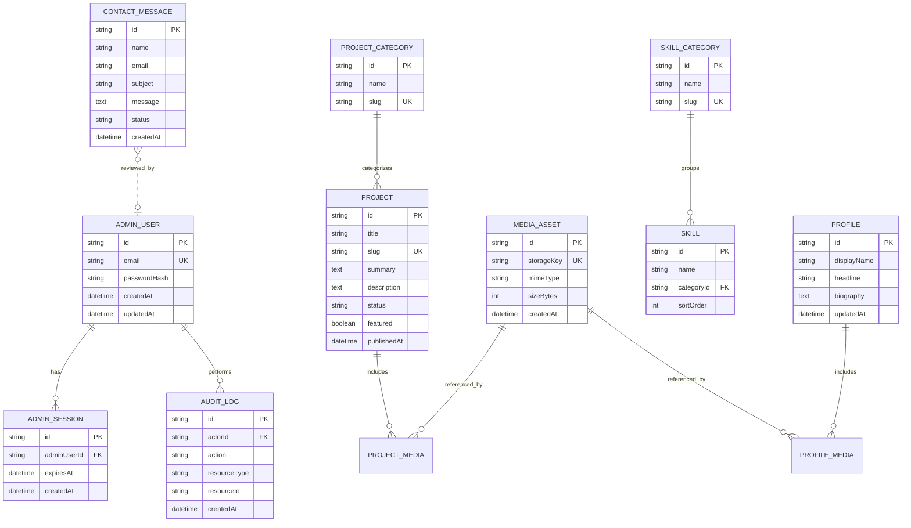

# Database Schema and Data Model

## 1. Purpose

This document defines the database architecture and proposed data model for the Luxury Personal Portfolio and Admin Dashboard.

The application uses PostgreSQL for persistent structured data and Prisma ORM for database access and migrations.

The database must support:

- Public portfolio content.
- Administrator authentication and sessions.
- Complete content CRUD workflows.
- Draft and published content states.
- Project and skill categories.
- Media metadata and content associations.
- Homepage configuration and SEO settings.
- Contact submissions and inbox management.
- Audit events.
- Optional content revisions and recoverable deletion.
- Data integrity, backup, recovery, and retention.

**Implementation rule:** This document describes the intended data model. The actual database schema is defined by the project's `prisma/schema.prisma`, migration history, and verified database state. Documentation must be updated whenever the implemented model changes.

## 2. Database Technology

| Component | Technology |
|---|---|
| Database | PostgreSQL |
| ORM | Prisma |
| Schema definition | Prisma schema |
| Schema changes | Version-controlled Prisma migrations |
| Local development | PostgreSQL through the configured development environment |
| Production backups | Database-native or provider-supported backup process |
| Media files | Configured local persistent storage or object storage |

The database stores structured records and relationships. Uploaded binary files should be stored separately, with references and metadata stored in PostgreSQL.

## 3. Data Model Principles

The schema should follow these principles:

1. Use stable primary keys for records.
2. Enforce relationships through foreign keys.
3. Add unique constraints for identifiers such as slugs and administrator email addresses where appropriate.
4. Use explicit publication states rather than relying on frontend visibility.
5. Store timestamps consistently, preferably in UTC.
6. Add indexes based on actual query patterns.
7. Use transactions for related operations that must succeed together.
8. Store password hashes rather than plaintext passwords.
9. Never store raw session tokens or application secrets unnecessarily.
10. Keep private administrator data separate from public portfolio responses.
11. Define deletion behavior explicitly for related records.
12. Maintain migration history in version control.
13. Do not add speculative entities without an approved feature requirement.

## 4. Entity Relationship Overview

The following diagram illustrates the intended logical model. Optional entities must only be added when their functionality is approved and implemented.



This diagram is a logical overview, not a substitute for the complete Prisma schema. Experience, education, certifications, homepage settings, revisions, and recovery records are also part of the proposed model and are described below.

## 5. Core Entities

### 5.1 Administrator

Suggested model: `AdminUser`

Purpose:

- Identify the authorized dashboard user.
- Store authentication-related account information.
- Support account status and future permission controls.

Proposed fields:

| Field | Purpose |
|---|---|
| `id` | Primary key |
| `email` | Unique login identifier |
| `passwordHash` | Argon2id password hash |
| `isActive` | Whether the account is enabled |
| `createdAt` | Creation timestamp |
| `updatedAt` | Last update timestamp |
| `lastLoginAt` | Optional last successful login timestamp |

Requirements:

- Store no plaintext passwords.
- Normalize email addresses consistently.
- Enforce unique email addresses.
- Do not expose password hashes through API responses.
- Use an appropriate permission model if multiple administrators are introduced.

For a single-administrator portfolio, a simple account model may be sufficient. Do not build complex role management unless required.

### 5.2 Administrator Sessions

Suggested model: `AdminSession`

Purpose:

- Represent server-side authenticated sessions.

Potential fields:

- `id`
- `adminUserId`
- `expiresAt`
- `createdAt`
- `lastSeenAt`, if required
- Optional session metadata that does not contain secrets

Requirements:

- Use unpredictable session identifiers.
- Store session state server-side.
- Never expose raw session identifiers in administrative APIs.
- Expire and invalidate sessions according to the authentication policy.
- Index expiry timestamps to support cleanup.
- Delete expired sessions through a controlled cleanup process.

The exact session model depends on the selected Express session store. If a dedicated session store manages sessions outside the application's ordinary Prisma models, document that architecture instead of duplicating session storage unnecessarily.

### 5.3 Profile

Suggested model: `Profile`

Purpose:

Store the public professional profile.

Potential fields:

- `id`
- `displayName`
- `headline`
- `biography`
- `location`, if intended for public display
- `publicEmail`, if approved for publication
- `websiteUrl`
- `linkedinUrl`
- `githubUrl`
- `profileImageId`, if using a direct media relation
- `createdAt`
- `updatedAt`

Requirements:

- Separate public professional information from administrator credentials.
- Make public visibility decisions explicit.
- Validate external URLs.
- Do not expose private contact details without approval.
- Prevent accidental creation of multiple primary profiles unless supported by the product design.

A singleton profile may be enforced through application rules or an appropriate database constraint.

### 5.4 Projects

Suggested model: `Project`

Purpose:

Store professional and personal portfolio projects.

Potential fields:

- `id`
- `title`
- `slug`
- `summary`
- `description`
- `categoryId`
- `featured`
- `status`
- `sortOrder`
- `liveUrl`
- `repositoryUrl`
- `startDate`
- `endDate`
- `publishedAt`
- `createdAt`
- `updatedAt`
- Optional `deletedAt` if recoverable deletion is implemented

Requirements:

- Enforce unique slugs.
- Validate URL fields and allowed protocols.
- Store project media through media references.
- Keep publication state explicit.
- Return only eligible published projects from public queries.
- Validate category relationships.
- Define behavior when a category is deleted.
- Use deterministic ordering.

The application should define a small, documented set of status values, for example:

- `DRAFT`
- `PUBLISHED`
- `ARCHIVED`, if required

Do not use both a publication status and a separate boolean `isPublished` unless there is a clear reason and the two values are kept consistent.

### 5.5 Project Categories

Suggested model: `ProjectCategory`

Potential fields:

- `id`
- `name`
- `slug`
- `description`, optional
- `sortOrder`
- `createdAt`
- `updatedAt`

Requirements:

- Enforce unique category slugs.
- Prevent invalid project-category references.
- Define category deletion behavior.
- Return only categories appropriate for public display through public endpoints.

### 5.6 Project Media Associations

Suggested model: `ProjectMedia`

Purpose:

Associate one or more media assets with a project and preserve ordering.

Potential fields:

- `projectId`
- `mediaAssetId`
- `sortOrder`
- Optional `altText`

Requirements:

- Use a unique constraint or composite primary key for the association.
- Enforce foreign-key relationships.
- Prevent duplicate associations.
- Preserve display order.
- Define cascade behavior carefully.

A separate association model is useful when projects support galleries, ordering, or association-specific metadata. If each project has only one cover image, a simpler direct relation may be adequate.

### 5.7 Skills

Suggested model: `Skill`

Potential fields:

- `id`
- `name`
- `description`, optional
- `categoryId`
- `sortOrder`
- `isVisible`
- `createdAt`
- `updatedAt`

Requirements:

- Validate category relationships.
- Use deterministic ordering.
- Avoid storing presentation-only data unless required.
- Expose only publicly eligible skills.

### 5.8 Skill Categories

Suggested model: `SkillCategory`

Potential fields:

- `id`
- `name`
- `slug`
- `description`, optional
- `sortOrder`
- `createdAt`
- `updatedAt`

Requirements:

- Enforce unique slugs.
- Define how associated skills are handled on deletion.
- Validate category ordering and visibility rules.

### 5.9 Professional Experience

Suggested model: `Experience`

Potential fields:

- `id`
- `organization`
- `role`
- `employmentType`, optional
- `location`, optional
- `description`
- `startDate`
- `endDate`, optional
- `isCurrent`
- `sortOrder`
- `isVisible`
- `createdAt`
- `updatedAt`

Requirements:

- Validate date ranges.
- Ensure current roles do not require an end date.
- Prevent contradictory current-role and end-date states.
- Define ordering for public display.
- Expose only approved public fields.

### 5.10 Education

Suggested model: `Education`

Potential fields:

- `id`
- `institution`
- `qualification`
- `fieldOfStudy`, optional
- `description`, optional
- `startDate`, optional
- `endDate`, optional
- `sortOrder`
- `isVisible`
- `createdAt`
- `updatedAt`

Requirements:

- Validate date ranges.
- Allow optional dates where historical information is incomplete.
- Display records in a predictable order.
- Keep private educational records out of public results.

### 5.11 Certifications

Suggested model: `Certification`

Potential fields:

- `id`
- `name`
- `issuingOrganization`
- `issueDate`, optional
- `expiryDate`, optional
- `credentialId`, optional
- `credentialUrl`, optional
- `mediaAssetId`, optional
- `sortOrder`
- `isVisible`
- `createdAt`
- `updatedAt`

Requirements:

- Validate URLs and dates.
- Avoid publishing credential identifiers unless appropriate.
- Define whether expired credentials remain visible.
- Store supporting images through the media-management system.

### 5.12 Contact Messages

Suggested model: `ContactMessage`

Potential fields:

- `id`
- `name`
- `email`
- `subject`
- `message`
- `status`
- `createdAt`
- `updatedAt`
- Optional `reviewedAt`
- Optional `reviewedById`

Possible statuses:

- `NEW`
- `READ`
- `ARCHIVED`

Use only the statuses required by the implemented inbox workflow.

Requirements:

- Validate and length-limit submitted fields.
- Apply rate limits and spam controls at the API layer.
- Protect messages behind administrator authorization.
- Avoid returning message data through public APIs.
- Define retention and deletion rules.
- Avoid storing unnecessary personal information.

Contact messages should not be treated as trusted HTML. Render user-submitted text safely.

### 5.13 Media Assets

Suggested model: `MediaAsset`

Purpose:

Store metadata and references for uploaded media.

Potential fields:

- `id`
- `storageKey`
- `originalFilename`, if needed
- `mimeType`
- `sizeBytes`
- `width`, optional
- `height`, optional
- `altText`, optional
- `createdAt`
- `updatedAt`
- `uploadedById`, optional

Requirements:

- Use generated storage keys.
- Validate MIME type and file content in the upload workflow.
- Enforce file-size limits.
- Do not trust original filenames as storage paths.
- Do not store storage credentials in records.
- Prevent public access to private media.
- Define safe behavior for referenced assets.
- Avoid deleting files that remain in use.

Media binary data should normally be stored outside PostgreSQL. The database stores metadata and storage references.

### 5.14 Homepage and Site Settings

Suggested model: `SiteSettings` or a small set of settings-specific models.

Purpose:

Manage approved presentation settings.

Potential settings:

- Site title and description.
- Public social links.
- Homepage section visibility.
- Homepage section order.
- Featured project references.
- Default SEO metadata.

Requirements:

- Keep public presentation settings separate from secrets and infrastructure configuration.
- Validate section names and order values.
- Reference existing content using validated identifiers.
- Expose only approved public settings through public endpoints.
- Prevent arbitrary client input from changing server configuration.

Do not create an unrestricted JSON configuration store for sensitive operational settings.

## 6. Publication and Visibility Model

Publication rules must be enforced by the backend.

A content record may use an explicit status field:

```text
DRAFT
PUBLISHED
ARCHIVED
```

The exact states depend on the approved workflow.

Recommended behavior:

- Draft records are available only to authorized administrators.
- Published records may appear in public queries if they meet other visibility requirements.
- Archived records are excluded from public listings unless a documented exception applies.
- Unpublishing removes a record from public results.
- Deletion follows the documented permanent or recoverable deletion policy.
- Publishing and unpublishing update the authoritative database state.
- If caching is enabled, affected public content is invalidated after successful changes.

Use consistent publication semantics across projects and any other content types that support drafts and publishing.

For simpler content types that do not need draft workflows, a documented visibility flag may be sufficient. Avoid mixing status fields and boolean visibility fields without a clear, enforced rule.

## 7. Revision History and Recoverable Deletion

These features are optional until implemented.

### 7.1 Content revisions

A proposed `ContentRevision` model may include:

- `id`
- `resourceType`
- `resourceId`
- `revisionNumber`
- `snapshot`
- `createdById`
- `createdAt`

Requirements:

- Validate revision ownership and resource existence.
- Define which fields are captured in snapshots.
- Exclude secrets and unnecessary personal information.
- Restrict revision access to authorized administrators.
- Record restoration actions in the audit log.
- Define revision retention and cleanup.

If snapshots are stored as JSON, validate their structure before restoring them. Do not restore arbitrary data without reapplying business validation.

### 7.2 Recoverable deletion

A recoverable deletion model may use `deletedAt` and `deletedById` fields or a dedicated trash record.

Requirements:

- Exclude deleted records from normal public and administrative lists unless explicitly requested.
- Restrict trash access to authorized administrators.
- Validate restoration operations.
- Prevent restoration from violating unique constraints.
- Define permanent deletion and retention rules.
- Coordinate media cleanup with content recovery.

Use one consistent strategy rather than adding both soft deletion and a separate trash system without a clear purpose.

## 8. Audit Logs

Suggested model: `AuditLog`

Purpose:

Record important administrative and security-sensitive actions.

Potential fields:

- `id`
- `actorId`, optional for system-generated events
- `action`
- `resourceType`, optional
- `resourceId`, optional
- `outcome`
- `requestId`, optional
- `metadata`, optional and carefully filtered
- `createdAt`

Requirements:

- Record relevant content mutations and publication changes.
- Record important authentication and session events according to policy.
- Record sensitive settings changes.
- Avoid storing passwords, session tokens, authentication cookies, or unnecessary private message contents.
- Restrict access to authorized administrators.
- Prevent ordinary update and delete operations on audit records.
- Define retention and access policies.
- Add appropriate indexes for time, actor, and action filters.

Application-level controls should be reinforced by database permissions and an appropriate audit-recording design. A model named `AuditLog` alone does not guarantee immutability.

## 9. Relationships and Deletion Policies

Define relationships deliberately.

| Relationship | Recommended consideration |
|---|---|
| Project → Project category | Restrict deletion or require reassignment |
| Project → Project media | Remove association rows when a project is permanently deleted |
| Project media → Media asset | Preserve assets that are referenced elsewhere |
| Skill → Skill category | Require reassignment or handle category removal explicitly |
| Admin user → Sessions | Invalidate associated sessions when the account is disabled |
| Admin user → Audit logs | Preserve historical audit records where required |
| Contact message → Reviewer | Handle account deletion without losing required history |
| Certification → Media asset | Avoid deleting shared media accidentally |
| Content → Revision | Apply a documented retention and deletion policy |

Choose `Cascade`, `Restrict`, `SetNull`, or explicit transactional cleanup based on the actual relationship and retention requirements.

Do not apply cascading deletion to audit records or shared media without carefully reviewing the consequences.

## 10. Indexing and Constraints

Indexes should support measured query patterns rather than being added indiscriminately.

Potential indexes include:

- Unique administrator email.
- Unique project slug.
- Unique category slugs.
- Project publication status and display order.
- Project category relationships.
- Skill category relationships.
- Experience and education display order.
- Certification display order.
- Contact message creation time and status.
- Session expiration time.
- Audit-log creation time, actor, and action.
- Revision resource identifier and creation time.

Constraints should cover:

- Unique identifiers.
- Required fields.
- Valid foreign keys.
- Valid numeric ranges.
- Appropriate enum values.
- Relationship uniqueness.
- Valid date ranges where enforceable.

Some business rules, such as publication eligibility or current employment behavior, may require service-layer validation in addition to database constraints.

## 11. Prisma Schema Example

The following is an illustrative excerpt, not a complete or verified production schema.

```prisma
enum ContentStatus {
  DRAFT
  PUBLISHED
  ARCHIVED
}

model ProjectCategory {
  id        String    @id @default(cuid())
  name      String
  slug      String    @unique
  sortOrder Int       @default(0)
  projects  Project[]
  createdAt DateTime  @default(now())
  updatedAt DateTime  @updatedAt
}

model Project {
  id           String        @id @default(cuid())
  title        String
  slug         String        @unique
  summary      String?
  description  String?
  status       ContentStatus @default(DRAFT)
  featured     Boolean       @default(false)
  sortOrder    Int           @default(0)
  liveUrl      String?
  repositoryUrl String?
  publishedAt  DateTime?
  categoryId   String?
  category     ProjectCategory? @relation(
    fields: [categoryId],
    references: [id],
    onDelete: SetNull
  )
  createdAt    DateTime      @default(now())
  updatedAt    DateTime      @updatedAt

  @@index([status, sortOrder])
  @@index([categoryId])
}
```

Before using this example:

- Compare it with the existing schema.
- Confirm that the project uses the same identifier strategy.
- Decide whether category deletion should use `SetNull` or another policy.
- Confirm whether `ARCHIVED` is required.
- Confirm the publication and featured-content rules.
- Run Prisma validation and tests using the project's installed Prisma CLI.
- Create a migration through the established migration workflow.

Do not paste this excerpt over a complete existing schema. Merge approved changes carefully.

## 12. Migrations and Schema Management

All database schema changes must be version-controlled.

Recommended workflow:

1. Review the feature requirements.
2. Update `prisma/schema.prisma`.
3. Generate a migration using the installed project version.
4. Review the generated SQL.
5. Apply the migration to a disposable or development database.
6. Run migration and integration tests.
7. Verify existing records and relationships.
8. Commit the schema and migration together.
9. Apply reviewed migrations through the deployment process.
10. Verify production health after deployment.

Use the Prisma CLI version declared by the project. Avoid accidentally installing a different major version through an unpinned `npx prisma` invocation.

Never edit a production database schema manually without recording and reconciling the change through the migration workflow.

## 13. Transactions and Consistency

Use transactions when a workflow modifies related records that must remain consistent.

Examples:

- Creating a project with relationship records.
- Updating content and its media associations.
- Publishing a record and creating its audit event.
- Applying a bulk operation.
- Restoring a revision.
- Updating relationships before deleting a category.

Requirements:

- Keep transactions appropriately scoped.
- Avoid performing slow external network operations inside database transactions.
- Handle unique-constraint and foreign-key errors.
- Ensure failed operations do not leave partial data where atomicity is required.
- Define how storage failures affect media metadata and cleanup.

For uploads, coordinate database records and external storage operations carefully. PostgreSQL transactions cannot automatically roll back an object-storage upload.

## 14. Security and Privacy

Database security requirements:

- Use separate database credentials for development and production.
- Grant only the permissions required by the application.
- Restrict network access to the database.
- Store credentials in environment configuration or a suitable secret manager.
- Never commit `.env` files containing real secrets.
- Use parameterized queries through Prisma.
- Validate and authorize every administrative operation.
- Keep administrator credentials separate from public profile data.
- Avoid exposing private fields through public API serializers.
- Protect contact messages and session data.
- Define data retention and deletion policies.
- Encrypt data in transit and use appropriate storage encryption where available.
- Back up the database and verify restoration.

The public API must never return database records wholesale without explicitly selecting approved fields.

## 15. Backup and Recovery

A backup strategy must account for both structured database records and separately stored media.

### Database backups

- Establish a backup schedule appropriate to the deployment.
- Define retention periods.
- Protect backup files and credentials.
- Store copies separately from the primary database where appropriate.
- Test restoration regularly.
- Document acceptable recovery point and recovery time objectives.

### Media backups

- Back up local persistent media or configure provider-supported object-storage protection.
- Ensure database media references remain valid after restoration.
- Document recovery steps for missing or orphaned files.
- Protect backup copies against unauthorized access.

### Recovery verification

A recovery test should verify:

- Database schema and migrations.
- Administrator access.
- Public portfolio content.
- Media associations and file availability.
- Contact records retained under policy.
- Publication visibility.
- Required audit history.

A successful database backup alone does not guarantee that the entire application can be restored.

## 16. Data Retention and Deletion

Define retention periods for:

- Contact submissions.
- Expired sessions.
- Audit logs.
- Content revisions.
- Recoverable deleted records.
- Unused media assets.
- Temporary upload files.

Retention policies must reflect actual product needs, security requirements, and applicable obligations.

Deletion workflows should:

- Confirm authorization.
- Apply the documented deletion policy.
- Preserve records that must remain available for legitimate audit purposes.
- Remove media only when safe.
- Record relevant administrative actions.
- Avoid leaving orphaned records or files indefinitely.

## 17. Testing Requirements

Database-related automated tests should verify:

### Schema and migrations

- The schema validates with the project's installed Prisma version.
- Migrations can be applied to a clean test database.
- Migration history is consistent.
- Constraints and indexes exist as expected.

### Relationships

- Foreign keys reject invalid relationships.
- Unique fields reject duplicates.
- Deletion behavior matches the documented policy.
- Shared media is not accidentally deleted.

### Publication

- Draft content is excluded from public queries.
- Published content is returned when eligible.
- Unpublished and archived content is excluded.
- Deleted content follows the selected visibility rules.

### Administrative workflows

- CRUD operations persist correctly.
- Transactions preserve consistency.
- Unauthorized users cannot mutate data.
- Audit events are recorded for required actions.
- Revision restoration revalidates data.

### Recovery

- Database backups can be restored.
- Media references resolve correctly.
- Retained records and publication states remain consistent.

Use a separate test database. Never run destructive schema or test commands against production data.

## 18. Implementation Priorities

### Phase 1 — Core schema

- Verify the existing Prisma schema.
- Define administrator and session storage.
- Define profile, project, skill, experience, education, and certification records.
- Add category relationships and required constraints.
- Establish migration and seed-data practices.

### Phase 2 — Content workflows

- Implement publication states where required.
- Add media metadata and associations.
- Add homepage settings.
- Add contact-message persistence.
- Verify public visibility queries.

### Phase 3 — Operational and advanced features

- Add audit logging.
- Add revisions and recoverable deletion if approved.
- Add retention and cleanup processes.
- Review indexes against real queries.
- Define backup and recovery procedures.

### Phase 4 — Verification

- Validate the schema.
- Apply migrations to a clean test database.
- Run integration tests.
- Verify authorization and publication rules.
- Test database and media restoration.
- Reconcile documentation with the actual implementation.

## 19. Definition of Done

The database model is ready for release when:

- The Prisma schema matches the implemented feature requirements.
- Migrations are version-controlled and reproducible.
- Relationships and constraints are correct.
- Public visibility rules are enforced by backend queries.
- Administrative CRUD workflows persist correctly.
- Media references remain consistent.
- Sensitive records are protected.
- Audit logging meets the documented requirements.
- Backup and recovery procedures are documented and tested.
- Automated tests pass against a dedicated test database.
- The schema documentation accurately reflects the actual database.

## 20. Related Documentation

- `README.md` — Project setup and overview.
- `docs/01-project-overview.md` — Product scope.
- `docs/02-portfolio-requirements.md` — Public portfolio requirements.
- `docs/05-system-architecture.md` — System architecture.
- `docs/06-frontend-architecture.md` — Frontend architecture.
- `docs/07-backend-api.md` — API endpoints and contracts.
- `docs/09-admin-dashboard.md` — Administrative workflows.
- `docs/10-security.md` — Security controls.
- `docs/11-testing-and-qa.md` — Testing and quality assurance.
- `docs/12-deployment-and-maintenance.md` — Deployment and recovery.
- `docs/13-admin-advanced-features.md` — Advanced administrative features.
- `docs/14-dynamic-content-and-media-management.md` — Dynamic content and media workflows.
