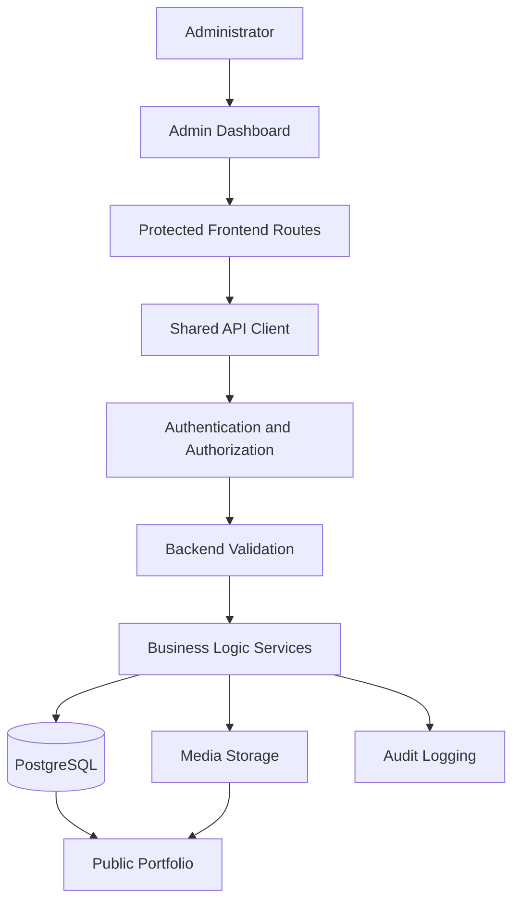

# Admin Dashboard Specification

## 1. Purpose

This document defines the functional, visual, security, and technical requirements for the Luxury Personal Portfolio Admin Dashboard.

The dashboard is the private management interface for maintaining the public portfolio without manually editing frontend source code for routine content changes.

It must provide a consistent interface for creating, reviewing, updating, publishing, and maintaining portfolio content through authenticated backend APIs.

The dashboard must be usable, responsive, secure, accessible, and connected to persistent application data.

## 2. Core Objectives

The admin dashboard must:

- Provide secure administrator authentication.
- Support complete CRUD operations for approved content types.
- Manage profile information and profile media.
- Manage projects and project categories.
- Manage skills and skill categories.
- Manage professional experience, education, and certifications.
- Support draft, preview, publish, and unpublish workflows where applicable.
- Manage uploaded media and its content associations.
- Control supported homepage sections and featured content.
- Manage SEO and public site settings.
- Display and manage contact submissions.
- Provide search, filtering, sorting, and pagination where appropriate.
- Record security-sensitive administrative actions.
- Support advanced capabilities such as revisions and recoverable deletion when implemented.
- Reflect confirmed backend changes accurately.
- Protect private information and prevent unauthorized operations.

The dashboard must not be a collection of decorative screens or nonfunctional buttons. Every implemented action must have a defined and tested behavior.

## 3. Technology and Architecture

The proposed frontend stack is:

- React
- TypeScript
- Vite
- Tailwind CSS
- The project's selected routing solution
- The shared API client
- Zod or the project's established validation approach

The backend stack is:

- Node.js
- Express
- TypeScript
- PostgreSQL
- Prisma
- Server-side sessions
- Argon2id password hashing

The exact libraries and versions must match the actual repository.

### 3.1 Architecture overview

The diagram represents logical responsibilities. Public content must be retrieved through the approved public API or media delivery mechanism, not by directly accessing the database from the browser.

## 4. Route Structure

The following routes are recommended. Implement only routes supported by the actual application.

| Route | Purpose |
|---|---|
| `/admin/login` | Administrator login, including the second-factor step |
| `/admin` | Dashboard overview |
| `/admin/profile` | Profile management |
| `/admin/projects` | Project management |
| `/admin/project-categories` | Project category management |
| `/admin/skills` | Skills management |
| `/admin/skill-categories` | Skill category management |
| `/admin/experience` | Professional experience management |
| `/admin/education` | Education management |
| `/admin/certifications` | Certification management |
| `/admin/media` | Media library |
| `/admin/homepage` | Homepage section configuration |
| `/admin/messages` | Contact inbox |
| `/admin/settings` | Supported site and SEO settings |
| `/admin/audit-logs` | Administrative audit history with a sign-in monitoring summary |
| `/admin/security` | Two-factor authentication and recovery codes for the signed-in account |
| `/admin/sessions` | Session management, when supported |
| `/admin/revisions` | Revision history, when supported |
| `/admin/trash` | Recoverable deleted content, when supported |

Routes for analytics, system health, backup status, or other operational functions should be added only when the required backend capabilities exist.

## 5. Dashboard Layout

The dashboard should use a shared application shell.

### 5.1 Sidebar navigation

The sidebar should contain clearly grouped navigation items for:

- Overview.
- Portfolio content.
- Media.
- Homepage and settings.
- Contact messages.
- Security and audit history.
- Optional advanced features.

Requirements:

- Indicate the active route.
- Support keyboard navigation.
- Collapse or transform appropriately on smaller screens.
- Avoid unnecessary visual clutter.
- Use clear labels and consistent icons.
- Hide navigation items the current administrator is not authorized to access, while still enforcing authorization on the backend.

### 5.2 Header

The header may include:

- Current page title or breadcrumbs.
- Quick navigation or search.
- Administrator account menu.
- Session or notification status where appropriate.

Avoid showing sensitive information unnecessarily.

### 5.3 Main content area

Each page should include:

- A clear title.
- A concise explanation where useful.
- Primary actions.
- Relevant filters or search controls.
- Main content or data table.
- Loading, empty, error, and success states.
- Pagination when required.

### 5.4 Visual style

Follow `docs/03-design-system.md`.

Use the shared design tokens:

- Charcoal: `#111110`
- Ivory: `#F4F0E8`
- Champagne gold: `#C6AA78`

The admin interface may be more data-dense than the public portfolio, but it must retain the same typography, spacing, component behavior, and visual consistency.

Administrative usability takes priority over decorative animation.

## 6. Authentication and Session Management

### 6.1 Login page

The login page should provide:

- Email input.
- Password input.
- Show/hide password control where accessible.
- Validation feedback.
- Loading state during submission.
- Generic invalid-credentials messages.
- Safe handling of server and network errors.
- A second step that asks for a six-digit authenticator code or a recovery code when the backend answers `{ mfaRequired: true }`, with the option to start over with a different account.

The page must not reveal whether a specific email address is registered. A pending challenge is not an authenticated session; the dashboard must not render until the code is accepted.

### 6.2 Authentication workflow

1. The administrator submits credentials.
2. The frontend sends the request to the authentication API.
3. The backend validates credentials and verifies the password hash.
4. The backend creates or rotates the server-side session.
5. The browser receives the configured session cookie.
6. The frontend retrieves the authenticated session state.
7. The administrator is redirected to an allowed destination.

The frontend must not treat local state as proof of authentication.

### 6.3 Session expiration

When a session expires or becomes invalid:

- Stop protected operations.
- Clear private client-side state.
- Show an appropriate authentication message.
- Redirect to login when suitable.
- Do not repeatedly retry unauthorized requests.

### 6.4 Logout

Logout must invalidate the server-side session and clear the session cookie.

After logout, cached private data must not remain accessible through the dashboard.

### 6.5 Security requirements

- Use server-side sessions.
- Hash passwords with Argon2id.
- Use appropriate `HttpOnly`, `Secure`, and `SameSite` cookie settings.
- Protect cookie-authenticated state-changing requests against CSRF.
- Apply login rate limiting.
- Enforce authorization on every protected API request.
- Never store raw session identifiers in browser storage.
- Do not place secrets in frontend code.

See `docs/10-security.md`.

### 6.6 Two-factor authentication

Route: `/admin/security`

Any signed-in administrator can manage their own second factor:

- Show whether MFA is enabled, when it was enabled, and how many recovery codes remain.
- Start enrolment: display the account name, the secret key, and the `otpauth://` URI for manual entry, then confirm with a six-digit code.
- After enabling, display the ten recovery codes once, with a copy button and a warning that they are not shown again.
- Regenerate recovery codes by confirming the password and a current authenticator code; every old code stops working.
- Disable MFA by confirming the password and a current code or a recovery code.

Enabling, disabling, or regenerating codes signs the account out of its other sessions; the current browser stays signed in. The page never receives a stored secret or an existing recovery code, only the one-time values produced by the action the administrator just performed.

## 7. Dashboard Overview

The overview page should provide a useful summary of portfolio management.

Potential widgets include:

- Total projects.
- Published projects.
- Draft projects.
- Skills and categories.
- Experience records.
- Certifications.
- New contact messages.
- Recent administrative activity.
- Shortcuts to common tasks.

Requirements:

- Retrieve metrics from the backend.
- Show loading and error states.
- Avoid fabricated statistics.
- Ensure all metrics use clearly defined meanings.
- Avoid exposing private information to unauthorized users.

Analytics beyond basic content counts should be implemented only when a suitable data source exists.

## 8. Content Management Standards

All content modules should follow a consistent workflow.

### 8.1 Standard CRUD workflow

**Create**

- Open the creation form.
- Enter required information.
- Validate input.
- Submit to the backend.
- Display success only after a confirmed response.
- Refresh the list or add the returned record.

**Read**

- Load records from the API.
- Display useful fields.
- Support details or editing views where appropriate.
- Handle missing or unavailable records.

**Update**

- Load the existing record.
- Populate the form.
- Validate changes.
- Submit the update.
- Reflect the confirmed server response.

**Delete**

- Ask for confirmation when appropriate.
- Verify authorization through the backend.
- Execute the documented deletion policy.
- Refresh affected data.
- Report failure clearly if the operation cannot complete.

### 8.2 General form requirements

- Use accessible labels.
- Mark required fields clearly.
- Display field-level validation errors.
- Preserve user input after recoverable errors.
- Disable duplicate submission where appropriate.
- Display saving and success states.
- Handle network failures.
- Confirm destructive actions.
- Use the backend's canonical response as the source of truth.

Client-side validation improves usability but never replaces backend validation.

## 9. Profile Management

Route: `/admin/profile`

The profile module manages approved public professional information.

Potential fields include:

- Display name.
- Professional headline.
- Biography.
- Profile photograph.
- Public contact details.
- Professional links.
- Other approved profile information.

Requirements:

- Load the existing profile.
- Validate required and optional fields.
- Support profile image selection from the media library or upload flow.
- Preview approved changes where supported.
- Save updates through the backend.
- Display success only after persistence succeeds.
- Ensure public endpoints return only approved profile fields.

Do not mix administrator credentials or authentication settings into the public profile form.

## 10. Project Management

Route: `/admin/projects`

### 10.1 Project list

Display appropriate fields, such as:

- Project title.
- Category.
- Publication status.
- Featured status.
- Last updated time.
- Available actions.

Support:

- Search by relevant text.
- Category filtering.
- Publication-status filtering.
- Sorting by supported fields.
- Pagination.
- Clear empty and error states.

### 10.2 Project creation and editing

Potential fields include:

- Title.
- Slug.
- Summary.
- Description.
- Category.
- Technology stack, if supported by the schema.
- Featured status.
- Cover image and gallery media.
- Live project URL.
- Repository URL.
- Relevant dates.
- Display order.
- Publication status.

The form must reflect the actual backend schema. Optional fields should not create invalid or misleading content.

### 10.3 Project actions

Depending on the implemented backend:

- Create project.
- Edit project.
- Preview draft.
- Save draft.
- Publish project.
- Unpublish project.
- Delete or move to trash.
- Restore from trash.
- View revision history.

### 10.4 Publication workflow

1. Administrator creates or edits the project.
2. The dashboard validates the form.
3. The backend independently validates the request.
4. The backend saves the record.
5. The administrator previews the draft when supported.
6. The administrator explicitly publishes the project.
7. The backend confirms the publication state.
8. The public portfolio retrieves the published project.
9. Any configured cache is refreshed or invalidated.

A draft must not become publicly visible before publication succeeds.

## 11. Project Category Management

Route: `/admin/project-categories`

The module should support:

- Listing categories.
- Creating categories.
- Editing category names and slugs.
- Setting display order where supported.
- Deleting categories when safe.
- Viewing relevant project associations.

Before deletion, the interface should explain the consequences if projects use the category.

The backend must enforce the actual deletion policy and database relationships.

## 12. Skills Management

Route: `/admin/skills`

The skills module should support:

- Listing skills.
- Creating skills.
- Editing skill names and descriptions.
- Assigning skill categories.
- Setting display order.
- Changing public visibility where supported.
- Deleting skills.

Search, filtering, and pagination should be provided when useful for the size of the collection.

## 13. Skill Category Management

Route: `/admin/skill-categories`

The module should support:

- Listing categories.
- Creating categories.
- Editing category names and slugs.
- Managing ordering.
- Viewing associated skills.
- Deleting categories according to the backend's relationship policy.

Do not allow the UI to bypass foreign-key or business-rule constraints.

## 14. Professional Experience Management

Route: `/admin/experience`

Potential fields include:

- Organization.
- Role or position.
- Employment type.
- Location.
- Description.
- Start date.
- End date.
- Current-role status.
- Display order.
- Public visibility.

Requirements:

- Validate date ranges.
- Prevent contradictory current-role and end-date states.
- Support create, edit, read, and delete operations.
- Display records in a predictable order.
- Handle optional fields correctly.

## 15. Education Management

Route: `/admin/education`

Potential fields include:

- Institution.
- Qualification.
- Field of study.
- Description.
- Start date.
- End date.
- Display order.
- Public visibility.

Requirements:

- Support CRUD operations.
- Validate dates when provided.
- Preserve optional fields.
- Display a clear list of records.
- Confirm destructive operations when appropriate.

## 16. Certification Management

Route: `/admin/certifications`

Potential fields include:

- Certification name.
- Issuing organization.
- Issue date.
- Expiration date.
- Credential identifier, where appropriate.
- Credential URL.
- Supporting media.
- Display order.
- Public visibility.

Requirements:

- Validate URLs and dates.
- Support the documented CRUD operations.
- Manage supporting media through the media system.
- Avoid publishing sensitive credential details unintentionally.
- Handle missing or expired credentials according to the public-content policy.

## 17. Media Library

Route: `/admin/media`

The media library manages uploaded files and their metadata.

### 17.1 Supported operations

Implemented at `/admin/media` (`AdminMediaPage`), backed by the authenticated
`/api/admin/media` endpoints documented in `docs/07-backend-api.md`:

- Browse media in reverse-chronological pages of 20, with total counts.
- Search by original filename or alt text (debounced, server-side).
- Upload one JPEG, PNG, or WebP image per request; the page checks the MIME type
  before sending, and the API validates the actual bytes.
- Preview images through the session-protected `GET /api/admin/media/:id/file`.
- View file metadata: filename, type, byte size, pixel dimensions, and timestamps.
- Edit the alt text (`PATCH /api/admin/media/:id`).
- Delete an asset (`DELETE /api/admin/media/:id`) after confirmation; the API
  refuses with `409` while the homepage references the asset.

Every operation writes an audit event (`MEDIA_UPLOADED`, `MEDIA_UPDATED`,
`MEDIA_DELETED`). The page shows loading, empty, and error states, and signs the
administrator out when a request returns `401`.

Uploaded assets can now be attached to content. The project form, the homepage
hero form, and the profile form each offer **Choose from library**, which opens a
paginated, searchable picker (`MediaPicker`) over `/api/admin/media`; selecting an
image fills the record's asset reference and clears the external URL field, and
typing a URL clears a previous pick. The server enforces one source per record
and refuses to delete an asset that a project, a gallery screenshot, the
homepage portrait, or the profile still uses (409). External URLs remain
supported for projects and the profile. Each gallery row has its own **Choose
from library** button and an upload field, so screenshots can be added without
leaving the project form. Rows can be dragged by their handle, or moved with the
up/down buttons, to change the gallery's display order before saving.

### 17.2 Upload workflow

1. The administrator selects a file.
2. The frontend checks basic file requirements for usability.
3. The file is sent to the protected upload endpoint.
4. The backend verifies authorization.
5. The backend validates size, type, and file content.
6. The file is stored in the configured storage system.
7. Metadata is persisted.
8. The dashboard displays the confirmed result.

Browser validation is not a security boundary.

### 17.3 Media safety

- Enforce upload-size limits.
- Use an allowlist of supported file types.
- Generate safe storage names.
- Avoid executing uploaded files.
- Prevent path traversal.
- Protect private media.
- Avoid deleting assets that are still referenced.
- Handle storage and database failures safely.

## 18. Homepage Management

Route: `/admin/homepage`

If implemented, homepage management should control approved presentation settings such as:

- Section visibility.
- Section ordering.
- Featured project selection.
- Selected public profile information.
- Other documented homepage controls.

Requirements:

- Load the existing configuration.
- Validate all submitted values.
- Ensure selected content references exist.
- Save changes through the backend.
- Show success only after persistence succeeds.
- Reflect updated settings on the public site.

Do not allow homepage settings to modify arbitrary server configuration or secrets.

## 19. SEO and Site Settings

Route: `/admin/settings`

The settings interface may support:

- Site title.
- Default meta description.
- Public social links.
- Canonical URL configuration, where applicable.
- Social-sharing image references.
- Other approved public metadata.

Requirements:

- Validate URLs and field lengths.
- Restrict fields to an explicit allowlist.
- Keep private infrastructure settings outside this interface.
- Avoid exposing secrets.
- Reflect updated metadata on the public pages through the documented rendering strategy.

## 20. Contact Inbox

Route: `/admin/messages`

### 20.1 Message list

Display appropriate fields, such as:

- Sender name.
- Sender email.
- Subject.
- Submission date.
- Message status.

Support search, filters, sorting, and pagination where appropriate.

### 20.2 Message details

Authorized administrators should be able to view the full message.

Render submitted content as text or safely encoded content. Never execute user-submitted HTML.

### 20.3 Inbox actions

Where supported:

- Mark as read.
- Update message status.
- Archive.
- Delete.

The backend must enforce permissions and validate all changes.

Contact messages must never be exposed through public APIs or public caching.

## 21. Search, Filtering, Sorting, and Pagination

Large collections should use consistent list controls.

### Search

- Search relevant fields.
- Debounce requests where appropriate.
- Provide a clear-search action.
- Handle empty results.
- Avoid sending unbounded query strings.

### Filtering

Possible filters include:

- Publication status.
- Category.
- Date range.
- Contact-message status.
- Other supported resource attributes.

### Sorting

- Allow only documented fields.
- Provide predictable ascending and descending order.
- Show the active sorting state.

### Pagination

- Display the current page.
- Show available navigation controls.
- Respect backend page-size limits.
- Handle deleted or changed records gracefully.

The backend must validate all query parameters. Client-side filtering alone is insufficient for large datasets or security-sensitive visibility rules.

## 22. Draft, Preview, Publish, and Unpublish

Publication behavior must be explicit and consistent.

### Draft

Draft records remain available only to authorized administrators.

### Preview

Preview must use an authorized backend mechanism. It must not expose drafts through an unrestricted public API.

### Publish

Publishing must:

1. Validate the request and current resource state.
2. Enforce administrator authorization.
3. Persist the new publication state.
4. Record the required audit event.
5. Invalidate or refresh any affected cache.
6. Return the confirmed result.

### Unpublish

Unpublishing must remove the resource from eligible public results after the change succeeds.

### Failure handling

If a save or publication request fails:

- Keep the correct previous state visible.
- Show a useful error.
- Avoid false success messages.
- Allow a safe retry where appropriate.

## 23. Revision History and Recovery

Routes: `/admin/revisions` and `/admin/trash`, if implemented.

### Revision history

Potential capabilities:

- List revisions.
- View a revision.
- Compare supported changes.
- Restore a revision.

Restoration must be authorized, validated, and recorded in the audit log.

### Trash and recovery

Potential capabilities:

- View recoverable records.
- Restore a record.
- Permanently delete a record where permitted.

Requirements:

- Clearly distinguish recoverable deletion from permanent deletion.
- Explain destructive consequences.
- Enforce permissions.
- Handle uniqueness conflicts during restoration.
- Coordinate media cleanup safely.

These features must not be shown as operational until the required backend and database support exists.

## 24. Bulk Actions

Bulk actions may support selected records for operations such as:

- Publish or unpublish.
- Change category.
- Delete or move to trash.
- Restore supported records.

Requirements:

- Clearly show the selected record count.
- Confirm destructive operations.
- Enforce backend permissions for every record.
- Validate all selected identifiers.
- Define whether the operation is atomic or allows partial success.
- Return understandable results.
- Record required audit events.

Never trust a bulk-action permission merely because the interface displays the relevant button.

## 25. Audit Logs and Session Management

### 25.1 Audit logs

Route: `/admin/audit-logs`

Where supported, display:

- Action.
- Actor.
- Resource type and identifier.
- Timestamp.
- Outcome.
- Relevant safe metadata.

Requirements:

- Restrict access to authorized administrators.
- Support filtering and pagination.
- Avoid exposing tokens, passwords, or unnecessary personal information.
- Do not provide ordinary edit or delete actions for audit events.

Above the event table the page shows a sign-in monitoring summary, served by `GET /api/admin/login-monitoring` (owner-only): rolling-window totals for failed sign-ins, failed verification codes, and successful sign-ins; failed sign-ins grouped by source address with counts and last-seen times; and the most recent failures with the targeted account, reason, source address, and a sanitized device description. The window selector offers the last 24 hours, 7 days, or 30 days. The summary reads the same append-only audit records as the log itself, so it has no separate storage or write path.

### 25.2 Session management

Route: `/admin/sessions`

If supported, the interface may display:

- Session creation time.
- Expiration time.
- Relevant safe session metadata.

The UI must not expose raw session identifiers or authentication tokens.

Session revocation must invalidate the corresponding server-side session.

## 26. System Health, Analytics, and Maintenance

These are optional capabilities that require real backend or infrastructure integrations.

### System health

May display safe indicators for:

- API availability.
- Database connectivity.
- Media storage availability.
- Background jobs, if used.

Avoid exposing internal infrastructure details to unauthorized users.

### Analytics

Only display metrics backed by an actual data source. Do not present fabricated visitor counts or traffic statistics.

### Backups

A dashboard may display backup status when a reliable backup system exists. Backup and restore operations must be protected and carefully controlled.

Do not add unrestricted buttons that claim to run backups or restore production data without a verified implementation.

## 27. Notifications and Feedback

The dashboard should provide consistent feedback for:

- Successful saves.
- Failed requests.
- Validation errors.
- Publication changes.
- Upload progress and completion.
- Session expiration.
- Destructive actions.
- Background processing where applicable.

Requirements:

- Use accessible status announcements.
- Avoid excessive notifications.
- Do not show success before confirmation.
- Preserve user input after recoverable errors.
- Provide retry actions where safe.

## 28. Frontend State and API Integration

Use the shared API client defined in `docs/06-frontend-architecture.md`.

Requirements:

- Keep server data distinct from local UI state.
- Avoid multiple contradictory copies of the same record.
- Refresh or invalidate affected data after successful mutations.
- Handle concurrent requests and stale responses.
- Cancel obsolete requests where appropriate.
- Clear private cached data after logout.
- Handle `401`, `403`, `404`, `409`, `422`, and `429` responses consistently.
- Avoid exposing raw server errors.

## 29. Accessibility and Responsive Behavior

The admin dashboard must target WCAG 2.2 Level AA for applicable requirements.

It should provide:

- Semantic headings and landmarks.
- Keyboard-accessible navigation.
- Visible focus indicators.
- Accessible dialogs and menus.
- Form labels and clear error messages.
- Sufficient contrast.
- Screen-reader announcements for status changes.
- Reduced-motion support.
- Responsive tables and forms.
- Touch-friendly controls.

On mobile screens, navigation should collapse appropriately and data tables should use a usable compact layout or controlled horizontal scrolling.

## 30. Performance Requirements

The dashboard should:

- Avoid loading unnecessary data.
- Use pagination for large collections.
- Optimize media previews.
- Avoid excessive API requests.
- Use debounced search where appropriate.
- Prevent duplicate form submissions.
- Keep UI interactions responsive.
- Avoid large decorative animations.
- Use loading states that preserve layout stability.

Measure actual performance before claiming a target has been met.

## 31. Security Requirements

The dashboard must:

- Require authentication for protected views.
- Enforce authorization in the backend.
- Use secure session cookies.
- Protect state-changing requests against CSRF.
- Validate all data on the server.
- Protect media uploads.
- Restrict administrative settings to an explicit allowlist.
- Avoid storing secrets in frontend code.
- Clear private data on logout.
- Avoid exposing private contact messages.
- Apply rate limits to sensitive endpoints.
- Record required security-sensitive actions.
- Avoid returning internal error details.
- Use secure external-link handling.

Frontend route guards improve navigation but do not replace backend access controls.

## 32. Testing Strategy

### Unit tests

Test:

- Form validation.
- Data formatting.
- Filtering and sorting helpers.
- Publication-state display.
- Error mapping.
- Utility functions.

### Component tests

Test:

- Forms and field errors.
- Tables and pagination.
- Search and filters.
- Dialogs and confirmations.
- Loading, empty, and error states.
- Keyboard interactions.
- Accessible status messages.

### API integration tests

Test:

- Authentication and session handling.
- Content CRUD operations.
- Authorization boundaries.
- Publication workflows.
- Media uploads.
- Contact inbox access.
- Audit-event creation.

### End-to-end tests

Verify these complete workflows:

1. An administrator logs in.
2. The dashboard loads actual backend data.
3. The administrator creates a draft project.
4. The draft does not appear in public project results.
5. The administrator publishes the project.
6. The published project appears on the public site.
7. The administrator edits or unpublishes the project.
8. The public result reflects the confirmed change.
9. The administrator uploads and associates media.
10. A contact submission appears in the inbox.
11. Invalid input produces clear errors.
12. Unauthorized requests are rejected.
13. Logout invalidates the session and clears private client state.

Use a dedicated test environment and test database.

## 33. Implementation Priorities

### Phase 1 — Foundation

- Build the admin layout and navigation.
- Integrate the shared API client.
- Implement login, logout, and session handling.
- Establish shared form, table, and feedback components.

### Phase 2 — Core content management

- Profile.
- Projects and project categories.
- Skills and skill categories.
- Experience.
- Education.
- Certifications.

### Phase 3 — Publishing and media

- Draft and publication controls.
- Authorized preview.
- Media library and upload validation.
- Homepage management.
- SEO and site settings.

### Phase 4 — Contact and operations

- Contact inbox.
- Audit-log viewer.
- Session management where supported.
- Revision history and recovery where implemented.
- Bulk operations where required.

### Phase 5 — Verification

- Complete component and end-to-end tests.
- Verify backend authorization.
- Test publication visibility.
- Review responsive behavior and accessibility.
- Run linting, type checking, formatting, and production builds.
- Verify documentation against the actual implementation.

## 34. Definition of Done

The admin dashboard is ready for release when:

- Login and logout work with server-side sessions.
- Protected API requests enforce authorization.
- Required content modules support their documented CRUD operations.
- Draft and published states behave correctly.
- Public content updates reflect confirmed backend changes.
- Media uploads and associations work safely.
- Contact submissions are protected.
- Forms and tables handle loading, empty, success, and error states.
- Search, filters, sorting, and pagination work where required.
- Destructive operations follow the documented policy.
- Required audit events are recorded.
- Accessibility and responsive behavior are verified.
- Automated tests pass.
- Documentation matches the implemented features.

## 35. Homepage Hero Portrait (Implemented)

Route: `/admin/homepage`

The page manages the portrait shown on the right of the public homepage hero. It reuses the authenticated admin shell, CSRF-protected client, inline alerts, and form styling.

### 35.1 Controls

- **Portrait upload:** file input accepting JPEG, PNG, and WebP; the browser checks type and size before requesting an upload. The selected file is previewed locally before it is uploaded.
- **Choose from library:** opens the shared media picker and uses an existing library image as the draft portrait instead of uploading a duplicate. The library description fills the alt text when it is empty, and the previously selected draft asset is removed when nothing else uses it.
- **Draft preview:** the page renders the same hero portrait component used publicly, driven by draft values and the authenticated media endpoint, labelled as not public.
- **Alt text:** required when the portrait is visible; enforced on publish.
- **Visibility:** shows or hides the portrait on the public homepage after publishing.
- **Effect controls:** enable/disable the effect, tilt intensity (0–100), animation intensity (0–100), and optional floating motion.
- **Save draft:** persists draft values without affecting the public site.
- **Publish:** copies the draft state to the published state; the public homepage updates on the next request.
- **Remove portrait:** clears the draft reference; publishing afterwards restores the built-in fallback.
- **Status:** published state, unpublished-change indicator, and upload limits are shown above the form.

### 35.2 States and feedback

- Uploading shows a busy state and any validation or server error in an alert.
- A missing, failed, or removed image falls back to the editorial monogram panel.
- The page is responsive, keyboard operable, and passes axe WCAG A/AA checks.
- Unpublished drafts are never exposed by public endpoints or public media URLs.

## 36. Homepage Sections and Site Settings (Implemented)

Routes: `/admin/homepage` and `/admin/settings`

### 36.1 Homepage sections

The homepage page extends §35 with the layout controls described in §18:

- **Section order:** an ordered list of every documented section with up/down controls; the hero is always first and is not reorderable.
- **Visibility:** a per-section checkbox. Hidden sections stay in the order and return in place when shown again.
- **Featured projects:** checkboxes over published projects only, capped at 12, displayed on the public homepage in the order selected. Projects without a selection fall back to their `featured` flag.
- **Save layout:** persists the draft layout; publishing (the same publish action as the hero) copies it to the published state. Draft layout is never public.
- Validation errors are shown inline per section or per featured selection, and success is announced only after persistence succeeds.

### 36.2 Site settings

The settings page manages the allowlisted public metadata from §19:

- Site title, default description, canonical URL, and social sharing image.
- The canonical and social image URLs must be absolute http(s) values; empty optional values are stored as `null`.
- Only these fields are writable; credentials, connection strings, storage paths, and arbitrary server configuration have no representation in the API and are rejected.
- Saving updates the public homepage metadata immediately; no publish step is required. Social profile links remain on the Profile page to keep one source of truth.
- UI notes state that settings are public immediately, and every save is recorded in the activity log as `SITE_SETTINGS_UPDATED`.

### 36.3 Verification

- `backend/tests/homepage-settings.test.ts` covers authorization, CSRF, defaults, allowlisting, URL validation, section-order permutations, published-only featured references, draft privacy, and publish semantics.
- The admin and homepage Playwright verifiers exercise both pages, including axe WCAG A/AA checks.

## 37. Bulk Actions, Trash, and Revisions (Implemented)

Route: `/admin/trash` and `/admin/revisions`; bulk controls sit on the projects, skills, experience, education, and certification lists.

### 37.1 Bulk actions

- Each content table has a select-all checkbox and a row checkbox. A toolbar appears while anything is selected, showing the count with Publish, Unpublish, Move to trash, and Clear selection.
- The request is one transactional call (up to 50 records). If any selected record is missing or in the trash, the whole request fails with a message and nothing changes.
- Deletion is confirmed before it runs. The page reports how many records changed and reloads the table.
- Manual single-row actions remain available; both paths write the same audit events and revisions.

### 37.2 Trash

- `/admin/trash` lists removed content across all five collections, filterable by type and paginated, newest deletion first.
- Each item shows what it was, whether it had been published, and when it was removed.
- **Restore** returns the record to its list with its original values and visibility. **Delete permanently** requires confirmation and removes the record and its gallery; this cannot be undone.
- A checkbox column and select-all control appear above the table. While anything is selected, a toolbar shows the count with **Restore selected**, **Delete permanently**, and **Clear selection**. The bulk actions work across content types in one request, so a page filtered to “All content” can be cleared in one go.
- Bulk restore reports how many records returned; bulk permanent deletion always asks for confirmation and names the selected count. If any selected record is no longer in the trash, the whole request is refused and nothing changes.
- The page explains that trashed records keep their names and slugs reserved until purged.

### 37.3 Revision history

- `/admin/revisions` lists saved snapshots with content type, record id, change type, editor, and time, filterable by type and by a single record id.
- Selecting **View snapshot** opens a field-level diff against the previous snapshot for that record, listing each changed field with its before and after values. The first snapshot lists every field as new; a revision that changed nothing shows an empty-diff message. The raw JSON stays available under **Raw snapshot**. **Restore** re-applies the snapshot after confirmation.
- Restoring runs through the ordinary update path, so field validation and publication rules still apply, and the restore itself becomes a new revision.
- Records in the trash must be restored before one of their revisions can be re-applied.

### 37.4 Related endpoints

See `docs/07-backend-api.md` §29 for request and response contracts.

## 38. Scheduled Publishing (Implemented)

Route: `/admin/scheduling`.

- Lists unpublished, live records across the five content types with their current schedule.
- Each row has a `datetime-local` input pre-filled with any existing schedule, plus **Schedule** and **Cancel schedule** actions. Times are entered and displayed in the administrator’s local zone and sent as ISO UTC.
- Past times are rejected in the browser and again by the API. Published records are not listed; they must be unpublished before scheduling, and trashed records must be restored.
- The server publishes due records within about 30 seconds of the chosen time, clears the schedule, and writes a revision and audit event. Failures retry on the next tick without affecting the API.
- The page states the 30-second window so the behaviour is not a surprise.

## 39. Administrators and Roles (Implemented)

Route: `/admin/administrators` (owners only).

- Lists every account with name, email, role, active status, and last sign-in. The current account is marked **(you)**.
- **Add an administrator** creates an owner or editor account with a 12-character minimum password; the API rejects duplicate emails.
- The role selector changes an account between Owner and Editor. The API refuses to demote the last active owner.
- **Reset password** sets a new password and revokes that account’s sessions. **Deactivate** signs the account out immediately and blocks sign-in until reactivated; your own account cannot be deactivated.
- The owner-only navigation group (site settings, health, analytics, administrators, activity log, sessions) is hidden for editors, and those routes redirect to the overview. The server enforces the same rule independently.

## 40. Related Documentation

- `README.md` — Project overview and setup.
- `docs/01-project-overview.md` — Overall product scope.
- `docs/02-portfolio-requirements.md` — Public portfolio requirements.
- `docs/03-design-system.md` — Visual system.
- `docs/04-animation-guidelines.md` — Motion and interactions.
- `docs/05-system-architecture.md` — System architecture.
- `docs/06-frontend-architecture.md` — Frontend structure and API integration.
- `docs/07-backend-api.md` — API endpoints and contracts.
- `docs/08-database-schema.md` — Database models and relationships.
- `docs/10-security.md` — Security controls.
- `docs/11-testing-and-qa.md` — Testing strategy.
- `docs/12-deployment-and-maintenance.md` — Deployment and operations.
- `docs/13-admin-advanced-features.md` — Advanced admin capabilities.
- `docs/14-dynamic-content-and-media-management.md` — Dynamic publishing and media workflows.
