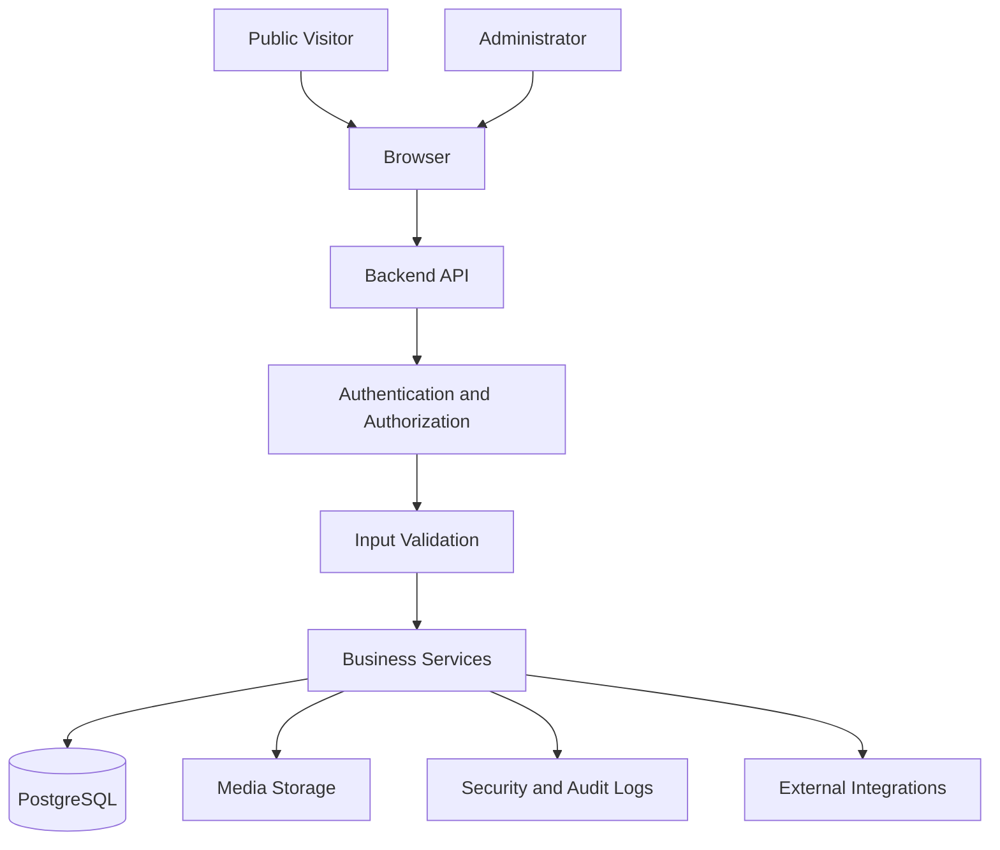

# Security Architecture and Implementation Guidelines

## 1. Purpose

This document defines the security requirements for the Luxury Personal Portfolio website, its backend API, administrator dashboard, database, media storage, and deployment environment.

The goal is to protect administrator accounts, private contact messages, unpublished content, uploaded files, application secrets, and infrastructure while maintaining a secure public portfolio experience.

This document describes the required security design. A control must not be considered implemented until it has been configured, tested, and verified in the actual application.

## 2. Security Objectives

The application must:

- Prevent unauthorized administrative access.
- Protect administrator credentials and sessions.
- Enforce authorization on every protected backend operation.
- Prevent unauthorized access to drafts and preview content.
- Validate and safely process user input.
- Protect the application against common web vulnerabilities.
- Restrict and validate uploaded media.
- Protect contact messages and personal information.
- Prevent unauthorized database access and unsafe data changes.
- Record relevant security-sensitive administrative actions.
- Keep secrets out of source control and frontend bundles.
- Support secure deployment, backup, recovery, and maintenance.

## 3. Scope and Trust Boundaries

Security controls apply to the following components:

1. Public portfolio frontend.
2. Administrator dashboard.
3. Backend REST API.
4. Authentication and session management.
5. PostgreSQL database.
6. Media storage.
7. Email and other configured integrations.
8. CI/CD pipelines and dependencies.
9. Production server and deployment configuration.
10. Logs, audit records, backups, and operational tooling.

### 3.1 Trust boundaries

Every boundary must be protected independently. Hiding an interface element or protecting a frontend route does not secure the corresponding backend resource.

## 4. Threat Model

| Threat | Potential impact | Required controls |
|---|---|---|
| Unauthorized login | Administrative compromise | Strong password hashing, rate limits, secure sessions |
| Session theft | Account takeover | Secure cookies, HTTPS, session rotation and revocation |
| CSRF | Unauthorized state-changing actions | CSRF protection, origin checks, appropriate cookie policy |
| Broken access control | Unauthorized data access or changes | Server-side authentication and authorization |
| SQL injection | Database compromise | Parameterized queries, Prisma, validation |
| Cross-site scripting | Data theft or unauthorized actions | Contextual output encoding, safe rendering, CSP |
| Malicious uploads | Code execution or unsafe content delivery | Allowlisted file types, content validation, storage isolation |
| Draft exposure | Disclosure of unpublished content | Explicit publication filtering and protected preview |
| Spam and abuse | Resource exhaustion or inbox flooding | Rate limits, validation, abuse monitoring |
| Data leakage | Exposure of messages or credentials | Data minimization, access controls, safe logging |
| Dependency compromise | Application compromise | Lockfiles, dependency updates, automated security checks |
| Database loss | Permanent data loss | Verified backups and tested restoration |
| Configuration exposure | Credential or infrastructure compromise | Secret management and least privilege |

The threat model should be reviewed when new integrations, features, or deployment environments are introduced.

## 5. Authentication Security

### 5.1 Administrator accounts

Administrator accounts must be created and managed through a controlled process.

Requirements:

- Do not expose public administrator registration.
- Do not ship default production credentials.
- Require authenticated access to account-management operations.
- Restrict account creation and privilege changes to authorized workflows.
- Disable or revoke compromised accounts promptly.
- Avoid unnecessary administrator accounts.

The dashboard implements two roles. `OWNER` may manage administrator accounts, site settings, sessions, health, analytics, and the activity log; `EDITOR` may manage content, media, the inbox, trash, revisions, and scheduling. The role is stored on the account, read from the database on every request, and never accepted from the client. Owner-only routes return `403 forbidden` for editors, and the last active owner cannot be demoted or deactivated.

### 5.2 Password storage

Use Argon2id for password hashing.

Requirements:

- Never store plaintext passwords.
- Never log passwords.
- Never return password hashes through API responses.
- Use a maintained password-hashing library.
- Configure hashing parameters according to current security guidance and available server resources.
- Reassess parameters periodically.

The proposed project configuration uses Argon2id parameters documented in the project environment configuration. Those values must be verified against the installed library and deployment resources rather than assumed to be correct indefinitely.

### 5.3 Login protection

The login endpoint must:

- Validate the request body.
- Apply rate limiting.
- Use generic invalid-credential responses.
- Avoid revealing whether an email address exists.
- Avoid logging passwords or authentication tokens.
- Return a clear but non-sensitive error for failed authentication.
- Use a consistent session-creation workflow.

Account lockout policies, if used, must be designed to avoid allowing attackers to lock out legitimate users indefinitely.

### 5.4 Password changes and recovery

If password changes or recovery are implemented:

- Require appropriate authorization or identity verification.
- Validate new credentials.
- Invalidate relevant existing sessions when appropriate.
- Use short-lived, single-use recovery tokens if recovery is supported.
- Store recovery tokens securely, preferably as hashes.
- Avoid exposing whether an account exists during recovery.
- Do not implement a recovery interface without a secure backend workflow.

## 6. Session Management

### 6.1 Server-side sessions

Use server-side sessions as the project's authentication mechanism.

The browser should receive an opaque session cookie. The server must determine the authenticated identity from the corresponding valid session.

Do not treat a user ID, administrator flag, or authentication state stored in browser storage as proof of identity.

### 6.2 Cookie requirements

Production session cookies must use:

- `HttpOnly`
- `Secure` over HTTPS
- An appropriate `SameSite` setting
- A restricted cookie path
- A sensible expiration policy

Prefer a host-only cookie. If practical, use a `__Host-` prefixed cookie with the corresponding browser requirements.

The exact configuration must match the application's deployment topology and cross-origin requirements.

### 6.3 Session lifecycle

The backend must:

- Generate unpredictable session identifiers.
- Rotate the session after successful authentication and other relevant privilege changes.
- Enforce idle and absolute expiration policies.
- Invalidate sessions during logout.
- Support revocation when an account is compromised.
- Avoid exposing raw session identifiers in API responses or logs.

If session storage uses Redis or another store, production configuration must protect it from unauthorized access.

### 6.4 Logout

Logout must invalidate the server-side session and clear the corresponding browser cookie.

The frontend must clear private cached data and return the user to a safe public or login route.

A frontend-only logout that leaves the server session valid is insufficient.

## 7. Authorization and Access Control

### 7.1 Backend enforcement

Every protected endpoint must verify authorization independently.

Examples include:

- Creating or modifying projects.
- Publishing and unpublishing content.
- Managing profile and site settings.
- Uploading or deleting media.
- Viewing contact messages.
- Reading audit logs.
- Managing sessions.
- Restoring revisions or deleted content.

The frontend may hide unauthorized controls for usability, but the backend must remain the enforcement boundary.

### 7.2 Least privilege

Grant only the permissions necessary for each operation.

If the application introduces multiple administrator roles, define explicit permissions and test every role-resource combination. Do not invent roles that are not supported by the actual data model.

### 7.3 Resource-level authorization

The backend must verify that a requested resource exists and that the authenticated user is allowed to perform the requested operation.

Never trust resource IDs, role names, ownership fields, or permission flags supplied by the client.

### 7.4 Public and private content

Public endpoints must return only content eligible for publication.

Drafts, private messages, unpublished media, internal settings, audit records, and administrator session data must not be accessible through unrestricted public endpoints.

## 8. CSRF Protection and Origin Validation

Cookie-based authentication requires protection against cross-site request forgery.

For state-changing operations:

- Use an appropriate CSRF protection strategy.
- Validate request origins where appropriate.
- Configure cookies with an appropriate `SameSite` policy.
- Reject invalid or missing CSRF tokens when the selected strategy requires them.
- Protect login and other sensitive cookie-authenticated workflows as appropriate.

Do not assume that `SameSite` cookies alone are sufficient for every deployment.

CORS is not a replacement for CSRF protection.

## 9. Input Validation and Output Safety

### 9.1 Server-side validation

Validate all incoming data at the backend boundary using the project's selected validation library, such as Zod.

Validate:

- Request body shape.
- Required and optional fields.
- String length.
- Email formats.
- URL formats.
- Numeric ranges.
- Date ranges.
- Enumerated values.
- Pagination parameters.
- Sort fields.
- Resource identifiers.
- Publication states.
- Uploaded file metadata.

Reject unexpected fields where appropriate, particularly for security-sensitive operations.

### 9.2 Mass assignment

Do not pass arbitrary request bodies directly into database update operations.

Construct an explicit allowlisted data object for each operation. Sensitive fields such as administrator roles, account status, ownership, audit metadata, and publication permissions must be changed only through authorized workflows.

### 9.3 Output encoding

Render user-submitted and database-backed text safely.

Requirements:

- Use normal framework text rendering.
- Avoid inserting untrusted HTML directly into the DOM.
- Sanitize rich text with a maintained sanitizer if rich text is genuinely required.
- Validate URLs before rendering external links.
- Avoid unsafe URL schemes.
- Use appropriate external-link protections when opening links in a new tab.

### 9.4 Error handling

Return structured, non-sensitive error responses.

Production errors must not expose:

- Stack traces.
- Database connection strings.
- SQL details.
- Filesystem paths.
- Secret values.
- Internal service credentials.

Detailed diagnostic information belongs in appropriately protected server logs.

## 10. SQL Injection and Database Security

Use Prisma and parameterized database operations.

Requirements:

- Avoid constructing SQL from untrusted strings.
- Use parameterized raw queries when raw SQL is necessary.
- Validate dynamic sorting and filtering fields against explicit allowlists.
- Use a restricted database account for the application.
- Avoid using a database superuser in production.
- Keep database ports private.
- Require appropriate authentication for database connections.
- Encrypt network traffic where required by the deployment environment.
- Restrict access to backups and migration credentials.

### 10.1 Database constraints

Use appropriate database constraints and indexes to protect data integrity.

Examples include:

- Unique slugs.
- Required fields.
- Valid relationships.
- Foreign-key constraints.
- Appropriate uniqueness rules for administrator accounts.
- Publication-state consistency where supported.

Application validation and database constraints should complement each other.

### 10.2 Transactions

Use database transactions for operations that must succeed or fail together.

Examples include:

- Updating related records.
- Publishing content and recording required database audit events.
- Coordinating database changes during deletion or restoration.

A database transaction does not automatically roll back external media storage operations or emails. Those require appropriate cleanup, compensation, or retry strategies.

### 10.3 Append-only audit data

Where audit records are required to be append-only:

- Prevent ordinary application workflows from updating or deleting existing records.
- Restrict database permissions appropriately.
- Test the restriction rather than relying solely on documentation.
- Avoid claiming tamper-proof audit logging unless the system provides and verifies that stronger guarantee.

## 11. Draft and Publication Security

The application must maintain a strict separation between draft and published content.

Requirements:

- Public list endpoints return only published and otherwise eligible records.
- Public detail endpoints must not expose drafts through predictable slugs or IDs.
- Draft previews require appropriate authentication and authorization.
- Publication state must be validated by the backend.
- Only authorized administrators may publish or unpublish content.
- Cache invalidation must follow successful publication-state changes.
- Unpublished media must not become publicly accessible merely because its URL is difficult to guess.

If preview links use tokens, those tokens must be unpredictable, appropriately scoped, time-limited, and revocable where practical.

## 12. Media Upload Security

### 12.1 File validation

The backend must enforce:

- An explicit file-type allowlist.
- Maximum upload size.
- File signature or content checks where appropriate.
- Safe file naming.
- Safe metadata handling.
- Image dimension or processing limits where applicable.

Do not rely exclusively on file extensions or browser-provided MIME types.

### 12.2 Storage safety

- Store uploads outside executable application paths.
- Do not execute uploaded files.
- Prevent path traversal.
- Avoid trusting user-supplied storage paths.
- Restrict write and read permissions.
- Separate private and public media when required.
- Avoid exposing server filesystem paths.
- Use controlled media delivery rules.

### 12.3 Image processing

If images are resized or transformed:

- Use maintained image-processing libraries.
- Keep dependencies updated.
- Set resource limits.
- Handle malformed files safely.
- Avoid processing unbounded image dimensions.
- Consider removing unnecessary metadata from public images.

### 12.4 Deletion and references

Before deleting an asset, check whether it is referenced by active content.

Where media storage and database metadata are separate, design deletion as a recoverable or retryable workflow. Do not assume a database rollback will restore a file already deleted from external storage.

## 13. Contact Form and Privacy

The public contact form is an untrusted input boundary.

Requirements:

- Validate submitted fields.
- Apply request-size and rate limits.
- Reject malformed or excessively large submissions.
- Use appropriate abuse-prevention measures.
- Avoid exposing internal email or integration credentials.
- Protect stored messages behind administrator authorization.
- Render messages safely.
- Avoid returning message data through public endpoints.
- Avoid logging full message bodies unnecessarily.
- Define a retention and deletion policy.

If automated email notifications are implemented, avoid using user-supplied input directly in email headers or other sensitive message fields.

## 14. API Security

The API should use the documented versioned prefix, such as `/api/v1`, where configured by the application.

### 14.1 Rate limiting

Apply appropriate limits to:

- Login attempts.
- Contact submissions.
- File uploads.
- Password recovery, if available.
- Other expensive or abuse-prone endpoints.

Choose limits according to actual usage and deployment requirements. Return an appropriate status and response when limits are exceeded.

### 14.2 Request limits

Configure reasonable:

- Request-body size limits.
- Upload size limits.
- Pagination limits.
- Query length limits.
- Timeout policies.

### 14.3 HTTP security headers

Configure suitable security headers, potentially including:

- Content Security Policy.
- `X-Content-Type-Options`.
- `Referrer-Policy`.
- `Strict-Transport-Security` in HTTPS production deployments.
- Appropriate frame and embedding restrictions.

Use a maintained security-header middleware where suitable.

CSP must be tested against the actual frontend and its assets before enforcement. Do not weaken it unnecessarily with broad unsafe directives merely to make the application work.

### 14.4 CORS

Configure an explicit allowlist of permitted origins.

Requirements:

- Do not use unrestricted wildcard origins with credentialed requests.
- Allow only necessary methods and headers.
- Configure credentials only when required.
- Match the frontend's actual production origin.
- Avoid treating CORS as authentication or authorization.

## 15. Secrets and Environment Configuration

Keep secrets in environment variables or an appropriate secret-management system.

Examples include:

- Database credentials.
- Session secrets.
- Email service credentials.
- Object-storage credentials.
- External API keys.
- Deployment tokens.

Requirements:

- Do not commit real secrets to Git.
- Keep `.env` files containing secrets out of source control.
- Provide a safe `.env.example` containing placeholders only.
- Restrict secret-file permissions.
- Rotate compromised credentials promptly.
- Use different credentials for development, testing, and production.
- Never embed backend secrets in frontend environment variables or built assets.
- Avoid printing secret values in CI logs.

If a credential has been exposed, rotate it rather than merely deleting the visible text from the latest source revision.

## 16. Logging and Monitoring

### 16.1 Application logs

Log relevant operational events, including:

- Application startup and shutdown.
- Unexpected server errors.
- Failed dependencies.
- Security-relevant failures.
- Background-job failures, if jobs exist.

### 16.2 Audit events

Record relevant administrative actions, such as:

- Authentication successes and failures where appropriate.
- Publication and unpublication.
- Content creation, updates, and deletion.
- Media changes.
- Settings changes.
- Session revocation.
- Revision restoration.
- Other sensitive operations.

Define the required audit events according to the actual feature set.

### 16.3 Sensitive data protection

Do not log:

- Passwords.
- Session cookies.
- Authentication tokens.
- Secret keys.
- Database passwords.
- Full payment or other unrelated sensitive data.
- Full contact messages unless explicitly justified and protected.

Sanitize untrusted values in logs to reduce log-injection risks.

### 16.4 Monitoring

Where operational monitoring is available:

- Monitor repeated authentication failures.
- Track unexpected API errors.
- Monitor database and storage availability.
- Alert on important operational failures.
- Restrict access to monitoring dashboards.

Do not expose detailed internal health information through a public endpoint.

## 17. Dependency and Supply-Chain Security

Requirements:

- Commit package-manager lockfiles.
- Use supported dependency versions.
- Review dependency updates.
- Run automated vulnerability checks.
- Fix exploitable high-risk vulnerabilities before release according to the project's security policy.
- Avoid installing unreviewed packages without a clear need.
- Pin critical CI actions to reviewed versions or immutable commit references where practical.
- Restrict CI permissions to the minimum necessary.
- Protect deployment secrets.
- Avoid executing untrusted pull-request code with privileged credentials.

Security scan results must be reviewed in context. A passing scan does not prove that the application is secure.

## 18. CI/CD Security

The CI pipeline should include applicable checks for:

- Dependency installation using the lockfile.
- Formatting.
- Linting.
- Type checking.
- Unit tests.
- Integration tests.
- Production builds.
- Dependency vulnerability scanning.
- Static analysis.
- Secret detection.
- Container scanning when containers are used.

Dynamic application security testing may be included once a suitable test deployment exists.

Requirements:

- Do not deploy if mandatory checks fail.
- Do not expose production secrets to untrusted jobs.
- Restrict deployment permissions.
- Protect production environments.
- Review scan findings and document accepted exceptions.
- Keep the pipeline configuration aligned with the actual repository.

## 19. Docker and Deployment Security

If Docker is used:

- Prefer maintained base images.
- Pin or control image versions.
- Avoid running application containers as root where practical.
- Avoid privileged containers unless specifically justified.
- Keep secrets out of image layers.
- Expose only required ports.
- Keep PostgreSQL and Redis private in production.
- Use appropriate container health checks.
- Apply resource limits where appropriate.
- Rebuild images when critical dependencies require updates.

For production deployment:

- Enforce HTTPS.
- Restrict administrative access.
- Use secure firewall rules.
- Configure trusted proxy handling correctly.
- Keep production environment files protected.
- Avoid exposing database administration tools publicly.
- Review permissions on persistent storage.

Development port mappings and local defaults must not be copied into production without review.

## 20. Backup and Recovery

A backup is useful only if it can be restored successfully.

Requirements:

- Define backup frequency according to acceptable data-loss limits.
- Protect backups with appropriate access controls.
- Encrypt backups where appropriate.
- Keep backup credentials separate from normal application credentials.
- Include required database data and media assets.
- Define retention periods.
- Test restoration in a controlled environment.
- Document recovery procedures.
- Record and review backup failures.

Database backups alone may be insufficient if uploaded media is stored separately.

Recovery time and recovery point objectives should be documented according to the actual hosting environment and business needs.

## 21. Error Handling and Incident Response

### 21.1 Error handling

- Return consistent error structures.
- Avoid leaking internal implementation details.
- Record useful diagnostics in protected logs.
- Handle unavailable database, email, and storage services gracefully.
- Avoid exposing stack traces to public clients.

### 21.2 Incident response

For a suspected security incident:

1. Identify the affected account, system, or resource.
2. Contain the issue and restrict compromised access.
3. Revoke affected sessions and rotate exposed credentials.
4. Preserve relevant logs and evidence.
5. Assess possible data exposure or unauthorized changes.
6. Restore safe operation.
7. Apply the required remediation.
8. Review the incident and improve preventive controls.

The exact response process must match the deployment environment and the severity of the incident.

## 22. Privacy and Data Retention

Collect and retain only the information needed to operate the portfolio.

Requirements:

- Keep administrator information private.
- Restrict contact messages to authorized users.
- Avoid unnecessary personal information in analytics and logs.
- Define retention periods for messages and operational logs.
- Delete or anonymize data when required by the applicable policy.
- Protect backups that contain deleted records.
- Document any external services receiving user data.

Privacy requirements must be reviewed against the laws and obligations applicable to the actual deployment and users.

## 23. Security Testing

### Authentication

- Invalid credentials are rejected.
- Login rate limiting works.
- Session rotation occurs where required.
- Logout invalidates the session.
- Expired sessions cannot access protected endpoints.

### Authorization

- Anonymous users cannot access protected administrative APIs.
- Authenticated non-authorized users cannot perform restricted operations.
- Draft content remains private.
- Contact messages remain private.
- Session and audit-management endpoints enforce access controls.

### Input and output

- Invalid request bodies are rejected.
- Unexpected fields cannot modify protected attributes.
- SQL injection payloads are safely handled.
- Stored and reflected XSS test cases are safely rendered.
- Unsafe URLs are rejected or rendered safely.

### Media

- Unsupported file types are rejected.
- Oversized files are rejected.
- Malformed files are handled safely.
- Unauthorized uploads are rejected.
- Media deletion respects reference and recovery policies.

### Infrastructure

- Production secrets are not committed.
- Database ports are not unnecessarily exposed.
- Required security headers are present.
- CI checks execute as expected.
- Backup restoration is tested.

Security tests should run against a dedicated test environment with test credentials and data.

## 24. Security Implementation Checklist

### Before development completion

- [ ] Authentication and authorization requirements are documented.
- [ ] Session handling follows the selected security design.
- [ ] Backend validation is applied to all relevant endpoints.
- [ ] Publication rules protect draft content.
- [ ] Media upload restrictions are implemented.
- [ ] Contact messages are protected.
- [ ] Database operations use safe query patterns.
- [ ] Sensitive settings use explicit allowlists.
- [ ] Required audit events are defined.

### Before production release

- [ ] HTTPS is configured.
- [ ] Production secrets are configured securely.
- [ ] Database and cache access are restricted.
- [ ] Login and abuse-related rate limits are enabled.
- [ ] CSRF protection is verified.
- [ ] Security headers are reviewed.
- [ ] Dependency and static-analysis checks have been reviewed.
- [ ] Authorization tests pass.
- [ ] Draft and preview access tests pass.
- [ ] Upload validation tests pass.
- [ ] Logging does not expose secrets.
- [ ] Backup restoration has been tested.
- [ ] Deployment and incident-response procedures are documented.

## 25. Definition of Done

Security work is complete only when the applicable controls are implemented and verified.

The application must demonstrate that:

- Protected endpoints reject unauthorized requests.
- Administrator credentials are stored safely.
- Sessions can expire and be invalidated.
- CSRF and origin protections match the authentication architecture.
- Public APIs do not leak drafts or private data.
- User input is validated and safely rendered.
- Media uploads follow the documented restrictions.
- Secrets are not exposed in source control or frontend builds.
- Security-sensitive actions are logged appropriately.
- Required automated checks pass.
- Production configuration has been reviewed.
- Backup and recovery procedures have been tested.

Documentation, security checklists, and passing automated scans are not substitutes for verification of the running application.

## 26. Media Upload Security (Implemented)

The hero portrait upload is the first endpoint that accepts binary content.

- Every upload, replacement, removal, draft update, publication, media read, and media deletion goes through `requireAdmin`; the upload route also requires the CSRF token like every other state-changing request.
- Uploads are rate limited per IP (`20` per hour) in addition to the session requirement.
- The multipart parser enforces a single file and the configured byte limit before the handler runs; oversized files are rejected with 413 and nothing is written.
- The client filename and `Content-Type` are ignored. The file is accepted only when its magic bytes match JPEG, PNG, or WebP. SVG is rejected because it can carry active content, and no sanitisation pipeline exists.
- Width, height, and pixel count are parsed from the file header; limits are 8000px per edge and 30 megapixels, which bounds decompression work.
- Storage keys are generated from a random UUID and the detected extension. No request value reaches a filesystem path, and reads validate the key shape before resolving it under the media root.
- Files are written outside the web root and are never served by a generic static handler. Public reads are restricted to the one asset id referenced by the published homepage state; draft assets are only readable through the authenticated admin media route.
- Responses set the detected `Content-Type`, `Content-Length`, `X-Content-Type-Options: nosniff` (via Helmet), and immutable caching for published bytes. Unknown or unpublished ids return 404 without revealing whether a file exists.
- Only metadata and references are stored in PostgreSQL. Storage credentials stay in environment variables; the repository contains none.
- Audit events record asset ids, detected types, sizes, and dimensions, but never file bytes or storage paths. Upload failures do not modify published content, and deleting an unreferenced asset is the only path that removes a file.

## 27. Related Documentation

- `README.md` — Project setup and overview.
- `docs/01-project-overview.md` — Product scope.
- `docs/02-portfolio-requirements.md` — Public portfolio requirements.
- `docs/03-design-system.md` — UI design standards.
- `docs/04-animation-guidelines.md` — Motion guidelines.
- `docs/05-system-architecture.md` — System architecture and trust boundaries.
- `docs/06-frontend-architecture.md` — Frontend security responsibilities.
- `docs/07-backend-api.md` — API contracts and endpoint security.
- `docs/08-database-schema.md` — Database relationships and constraints.
- `docs/09-admin-dashboard.md` — Administrative workflows.
- `docs/11-testing-and-qa.md` — Testing and release quality.
- `docs/12-deployment-and-maintenance.md` — Production deployment and maintenance.
- `docs/13-admin-advanced-features.md` — Optional advanced admin capabilities.
- `docs/14-dynamic-content-and-media-management.md` — Publishing and media workflows.
