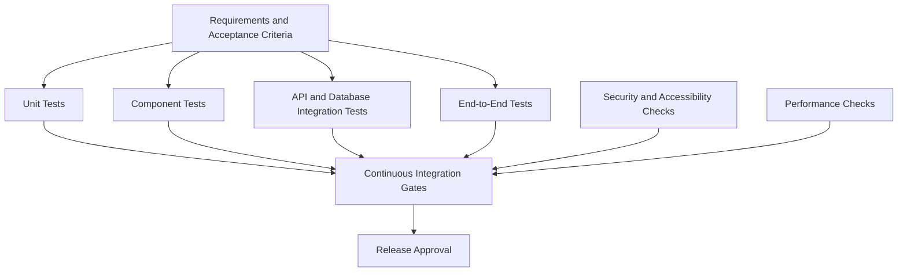

# Testing and Quality Assurance

## 1. Purpose

This document defines the testing strategy, quality standards, automation requirements, and release criteria for the Luxury Personal Portfolio website and its administrator dashboard.

The objective is to verify that the application is functional, secure, accessible, responsive, maintainable, and consistent with its documented requirements.

Testing must cover both the public portfolio and the private administrative system, including frontend behavior, backend APIs, database operations, publication workflows, media handling, and deployment configuration.

This document describes the intended testing process. Tests must not be described as passing until they have actually been executed and their results verified.

## 2. Quality Objectives

The project must aim to:

- Verify functional requirements against documented acceptance criteria.
- Detect defects early through automated checks.
- Protect administrator accounts and private information.
- Verify correct CRUD operations and data persistence.
- Ensure unpublished content remains private.
- Verify that published content appears correctly on the public site.
- Test responsive layouts and accessibility.
- Detect performance regressions.
- Validate API contracts and database constraints.
- Verify error handling and recovery behavior.
- Prevent releases when mandatory quality gates fail.
- Maintain repeatable development and release procedures.

## 3. Testing Scope

Testing covers the following application areas:

| Area | Testing focus |
|---|---|
| Public portfolio | Pages, navigation, content, forms, SEO |
| Admin dashboard | Navigation, tables, forms, feedback |
| Authentication | Login, logout, sessions, expiration |
| Authorization | Protected resources and restricted actions |
| Content management | CRUD, validation, relationships |
| Publishing | Drafts, preview, publish, unpublish |
| Media | Upload, validation, association, deletion |
| Contact inbox | Submission, privacy, status updates |
| API | Contracts, validation, errors, rate limits |
| Database | Constraints, transactions, persistence |
| Security | Input handling, access control, uploads |
| Accessibility | Keyboard, screen readers, contrast |
| Responsive UI | Mobile, tablet, desktop |
| Performance | Loading, interactions, layout stability |
| Deployment | Environment configuration, health, recovery |

Optional capabilities such as revision history, trash, analytics, backups, and bulk actions must be tested if implemented. They must not be treated as mandatory working features merely because they appear in documentation.

## 4. Testing Strategy

Use a layered testing approach.

Not every test must run on every code change. Fast checks should run frequently, while expensive end-to-end, performance, or dynamic security tests can run at suitable pipeline stages.

## 5. Test Environments

### 5.1 Local development

Use the local development environment for:

- Unit tests.
- Component tests.
- Manual verification.
- API development tests.
- Local integration testing.

### 5.2 Automated test environment

Use an isolated test environment for:

- API integration tests.
- Database tests.
- Authentication and authorization tests.
- Automated end-to-end tests.
- Upload tests.

Tests must not accidentally modify production data.

### 5.3 Staging environment

Where available, staging should resemble production configuration closely enough to verify:

- Production builds.
- HTTPS and cookie configuration.
- CORS and CSRF behavior.
- Database migrations.
- Media storage.
- Deployment configuration.
- Smoke tests.
- Rollback procedures.

### 5.4 Production

Production verification should use safe smoke tests and health checks.

Do not run destructive tests, unrestricted vulnerability scans, or test uploads against production without explicit authorization and suitable safeguards.

## 6. Testing Tools

Use tools that match the actual project dependencies.

| Purpose | Recommended tool |
|---|---|
| Frontend unit tests | Vitest |
| React component tests | React Testing Library |
| API tests | Vitest with an HTTP test client, or the project's equivalent |
| End-to-end tests | Playwright |
| Type checking | TypeScript compiler |
| Linting | ESLint |
| Formatting | Prettier |
| API request exploration | Bruno, Postman, or an equivalent client |
| Dependency auditing | npm audit or an approved scanner |
| Static security analysis | CodeQL or an equivalent tool |
| Container scanning | Trivy, if containers are used |
| Accessibility checks | Automated accessibility tooling plus manual review |
| Performance testing | Lighthouse and browser performance tools |

These are recommendations, not proof that the tools are installed. Use the repository's actual package scripts and configuration.

## 7. Unit Testing

Unit tests verify small, isolated units of application logic.

### 7.1 Frontend unit tests

Test:

- Formatting utilities.
- Slug-generation helpers.
- Date formatting.
- Pagination calculations.
- Search and filtering helpers.
- Form-validation rules.
- API error mapping.
- Publication-state presentation.
- Utility functions.
- Permission-based UI behavior.

### 7.2 Backend unit tests

Test:

- Business rules.
- Input-validation helpers.
- Publication eligibility.
- Slug and uniqueness rules.
- Permission checks.
- Data transformation.
- Rate-limit configuration helpers where practical.
- Error mapping.
- Media-validation logic.

### 7.3 Unit test principles

- Keep tests deterministic.
- Avoid dependence on production services.
- Test success and failure cases.
- Include boundary values.
- Use descriptive test names.
- Mock external integrations where appropriate.
- Avoid testing only implementation details.

## 8. Component Testing

Component tests verify user-visible behavior and interaction.

### 8.1 Shared components

Test:

- Buttons and disabled states.
- Form inputs and validation messages.
- Dialogs and confirmation prompts.
- Tables and pagination.
- Search and filter controls.
- Navigation menus.
- Toasts and notifications.
- Loading indicators.
- Empty states.
- Error states.

### 8.2 Admin forms

Verify that:

- Fields display the correct initial values.
- Required fields are identified.
- Invalid input shows clear errors.
- Submission disables duplicate actions where appropriate.
- Server errors are displayed safely.
- User input is preserved after recoverable failures.
- Successful operations update the visible state correctly.

### 8.3 Accessibility

Verify that:

- Inputs have accessible names.
- Interactive controls are keyboard-operable.
- Focus indicators are visible.
- Dialogs manage focus appropriately.
- Status changes are announced when required.
- Color is not the only way to communicate status.

## 9. API Integration Testing

API integration tests verify interactions between routes, middleware, business services, and the database.

### 9.1 General API tests

For each endpoint, verify applicable cases:

- Valid request.
- Invalid request body.
- Missing required fields.
- Invalid identifiers.
- Missing authentication.
- Insufficient authorization.
- Missing resource.
- Duplicate or conflicting data.
- Database failure.
- Correct response status.
- Correct response structure.
- Appropriate error messages.
- Persistence of successful changes.

### 9.2 Public API tests

Verify that public endpoints:

- Return only published and eligible content.
- Do not expose draft records.
- Do not return administrator credentials or sessions.
- Do not expose private contact messages.
- Validate pagination and filters.
- Handle unknown resource identifiers safely.
- Return consistent error responses.

### 9.3 Admin API tests

Verify that protected endpoints:

- Reject unauthenticated requests.
- Enforce authorization on every request.
- Validate input independently of frontend validation.
- Restrict sensitive field changes.
- Record required audit events.
- Handle invalid state transitions.
- Do not leak stack traces or internal infrastructure details.

### 9.4 API contract consistency

Use the API specification in `docs/07-backend-api.md` as the intended contract.

When implementation changes, update the API documentation and relevant tests together.

Do not silently change response shapes or error formats without updating dependent frontend code.

## 10. Database and Persistence Testing

Use a dedicated test database.

### 10.1 Schema and constraints

Verify:

- Required fields.
- Unique constraints.
- Foreign-key relationships.
- Valid deletion behavior.
- Slug uniqueness.
- Publication-state consistency.
- Indexes for important query patterns where practical.

### 10.2 CRUD persistence

For each implemented content type:

1. Create a record.
2. Retrieve the record.
3. Update it.
4. Verify the updated values.
5. Delete or archive it according to the configured policy.
6. Verify the resulting state.

Include projects, categories, skills, skill categories, experience, education, certifications, and profile data where applicable.

### 10.3 Transactions

Test operations that require multiple database changes.

Verify that:

- Successful operations persist all required changes.
- Failed operations do not leave inconsistent partial database state.
- Uniqueness conflicts are handled correctly.
- Foreign-key restrictions behave as documented.
- Audit records are created where required.

Database rollback does not automatically reverse external email or media-storage operations. Test those workflows separately.

### 10.4 Migrations

Verify that:

- Migrations apply successfully to a clean test database.
- Migrations work against a representative existing schema.
- Migration failures are visible.
- Production migration procedures are documented.
- Schema changes do not unintentionally destroy required data.

Use the migration commands supported by the installed Prisma version and the project's actual configuration.

## 11. Authentication and Authorization Testing

Security tests must cover both frontend behavior and backend enforcement.

### 11.1 Authentication scenarios

Verify that:

- Valid credentials allow login.
- Invalid credentials are rejected.
- Responses do not reveal whether an account exists.
- Login rate limiting works.
- A valid session permits authorized requests.
- An expired session is rejected.
- Logout invalidates the session.
- Session rotation occurs where required.
- Session cookies use the intended production settings.

### 11.2 Authorization scenarios

Verify that:

- Anonymous users cannot access protected APIs.
- A user without the required permission cannot perform restricted actions.
- Changing frontend state does not bypass backend authorization.
- Manipulated resource identifiers do not grant access.
- Sensitive fields cannot be changed through mass assignment.
- Audit and session-management endpoints enforce appropriate permissions.

### 11.3 CSRF and CORS

Verify:

- Invalid CSRF requests are rejected when required by the selected strategy.
- Origin validation behaves as intended.
- Unexpected origins cannot use credentialed cross-origin access.
- Cookie settings match the deployment architecture.
- Legitimate frontend requests continue to work.

CORS tests must not be treated as a substitute for authentication or CSRF tests.

## 12. Content Management and Publishing Tests

### 12.1 CRUD workflow

For every required content module, verify:

- Create.
- Read.
- Update.
- Delete or documented alternative.
- Input validation.
- Error handling.
- Search and filtering where applicable.
- Sorting and pagination where applicable.

### 12.2 Draft visibility

Verify that:

- A newly created draft is saved correctly.
- Public list endpoints exclude the draft.
- Public detail endpoints cannot retrieve the draft.
- Predictable slugs and identifiers do not bypass publication checks.
- Unauthorized users cannot access draft previews.

### 12.3 Publication workflow

Verify that:

1. An authorized administrator creates or edits content.
2. The backend persists the intended draft state.
3. The public API excludes the draft.
4. An authorized administrator publishes the record.
5. The backend confirms the publication state.
6. The public API returns the published record.
7. The administrator unpublishes it.
8. The public API excludes it after the change succeeds.
9. Relevant cache invalidation occurs if caching is configured.

### 12.4 Concurrent updates

Where practical, test two administrators or requests updating the same record.

The application should handle conflicts predictably and avoid silently overwriting important changes. Implement optimistic concurrency controls only if supported by the design and data model.

## 13. Media Upload Testing

Verify the media workflow end to end.

### Valid uploads

- Supported files upload successfully.
- Metadata is persisted correctly.
- The asset can be associated with an allowed content record.
- The correct preview or media URL is returned.

### Invalid uploads

- Unsupported file types are rejected.
- Oversized files are rejected.
- Malformed or suspicious files are handled safely.
- Missing authentication prevents protected uploads.
- Invalid content associations are rejected.
- Storage failures do not produce false success messages.

### Deletion and recovery

If implemented, verify that:

- Referenced media cannot be accidentally removed.
- Deletion follows the documented policy.
- Failed cleanup can be retried safely.
- Restoration handles missing files and conflicting references correctly.

Never test destructive media operations using production assets without an approved procedure.

## 14. Contact Form and Inbox Testing

Verify that:

- Valid contact submissions are accepted.
- Invalid fields are rejected.
- Excessive request sizes are rejected.
- Rate limits are enforced.
- Messages persist in the database.
- New messages appear in the authenticated inbox.
- Public APIs do not expose message contents.
- Message status changes persist correctly.
- Submitted content is rendered safely.
- External email failures are handled without exposing credentials.

If spam prevention or email notifications are implemented, test those integrations separately.

## 15. Admin Dashboard End-to-End Tests

Use Playwright or the repository's selected E2E framework.

Recommended workflows:

### Workflow A — Authentication

1. Open the login page.
2. Submit invalid credentials.
3. Verify the error state.
4. Log in with a valid test account.
5. Verify access to protected dashboard routes.
6. Log out.
7. Verify that protected APIs reject the invalidated session.

### Workflow B — Project publishing

1. Log in.
2. Create a project draft.
3. Verify that it appears in the admin list.
4. Verify that it is absent from public results.
5. Publish the project.
6. Verify that it appears on the public portfolio.
7. Edit the project.
8. Verify that confirmed changes appear publicly.
9. Unpublish it.
10. Verify that it no longer appears in public results.

### Workflow C — Media management

1. Log in.
2. Upload a valid test image.
3. Verify its metadata and preview.
4. Associate it with a test project.
5. Verify that the project displays the correct image.
6. Attempt an invalid upload.
7. Verify that the request is rejected.

### Workflow D — Contact inbox

1. Submit a valid public contact message.
2. Verify the expected submission response.
3. Log in to the admin dashboard.
4. Locate the new message.
5. Open its details.
6. Update its status if supported.
7. Verify that the change persists.
8. Confirm that public APIs cannot retrieve the message.

### Workflow E — Error handling

1. Submit invalid form data.
2. Simulate a network failure.
3. Simulate an expired session.
4. Verify appropriate feedback.
5. Confirm that the UI does not display false success.
6. Verify that recoverable form input remains available.

Use isolated test data and clean up records safely.

## 16. Responsive and Cross-Browser Testing

Test representative viewport sizes for:

- Mobile.
- Tablet.
- Laptop.
- Desktop and wider screens.

Verify:

- Navigation and menus.
- Project grids.
- Admin tables.
- Forms.
- Dialogs.
- Image scaling.
- Text wrapping.
- Keyboard focus.
- Touch interactions.
- Overflow and horizontal scrolling.

Test the current supported versions of major browsers, especially Chromium-based browsers, Firefox, and Safari where the project's support requirements include them.

Do not claim cross-browser support without performing appropriate tests.

## 17. Accessibility Testing

Target WCAG 2.2 Level AA for applicable requirements.

### Automated checks

Use suitable accessibility tooling to identify common issues such as:

- Missing accessible names.
- Invalid semantic structure.
- Some contrast failures.
- Form-label problems.
- Certain ARIA misuse.

### Manual checks

Automated tests are not sufficient. Manually verify:

- Keyboard-only navigation.
- Focus order.
- Visible focus.
- Dialog focus handling.
- Screen-reader usability for critical workflows.
- Zoom and text resizing.
- Reduced-motion behavior.
- Form error announcements.
- Meaningful link and button labels.

Test both the public site and the administrator dashboard.

## 18. Animation and Motion Testing

Follow `docs/04-animation-guidelines.md`.

Verify that:

- Animations do not block essential interaction.
- Reduced-motion preferences are respected.
- Scroll-triggered elements remain visible if animation does not run.
- Motion does not cause significant layout shifts.
- Hover effects have suitable keyboard equivalents where relevant.
- Animations remain usable on mobile devices.
- Loading indicators do not continue indefinitely.
- Animation failures do not prevent access to content.

## 19. Performance Testing

### 19.1 Public portfolio

Measure:

- Initial page load.
- Image loading and sizing.
- JavaScript bundle size.
- Layout stability.
- Navigation responsiveness.
- API latency.
- Core Web Vitals where real-user data is available.

Recommended field targets at the 75th percentile, when sufficient field data exists:

| Metric | Target |
|---|---:|
| Largest Contentful Paint (LCP) | ≤ 2.5 seconds |
| Interaction to Next Paint (INP) | ≤ 200 milliseconds |
| Cumulative Layout Shift (CLS) | ≤ 0.1 |

Lab measurements can help identify regressions, but they are not interchangeable with field measurements.

### 19.2 Admin dashboard

Measure:

- Dashboard load time.
- API request count.
- Table rendering.
- Search and filter responsiveness.
- Form submission latency.
- Media preview performance.

### 19.3 Backend and database

Check:

- Slow endpoints.
- Inefficient database queries.
- Unbounded list responses.
- Missing indexes for demonstrated query patterns.
- Connection-pool behavior.
- Cache behavior if caching is implemented.

Do not introduce arbitrary performance claims without measurement.

## 20. Security and Dependency Testing

### 20.1 Application security

Test for:

- Broken access control.
- SQL injection.
- Cross-site scripting.
- CSRF.
- Unsafe file uploads.
- Sensitive-data exposure.
- Session-management flaws.
- Excessive request sizes.
- Rate-limit bypass.
- Unsafe error responses.
- Insecure configuration.

### 20.2 Dependency checks

Run the configured dependency audit and review the results.

Separate production dependency risk from development-only dependency findings while still evaluating whether development tooling could affect CI or build security.

Do not automatically assume every finding is exploitable, and do not ignore a finding solely because it originates in a development dependency.

### 20.3 Static and dynamic analysis

Use configured static-analysis and dynamic-testing tools where appropriate.

Dynamic tests must target an authorized test deployment. Record findings, severity, remediation, and any approved exceptions.

Automated scanning does not prove that the application is secure.

## 21. SEO and Public Content Testing

Verify that:

- Public pages have appropriate titles and descriptions.
- Canonical URLs are correct where configured.
- Social-sharing metadata is valid.
- Images have appropriate alternative text when meaningful.
- Public routes return the correct status codes.
- Unpublished content is not exposed through public routes or metadata.
- Internal admin routes are not unintentionally indexed.
- Sitemap and robots directives reflect the intended publication policy.
- Navigation and internal links work.
- Unknown routes display an appropriate not-found page.

Do not include private preview URLs or sensitive data in public sitemaps.

## 22. Error Handling and Resilience Testing

Simulate expected failures where practical:

- API unavailable.
- Database unavailable.
- Media storage unavailable.
- Email provider unavailable.
- Expired session.
- Invalid API response.
- Rate limit exceeded.
- Duplicate record.
- Missing resource.
- Database constraint violation.

Verify that the application:

- Displays clear user-facing feedback.
- Does not leak internal details.
- Avoids false success messages.
- Preserves recoverable user input.
- Retries only when retrying is safe.
- Does not duplicate destructive operations.
- Recovers correctly when the dependency becomes available again.

## 23. Test Data and Test Isolation

Requirements:

- Use dedicated test accounts.
- Use a separate test database.
- Avoid real credentials and unnecessary personal information.
- Generate deterministic fixtures where practical.
- Reset or clean up test data safely.
- Avoid tests depending on execution order.
- Avoid tests sharing mutable records unexpectedly.
- Use mocked external services where appropriate.

End-to-end tests that require database state must create and clean up their own test records or use an equivalent controlled fixture process.

## 24. Continuous Integration Quality Gates

The CI pipeline should run the checks supported by the repository.

Recommended sequence:

1. Install dependencies using the committed lockfile.
2. Verify formatting.
3. Run linting.
4. Run TypeScript type checking.
5. Run unit tests.
6. Run component tests.
7. Run API integration tests.
8. Build frontend and backend.
9. Run applicable dependency and security checks.
10. Run selected end-to-end tests.
11. Publish test results and build artifacts where configured.

### Mandatory gates

A release must not proceed when a required gate fails.

Recommended release blockers include:

- Build failure.
- Type-check failure.
- Lint or formatting failure under the project's enforced policy.
- Failed mandatory tests.
- Critical or high-risk security findings that remain unresolved under the project's policy.
- Failed required database migration checks.
- Failed essential authorization or publication tests.

Approved exceptions must have a documented reason, responsible reviewer, and remediation plan.

The actual CI configuration is the source of truth for which checks currently run.

### 24.1 Implemented workflow

`.github/workflows/ci.yml` runs on push to `main` and on pull requests, with `contents: read` permissions and a concurrency group that cancels superseded runs.

| Job | Steps |
|---|---|
| Backend | `npm ci` → `prisma generate` → `tsc --noEmit` (source and tests) → `vitest run` → `tsc` build |
| Frontend | `npm ci` → `oxlint` → `vitest run` (unit tests) → `tsc -b && vite build` |
| End-to-end | PostgreSQL service → migrations → `create-admin` → API and dev server → `npm run build` → `npm run verify` (both Playwright verifiers) |
| Containers | `docker build` for `backend/` and `frontend/` |

The backend job starts a `postgres:18-alpine` service on port `5433` with the credentials in `backend/tests/config.ts`, so the API suite runs against the same isolated database a developer would use. `tests/global-setup.ts` applies the committed migrations; the suite truncates tables between cases and uses `tests/.tmp-media` for uploads.

The end-to-end job provisions its own stack: `prisma migrate deploy` plus `npm run create-admin` against a second PostgreSQL service, the API on port 4000, Vite on port 5173, and Chromium installed through `npx playwright install --with-deps chromium`. `npm run verify` builds the SPA, runs `verify:homepage` against `vite preview`, then `verify:admin`, and fails the job if either does. Both verifiers are non-destructive, so the CI database is left as it was found. No formatting check is configured; lint, type checking, and the test suites are the enforced gates.

## 25. Defect Management

Each significant defect should include:

- Short title.
- Reproduction steps.
- Expected behavior.
- Actual behavior.
- Environment.
- Relevant logs or screenshots with sensitive data removed.
- Severity and priority.
- Assigned owner where applicable.
- Fix and verification status.

### Suggested severity levels

| Severity | Meaning |
|---|---|
| Critical | Severe security compromise, major data loss, or complete core-system failure |
| High | Major feature failure, serious security weakness, or significant data-integrity problem |
| Medium | Important functionality impaired with a reasonable workaround |
| Low | Minor visual, usability, or noncritical behavior issue |

Severity and release impact must be assessed in context.

## 26. Release Readiness Checklist

### Functional

- [ ] Required public pages work.
- [ ] Admin login and logout work.
- [ ] Required content CRUD operations work.
- [ ] Drafts remain private.
- [ ] Publication changes appear correctly on the public site.
- [ ] Media uploads and associations work.
- [ ] Contact messages are stored and protected.
- [ ] Forms and tables handle error states.
- [ ] Required search and pagination behavior works.

### Security

- [ ] Backend authorization tests pass.
- [ ] Session and CSRF behavior has been verified.
- [ ] Public endpoints do not expose private data.
- [ ] Upload validation tests pass.
- [ ] Secrets are not exposed in the repository or frontend bundle.
- [ ] Security findings have been reviewed.
- [ ] Production configuration has been checked.

### Quality

- [ ] Formatting checks pass.
- [ ] Linting passes.
- [ ] Type checking passes.
- [ ] Required automated tests pass.
- [ ] Production builds succeed.
- [ ] Accessibility checks and manual reviews are complete.
- [ ] Responsive behavior has been verified.
- [ ] Performance has been assessed.
- [ ] SEO metadata and public routes have been checked.

### Operations

- [ ] Database migrations are ready.
- [ ] Backup and recovery procedures are documented.
- [ ] Environment variables are configured.
- [ ] Monitoring and health checks work where configured.
- [ ] Deployment and rollback procedures are available.
- [ ] Release notes are prepared where required.

## 27. Definition of Done

A feature is complete when:

- Its requirements and acceptance criteria are documented.
- Its expected success and failure paths are implemented.
- Relevant unit and component tests pass.
- API and database behavior is verified where applicable.
- Authorization and validation are tested for protected operations.
- Accessibility and responsive behavior are checked.
- Relevant end-to-end tests pass for critical user workflows.
- Documentation reflects the actual behavior.
- No known release-blocking defect remains.

The application is release-ready only when all mandatory quality gates pass and required deployment checks are complete.

## 28. Hero Portrait Test Coverage (Implemented)

`backend/tests/hero.test.ts` covers the upload and publication contract:

- Unauthenticated upload, draft update, publish, file read, and delete are rejected; a signed-in request without the CSRF header is rejected with 403.
- A valid PNG upload is stored, returns detected metadata, and becomes the draft without touching the published state.
- Text, SVG, a fake image whose bytes do not match its declared type, and a file over the size limit are rejected; the previous draft and published state remain intact.
- Draft alt text, visibility, and effect values are validated (alt required for a visible published portrait, intensities 0–100).
- Before publishing, `/api/hero` still returns the previous published portrait (or `null`); the draft asset id returns 404 from the public media route.
- After publishing, `/api/hero` returns the new URL and effect settings, and the published media route returns the bytes with an image content type and immutable caching.
- Hiding the portrait or removing it and publishing restores the fallback.
- Deleting a referenced asset returns 409; an unreferenced asset is removed from the database and the media root.
- Replacing a portrait removes the superseded file only after it is unreferenced.

The frontend is verified with `npm run verify:homepage` (portrait rendering, fallback, reduced motion, no layout overflow) and `npm run verify:admin` (upload, draft preview, save, publish, remove). Both scripts also run axe WCAG A/AA audits on the affected pages.

## 29. Bulk, Trash, and Revision Coverage (Implemented)

`backend/tests/content-admin.test.ts` adds 15 integration tests against the real database and session stack:

- **Bulk actions:** authentication and CSRF enforcement, multi-record publish and unpublish, atomic rollback when one selection is trashed, payload validation (empty list, 51 ids, unknown action, unknown type), and bulk audit metadata.
- **Trash:** trashed projects disappear from the admin detail read and public API while appearing in the trash, restore returns the published state, restore/purge reject live records, purge removes the row, and a slug stays reserved until purge. Bulk restore and bulk purge work across content types, collapse duplicate entries, refuse the whole transaction when any record is live or missing, write one audit event and revision per record, and reject malformed payloads (empty or oversized lists, unknown types, unknown fields, missing CSRF).
- **Revisions:** every create and update stores a snapshot, listing filters by entity type and id, snapshot detail is available and includes the previous snapshot for the same entity (or `null` for the first), restore re-applies old values (including `featured`), restore adds a third revision and a `REVISION_RESTORED` audit event, and restore is refused while the record is in the trash.

`tests/screenshots.test.ts` now asserts the trash behaviour: deleting a project keeps its gallery restorable, and permanent deletion cascades the gallery rows.

End-to-end coverage in `frontend/scripts/verify-admin.mjs` opens the trash page, restores a trashed project, checks the bulk-selection toolbar appears and clears, permanently deletes from the trash, and loads the revision history, opens a snapshot to confirm the field-level diff and raw-snapshot control. It also creates two fixture projects, trashes them through the API, selects both in the trash, restores them with the bulk toolbar, verifies they are available again, trashes them again, and confirms that bulk permanent deletion names the selected count, reports success, and removes both records. `npm run verify` (in `frontend/`) runs the homepage verifier against `vite preview` and then the admin verifier, managing the preview server itself and failing if the API or dev server is missing. Both verifiers are non-destructive: the admin run restores the homepage portrait and draft layout it finds, restores site settings and profile values, and purges the fixtures it trashed plus leftovers from an interrupted earlier run. Bulk publish/unpublish itself is intentionally left to the backend suite so the script never changes seeded portfolio content.

## 30. Administrator Roles and Scheduled Publishing Coverage (Implemented)

`backend/tests/administrators.test.ts` covers owner-only account management:

- Listing returns accounts without password hashes or plaintext passwords; creating an editor writes an `ADMIN_CREATED` audit event; duplicate emails return 409 and short passwords return 400.
- Role changes promote and demote accounts, the demoted account immediately loses oversight access but keeps content access, and demoting or deactivating the last active owner returns 409.
- Deactivating an account revokes its sessions immediately, blocks sign-in, and reactivation restores access.
- Password resets revoke existing sessions, accept the new password, reject short passwords, return 404 for unknown accounts, and write `ADMIN_PASSWORD_RESET`.

`backend/tests/oversight.test.ts` adds a role test: an editor can sign in, read the overview, and create and read projects, but every owner-only endpoint (health, analytics, activity log, settings, sessions, administrators) returns 403, and editors cannot change administrator roles.

`backend/tests/scheduling.test.ts` covers scheduled publishing:

- Authentication and CSRF are enforced, a future schedule is stored, listed, and shown in the audit log, and cancelling clears it.
- Past times and malformed timestamps return 400; published and trashed records return 409; unknown records return 404.
- `publishDueContent` promotes due records exactly once, clears the schedule, publishes the project, makes it visible on the public API, and writes one `scheduled` audit event per record.

## 31. Related Documentation

- `README.md` — Project setup and overview.
- `docs/01-project-overview.md` — Product scope.
- `docs/02-portfolio-requirements.md` — Public website requirements.
- `docs/03-design-system.md` — Design system.
- `docs/04-animation-guidelines.md` — Motion guidelines.
- `docs/05-system-architecture.md` — System architecture.
- `docs/06-frontend-architecture.md` — Frontend structure.
- `docs/07-backend-api.md` — API contracts.
- `docs/08-database-schema.md` — Database design.
- `docs/09-admin-dashboard.md` — Admin functionality.
- `docs/10-security.md` — Security controls.
- `docs/12-deployment-and-maintenance.md` — Deployment and operations.
- `docs/13-admin-advanced-features.md` — Optional advanced admin features.
- `docs/14-dynamic-content-and-media-management.md` — Publishing and media workflows.
