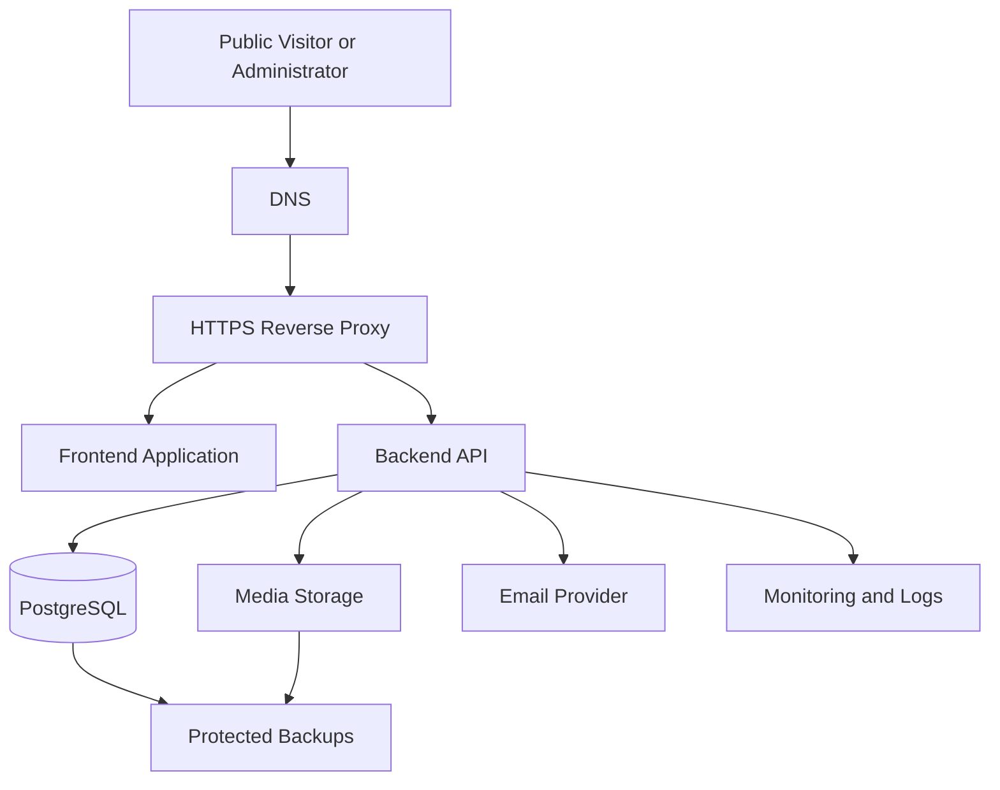

# Deployment and Maintenance Guide

## 1. Purpose

This document defines the deployment, configuration, release, monitoring, backup, recovery, and maintenance requirements for the Luxury Personal Portfolio website and its administrator dashboard.

The goal is to deploy the application consistently, protect production data, reduce downtime, and maintain a secure and reliable system throughout its lifecycle.

This document describes the intended operational process. Deployment instructions must be verified against the actual repository, environment variables, Docker configuration, CI/CD workflows, and hosting provider before production use.

## 2. Deployment Objectives

The deployment process must:

- Separate development, testing, staging, and production environments.
- Keep credentials and secrets outside source control.
- Build reproducible application artifacts.
- Apply database migrations safely.
- Use HTTPS in production.
- Restrict access to internal services.
- Provide application health checks and operational logs.
- Protect uploaded media and database backups.
- Support recovery from failed deployments.
- Verify critical public and administrative workflows after release.
- Keep dependencies and infrastructure maintained.
- Document operational responsibilities and known limitations.

## 3. System Architecture

The proposed production architecture is:



This is a logical architecture, not a statement that all components have already been deployed.

The exact hosting model may use containers, a virtual private server, managed services, or a combination of these.

## 4. Environments

### 4.1 Development

Purpose:

- Local implementation.
- Debugging.
- Unit and component testing.
- Local database integration.
- Feature development.

Use non-production credentials and data.

### 4.2 Testing

Purpose:

- Automated integration tests.
- End-to-end tests.
- Security tests.
- Database migration verification.
- Regression testing.

The test environment must be isolated from production data.

### 4.3 Staging

Where available, staging should resemble production sufficiently to verify:

- Production builds.
- HTTPS and cookie settings.
- Database migrations.
- Media storage.
- Authentication and CSRF behavior.
- Health checks.
- Deployment and rollback procedures.

### 4.4 Production

Production must use:

- HTTPS.
- Protected environment variables and secrets.
- Restricted database and cache access.
- Appropriate logging and monitoring.
- Verified backup and recovery procedures.
- Reviewed migrations.
- A tested release and rollback process.

Development defaults must not be copied into production without review.

## 5. Configuration and Environment Variables

Keep configuration outside application source code wherever practical.

Potential backend configuration includes:

| Variable | Purpose |
|---|---|
| `NODE_ENV` | Runtime environment |
| `PORT` | Backend listening port |
| `DATABASE_URL` | PostgreSQL connection |
| `SESSION_SECRET` | Session secret, at least 32 characters. Also derives the encryption key for stored MFA secrets; rotating it invalidates every enrolment, so administrators must enrol again |
| `FRONTEND_ORIGIN` | Permitted frontend origin |
| `CORS_ORIGIN` | CORS allowlist, if configured separately |
| `REDIS_URL` | Redis connection, if Redis is used |
| `SMTP_HOST` | Email server hostname |
| `SMTP_PORT` | Email server port |
| `SMTP_USER` | Email authentication username, if required |
| `SMTP_PASSWORD` | Email authentication password, if required |
| `MEDIA_STORAGE_PATH` | Local media-storage location, if applicable |
| `MEDIA_STORAGE_PROVIDER` | Configured media-storage provider, if supported |
| `LOG_LEVEL` | Application logging level |

The exact variable names must match the application implementation. Do not add unsupported variables merely because they appear in this document.

### 5.1 Configuration rules

- Provide `.env.example` with placeholder values only.
- Keep real `.env` files out of Git.
- Use separate credentials for development, testing, and production.
- Restrict access to production secret files.
- Rotate exposed credentials immediately.
- Validate required configuration during application startup.
- Fail safely when essential configuration is missing.
- Never expose backend secrets through frontend environment variables.

### 5.2 Frontend configuration

Only public configuration should be included in the frontend build.

For example, a frontend API base URL may be public configuration. Database credentials, session secrets, email passwords, and storage credentials must never be bundled into browser code.

## 6. Pre-Deployment Requirements

Before deploying a release:

1. Review the code changes.
2. Confirm that the required features are implemented.
3. Run formatting checks.
4. Run linting and type checking.
5. Run mandatory automated tests.
6. Build the frontend and backend.
7. Review dependency and security findings.
8. Verify environment-variable requirements.
9. Check database migration status.
10. Confirm backup availability before risky schema changes.
11. Review changes to authentication, authorization, and publication rules.
12. Prepare a rollback or recovery plan.
13. Confirm that the release can be deployed without exposing secrets.

Use `docs/11-testing-and-qa.md` as the release quality reference.

## 7. Build and Artifact Management

Build production artifacts using the project's declared scripts and lockfiles.

Requirements:

- Install dependencies reproducibly.
- Use the intended Node.js version.
- Run the configured production build.
- Avoid including development-only tools in production runtime images when practical.
- Keep build output separate from source files.
- Review generated assets for accidentally embedded secrets.
- Use consistent artifact versions for each release.
- Record the deployed commit or release identifier.

Do not assume that a build is successful until the actual build command exits successfully.

## 8. Docker Deployment

If the project uses Docker Compose, verify the actual Compose file and service configuration before deployment.

### 8.1 Service responsibilities

A deployment may include:

- Frontend service.
- Backend service.
- PostgreSQL.
- Redis, if required.
- Reverse proxy.
- Email testing service for development only.
- Monitoring services, if configured.

Not every service is mandatory in every deployment.

### 8.2 Development workflow

From the project root, inspect the available Compose configuration:

```bash
docker compose config --quiet
docker compose ps
```

To start services when the Compose configuration is valid:

```bash
docker compose up -d
```

To view service status:

```bash
docker compose ps
```

To inspect logs:

```bash
docker compose logs --tail=200
```

To follow a specific service, substitute its actual Compose service name:

```bash
docker compose logs -f backend
```

The service name `backend` is an example and must match the project's configuration.

### 8.3 Production container requirements

- Prefer maintained base images.
- Control image versions.
- Run as a non-root user where practical.
- Avoid privileged containers unless justified.
- Do not store secrets in image layers.
- Expose only required ports.
- Keep PostgreSQL and Redis private.
- Configure health checks where appropriate.
- Apply suitable resource limits.
- Persist database and media data outside disposable container layers.

### 8.4 Development versus production

Development Compose files may expose database ports, include test tools, or run development servers.

Production should use a separately reviewed configuration that restricts network exposure and disables development-only services.

Mail testing interfaces and local database administration tools must not be publicly exposed in production.

### 8.5 Render (PaaS) deployment

`render.yaml` at the repository root is a Render Blueprint for a single-origin production deployment: one free web service runs `Dockerfile.render`, which builds the API and the SPA into one container so the site and `/api` share the origin that the `SameSite=Lax` session cookie requires. Render's free tier does not let a free web service *receive* private-network requests, so the two-container nginx proxy cannot connect two free services; instead the API serves the built SPA itself (the same code path `docker-compose.prod.yml` uses when `../frontend/dist` exists), including cache parity with nginx: the HTML shell is `no-cache` and content-hashed `/assets/` files are immutable.

The blueprint provisions:

- `portfolio` — web service (Docker, `Dockerfile.render`, region set in the file and immutable after creation), health check `/api/health`, start command `npx prisma migrate deploy && node dist/index.js` so migrations run once per deploy (single instance, so no two instances can race).
- `portfolio-db` — free Render Postgres; `DATABASE_URL` is wired automatically from its connection string.
- `SESSION_SECRET` — generated by Render on first sync (256-bit). Do not rotate it after the first deploy: rotation invalidates every session and makes stored TOTP secrets undecryptable (`docs/10-security.md` §5.5).
- `TRUST_PROXY=true` — the Render edge terminates TLS and sets `X-Forwarded-For`; the API trusts that single hop for per-client rate limiting.

Status: the blueprint, image, and seeding procedure are committed and the production image is verified locally (§32.3), but no Render service has been created yet, so there is no live URL.

First deployment:

1. Commit and push the repository, including `render.yaml`, `Dockerfile.render`, and `.dockerignore`.
2. Render Dashboard → **New → Blueprint** → authorize the GitHub repository. Review the region before creating it; it cannot be changed later.
3. Wait for the first build. The API applies migrations on start and the `/api/health` check must pass before the service is live.
4. Seed the owner account — there is no public registration endpoint:

   ```bash
   DATABASE_URL='<External Database URL, with ?sslmode=require>' \
     ADMIN_EMAIL='you@example.com' ADMIN_PASSWORD='at least 12 characters' \
     npm --prefix backend run create-admin
   ```

   `dotenv` never overrides an existing `DATABASE_URL`, so the local script provisions the remote database. Use the database's **External** connection string, because the Internal one is only reachable inside Render's network; add `?sslmode=require` if Prisma rejects the connection. Run this from your own machine rather than the service Shell: Shell access requires a paid compute plan. From a paid service Shell the equivalent is `ADMIN_EMAIL=... ADMIN_PASSWORD=... node dist/scripts/create-admin.js`.

5. Open the service URL, sign in at `/admin`, and confirm the overview renders (Step 5 smoke test).

After the first deploy:

- Every push to `main` redeploys automatically (Render's default `commit` trigger).
- Confirm the readiness probe from outside Render (`curl -sS -o /dev/null -w '%{http_code}\n' https://<host>/api/ready`) and point the uptime monitor and alert channel at it (§17.2). The platform health check stays on `/api/health`.
- Rollback: restore a previous deploy from the Render dashboard, or revert the commit. Database rollback follows §9.4.

Free-plan limitations, deliberate and documented. The vendor policies below were checked against Render's own free-tier documentation in October 2026; re-check them before relying on the free plan, because they change:

**The free tier is a preview, not production.** Render states that free instances have important limitations and should not be used for production applications. For a portfolio that has to stay up and keep its data, budget for a paid web service and a paid database.

- **The free database expires 30 days after creation.** An expired database is inaccessible unless it is upgraded to a paid plan; a 14-day grace period follows, after which Render deletes the database and all of its data. Render emails you as the expiry and the grace period approach. For a portfolio with content in it, this is the limitation that matters most: upgrade before the deadline (or take an export with `pg_dump` first) or lose the content.
- A workspace can run only one free Render Postgres database, capped at 1 GB, with no backups and no managed connection pooling.
- Instances spin down after roughly 15 minutes without traffic, so the first request after idle is slow (about a minute) and the dashboard shows a loading page. A paid plan keeps instances warm; the readiness probe is what tells you the service is available again.
- Uploaded media lives on the container filesystem, which is ephemeral: uploads are lost on every redeploy, restart, and spin-down, and free services cannot attach a persistent disk. Database-backed content survives. Treat the media library as replaceable until the service is on a paid plan with a disk mounted at `MEDIA_ROOT` (`/app/backend/storage/media`), or move uploads to object storage later.
- No Shell access (SSH or dashboard) on a free web service, which is why the owner account is seeded from your machine (step 4).
- While a service is spun down, requests to `/robots.txt` receive an automatic "disallow all" response that never reaches the service. Crawlers can therefore see a temporarily deindexed site during idle periods; a paid instance removes this behaviour (see the indexing limitation in `docs/06-frontend-architecture.md` §15).
- 750 free instance hours per workspace each month, plus included bandwidth and build minutes. Exceeding them suspends free services until the next month unless a payment method is on file; Render emails you before that happens.
- Supported on free web services and worth using: custom domains, managed TLS certificates, log streams, and rollbacks to the two most recent deploys.
- No CDN and no generated image variants (`docs/14`).

## 9. Database Deployment and Migrations

The application uses PostgreSQL with Prisma as the proposed database access layer.

### 9.1 Before migration

- Confirm the target database.
- Verify migration files are committed.
- Review schema changes.
- Check whether the migration is destructive.
- Confirm a recent restorable backup exists when necessary.
- Verify database credentials have the required privileges.
- Test the migration against a representative non-production database.

### 9.2 Migration execution

Use the Prisma CLI version and scripts declared by the actual project.

For projects configured to use Prisma Migrate, a typical production command is:

```bash
npx prisma migrate deploy
```

Run it from the directory containing the correct Prisma configuration and schema, with the intended production environment configured.

Do not use development migration commands against production unless the project's documented procedure explicitly requires them.

### 9.3 After migration

Verify:

- The migration completed successfully.
- The application can connect to the database.
- Required tables and constraints exist.
- Application health checks pass.
- Core public endpoints work.
- Administrative authentication still works.
- Content CRUD operations remain functional.

### 9.4 Schema compatibility

Prefer migration sequences that allow the running application to operate safely during deployment where possible.

For changes requiring multiple releases, consider an expand-and-contract strategy:

1. Introduce compatible schema changes.
2. Deploy code that supports the transition.
3. Migrate or backfill data.
4. Verify the new behavior.
5. Remove obsolete schema elements in a later release.

Database rollback is not always equivalent to application rollback. Some schema or data changes may be irreversible without restoring a backup.

## 10. HTTPS, DNS, and Reverse Proxy

Production traffic should use HTTPS.

Requirements:

- Configure the production domain and DNS records.
- Use valid TLS certificates.
- Redirect HTTP to HTTPS where appropriate.
- Configure certificate renewal.
- Set suitable security headers.
- Restrict allowed hostnames.
- Configure proxy headers correctly.
- Trust forwarded headers only from known reverse proxies.
- Configure request-size and timeout limits.
- Ensure secure session-cookie settings work through the proxy.

Do not enable `Secure` cookie behavior in a way that accidentally breaks local development; maintain separate environment configurations.

## 11. Backend Deployment

The backend must be deployed with the intended runtime configuration.

### Requirements

- Use the supported Node.js version.
- Install production dependencies correctly.
- Configure environment variables.
- Apply database migrations according to the release plan.
- Start the application using the production script.
- Expose only the required API interface.
- Configure graceful shutdown where supported.
- Handle termination signals.
- Ensure in-flight requests and database connections are handled safely.
- Provide a health-check endpoint with appropriately limited information.

The backend should not expose stack traces, database credentials, internal paths, or secret configuration through health checks or API responses.

## 12. Frontend Deployment

The frontend should be built for production and served using the configured hosting platform or web server.

Requirements:

- Use the production build command declared by the project.
- Configure the correct API base URL.
- Verify route handling and deep links.
- Ensure static assets use suitable caching rules.
- Avoid caching private administrative responses publicly.
- Verify that frontend bundles contain no backend secrets.
- Configure security headers.
- Confirm that the public portfolio and admin dashboard routes load correctly.

If the frontend and API use different origins, verify CORS, cookie, and CSRF configuration against the actual deployment architecture.

## 13. Media Storage Operations

The media-storage design may use local persistent storage or an external object-storage provider.

The actual implementation must determine which approach is supported.

### Operational requirements

- Persist required media across container recreation.
- Protect private files.
- Ensure public media URLs behave as intended.
- Restrict upload permissions.
- Monitor available storage.
- Back up media where required.
- Verify media restoration.
- Avoid deleting referenced assets.
- Document how storage credentials are rotated.

If media files are stored separately from PostgreSQL, the backup and recovery process must cover both systems.

## 14. Email and External Integrations

If email delivery is configured:

- Use the intended production SMTP or email provider.
- Keep credentials secret.
- Verify sender and recipient configuration.
- Monitor delivery failures where possible.
- Handle temporary provider outages.
- Avoid logging authentication credentials.
- Use timeouts and safe retry behavior.

Development-only services such as Mailpit must remain isolated from production.

If other external integrations are introduced, document their credentials, permissions, failure modes, and recovery procedures.

## 15. CI/CD Pipeline

Use the repository's actual workflow configuration.

A typical pipeline includes:

1. Checkout the intended commit.
2. Install dependencies from lockfiles.
3. Run formatting checks.
4. Run linting and type checking.
5. Run unit and component tests.
6. Run API integration tests.
7. Build frontend and backend.
8. Run configured dependency and security scans.
9. Build and scan container images where applicable.
10. Run selected end-to-end tests.
11. Publish versioned artifacts.
12. Deploy to staging.
13. Run staging smoke tests.
14. Obtain any required production approval.
15. Deploy production.
16. Run production smoke tests.

### CI/CD security

- Use least-privilege workflow permissions.
- Protect deployment credentials.
- Avoid exposing production secrets to untrusted pull requests.
- Protect production environments.
- Review third-party workflow actions.
- Avoid deploying when required checks fail.
- Keep build and deployment logs free of secrets.

Not every pipeline stage must run on every commit, but mandatory release gates must be enforced.

## 16. Release and Deployment Procedure

### Step 1 — Prepare

- Identify the release commit.
- Review changes.
- Confirm required tests pass.
- Review migration and configuration changes.
- Confirm backup and recovery readiness.

### Step 2 — Build

- Build the production frontend.
- Build the backend.
- Create versioned deployment artifacts.
- Record the commit or release identifier.

### Step 3 — Prepare the database

- Confirm the target database.
- Review migration status.
- Take or verify an appropriate backup.
- Apply migrations according to the approved sequence.

### Step 4 — Deploy

- Deploy the intended backend and frontend versions.
- Apply configuration changes.
- Confirm services start successfully.
- Verify liveness (`/api/health`) and readiness (`/api/ready`).

### Step 5 — Smoke test

Verify:

- Public homepage loads.
- Public project pages load.
- Public API returns eligible content only.
- Administrator login works.
- Protected dashboard routes work.
- A safe test content operation works where appropriate.
- Contact submission behaves correctly.
- Media delivery works.
- No critical error appears in logs.

### Step 6 — Monitor

Monitor errors, service availability, database behavior, and any relevant integration failures.

### Step 7 — Record

Document:

- Release identifier.
- Deployment time.
- Migration status.
- Smoke-test result.
- Known issues.
- Rollback or follow-up actions.

## 17. Health Checks and Monitoring

Where supported, monitor:

- Backend availability.
- Database connectivity.
- Media storage availability.
- Email integration health.
- Error rates.
- Request latency.
- Resource utilization.
- Disk space.
- Container restarts.
- Background-job failures, if jobs exist.

Health endpoints should disclose only the minimum information needed for the intended consumer.

Use separate readiness and liveness checks when the deployment platform benefits from that distinction.

Monitoring thresholds must be based on expected workload and actual infrastructure rather than invented performance guarantees.

### 17.1 Implemented probes

| Endpoint | Consumer | Reports |
| --- | --- | --- |
| `GET /api/health` | Platform liveness | `200 {"status":"ok"}`. Answers whether the process is up and checks no dependencies. |
| `GET /api/ready` | Readiness, uptime monitors, alerting | `200 {"status":"ok","checks":{"database":true,"storage":true}}` when it can serve; `200` with `"degraded"` when the media volume is not writable; `503` with `"error"` when the database does not answer. |

`backend/src/services/readiness.service.ts` implements the probe and `backend/src/routes/admin/index.ts` keeps the operator-facing detail in the owner-only health panel (`GET /api/admin/health`), which reports the database round trip, the session table, the media directory, and unfinished migrations.

The database gates readiness because no route can serve without it. Media storage is reported but does not gate: a full or read-only volume degrades uploads without taking the public site down, so the probe answers `200` and an alert watches the `degraded` status. Both probes are public and disclose two booleans — no hosts, paths, versions, timings, or error text.

The Render blueprint keeps the platform health check on `/api/health` and lets an external monitor watch `/api/ready`. Either way works once the database is reachable before the service starts, which the start command already guarantees (`prisma migrate deploy` runs first). Keeping the platform check on liveness is the safer default for a single instance: a readiness failure then raises an alert instead of a restart loop that cannot fix the dependency.

### 17.2 Alerting

Alerting is configured in the hosting platform and the monitoring service, not in this application: the application exposes the probes and the audit trail and holds no notification credentials. Reachability is confirmed per environment with, for example, `curl -sS -o /dev/null -w '%{http_code}\n' https://<host>/api/ready`.

Wire these before the site is announced:

| Signal | Source | Why it matters |
| --- | --- | --- |
| API unreachable | Uptime monitor on `/api/ready`, from at least two regions | The site is down for visitors. |
| Database unreachable | `/api/ready` returning `503` | Every route fails; uploads, sessions, and the admin area are unavailable. |
| Media volume not writable or full | `/api/ready` returning `200` with `"degraded"` | Uploads silently fail while pages still render; disk usage on the host is the usual cause. |
| Failed deploys | Platform notifications (Render → Settings → Notifications) | A release did not reach production. |
| Repeated restarts | Platform service events | The container is crash-looping. |
| Unexpected 5xx responses | Platform logs, or a log drain to an alerting service | An application defect is failing requests; the log entry carries the stack, not the request body. |
| Repeated sign-in failures | Owner dashboard → sign-in monitoring (`GET /api/admin/login-monitoring`) | A credential-stuffing attempt against the admin area. |
| TLS certificate expiry | Platform edge (Render manages certificates) | Visitors reach an insecure site. |
| Database and disk size | Platform metrics | The plan limit is the next outage. |

Set the actual thresholds from the workload observed in the first weeks of operation rather than from assumed traffic. Deliver alerts to a channel the operator actually reads, and restrict monitoring dashboards and alert channels to the accounts that need them.

A readiness failure that outlives a restart points at the dependency, not the API: check the database service first, then the media volume, then the deploy history. The owner-only health panel is the fastest way to see which dependency is unhealthy without shell access.

## 18. Logging and Audit Operations

### Application logs

Retain relevant operational information for debugging and incident response.

### Security audit logs

Where implemented, audit records should cover relevant administrator actions, publication changes, settings changes, and security-sensitive operations.

### Log safety

- Never log passwords or session cookies.
- Avoid logging secret tokens.
- Minimize unnecessary personal information.
- Restrict log access.
- Define retention periods.
- Protect logs against unauthorized alteration where required.
- Review repeated failures and unusual patterns.

Operational logs and application audit records serve different purposes and should not be treated as interchangeable.

## 19. Backup Strategy

Backups must be designed around the actual data-loss tolerance and recovery requirements.

### 19.1 What to back up

Depending on the deployment:

- PostgreSQL database.
- Uploaded media.
- Required application configuration.
- Deployment and migration metadata.
- Other persistent application data.

Do not back up transient build artifacts unless the deployment process requires them.

### 19.2 Backup protection

- Encrypt backups where appropriate.
- Restrict backup access.
- Use separate backup credentials.
- Store backups separately from the primary system where practical.
- Define retention periods.
- Monitor failed backup jobs.
- Avoid storing production secrets in unsecured backup locations.

### 19.3 Example PostgreSQL backup

The following is an illustrative command for a PostgreSQL database. Adapt the database name, user, authentication method, and output path to the actual environment.

```bash
pg_dump \
  --format=custom \
  --no-owner \
  --no-acl \
  --dbname="$DATABASE_URL" \
  --file="portfolio-backup.dump"
```

Protect the output file because it may contain private application data.

Avoid putting database passwords directly in command-line arguments or shell history.

### 19.4 Example restore

A custom-format dump can typically be restored using `pg_restore` into an appropriately prepared target database.

```bash
pg_restore \
  --no-owner \
  --no-acl \
  --dbname="$RESTORE_DATABASE_URL" \
  portfolio-backup.dump
```

Restore behavior depends on the target database state, extensions, roles, schema ownership, and migration requirements.

Test restoration in a controlled environment before relying on it during an incident. Do not run destructive restore commands against production without an approved recovery procedure.

## 20. Recovery and Disaster Planning

Define recovery objectives appropriate to the project.

- **Recovery Point Objective (RPO):** the maximum acceptable amount of data loss measured in time.
- **Recovery Time Objective (RTO):** the target time to restore service.

The actual values must be chosen based on hosting, backup frequency, storage, and business requirements.

### Recovery procedure

1. Identify the failure and affected components.
2. Prevent further damage where possible.
3. Preserve relevant logs and evidence.
4. Determine whether the issue is application, database, storage, or infrastructure related.
5. Restore the required infrastructure or data.
6. Apply compatible application configuration.
7. Verify database and media consistency.
8. Run health checks and smoke tests.
9. Restore public service.
10. Document the incident and follow-up work.

A database restore may need a matching media restore to avoid broken project images or missing assets.

## 21. Rollback Strategy

A rollback plan must exist before risky releases.

### Application rollback

Where compatible, redeploy the previous known-good frontend and backend artifacts.

### Database rollback

Do not assume that rolling back application code automatically rolls back the database.

Before a migration:

- Review backward compatibility.
- Determine whether the migration is reversible.
- Confirm a restorable backup when required.
- Plan for data transformations.
- Identify whether forward-fixing is safer than restoring.

### Rollback triggers

Consider rollback or immediate mitigation when:

- Core public routes fail.
- Administrator authentication is broken.
- Unauthorized access is detected.
- Data integrity is compromised.
- Critical API operations fail.
- A migration causes serious operational problems.
- Error rates or service availability exceed approved thresholds.

The decision must account for data integrity and the risks of restoring older application code against a newer schema.

## 22. Security Maintenance

Follow `docs/10-security.md`.

Routine tasks include:

- Review dependency advisories.
- Apply supported security updates.
- Rotate credentials when required.
- Review administrator access.
- Check HTTPS and certificate renewal.
- Verify security headers.
- Review rate-limit configuration.
- Review access and audit logs.
- Check storage permissions.
- Verify that development services are not exposed publicly.
- Review CI/CD permissions and secrets.

Security checks must be repeated after major architecture or authentication changes.

## 23. Application and Dependency Maintenance

### Routine maintenance

- Update dependencies using a controlled process.
- Review release notes for major updates.
- Run regression tests after updates.
- Rebuild production artifacts.
- Review database query performance.
- Remove unused dependencies.
- Keep the supported runtime version current.
- Update documentation when operational procedures change.

### Dependency update procedure

1. Create a controlled update branch.
2. Update the intended dependency.
3. Run relevant tests.
4. Run dependency and security checks.
5. Review breaking changes.
6. Build the application.
7. Deploy to staging where available.
8. Verify the affected functionality.
9. Merge and release after approval.

Do not apply major dependency updates directly to production without testing.

## 24. Database and Storage Maintenance

Monitor:

- Database availability.
- Disk usage.
- Connection usage.
- Slow queries.
- Index effectiveness.
- Failed migrations.
- Backup completion.
- Media-storage usage.
- Orphaned media references where detectable.

Run cleanup tasks only after verifying their scope and consequences.

Do not manually delete production files or database records to free space without understanding their relationships and recovery implications.

## 25. Scheduled Maintenance Checklist

### Daily or automated checks

- Review critical application alerts.
- Check service availability.
- Check backup-job results where configured.
- Investigate unexpected application errors.

### Weekly

- Review dependency and security alerts.
- Check disk and storage capacity.
- Review relevant authentication failures.
- Verify that monitoring and alerting still work.

### Monthly

- Review administrator access.
- Verify backup restoration according to the recovery plan.
- Review dependency updates.
- Inspect operational documentation.
- Review unresolved defects and security exceptions.

### Periodically

- Test disaster recovery.
- Review retention policies.
- Review deployment permissions.
- Reassess recovery objectives.
- Review the threat model and incident-response procedure.

The schedule should be adapted to the actual hosting environment, workload, and operational risk.

## 26. Content and SEO Maintenance

Because the public portfolio uses dynamic content, maintenance should include:

- Review published project details and links.
- Check for broken external links.
- Verify profile and contact information.
- Review image quality and alternative text.
- Check page titles and meta descriptions.
- Verify canonical URLs and sitemap behavior where configured.
- Ensure unpublished content remains excluded from public pages.
- Review media that is no longer referenced.
- Confirm that public pages reflect successful administrative changes.

Do not assume that every change requires a frontend rebuild. The need for rebuilding or cache invalidation depends on the application's rendering and caching strategy.

## 27. Incident Response

For a suspected production incident:

1. Assess the severity and scope.
2. Protect users and data from further harm.
3. Restrict or revoke compromised access.
4. Rotate exposed credentials.
5. Preserve relevant logs and evidence.
6. Restore service using the approved recovery process.
7. Verify data integrity and security.
8. Communicate the incident to the appropriate stakeholders.
9. Record root cause and remediation.
10. Improve monitoring, controls, and documentation.

For suspected data exposure, follow applicable legal and organizational reporting obligations.

## 28. Operational Documentation

Keep the following documentation current:

- Environment-variable reference.
- Deployment procedure.
- Database migration procedure.
- Backup and restore instructions.
- Incident-response process.
- Rollback procedure.
- Service and health-check reference.
- Dependency update process.
- Known operational limitations.
- Release notes and migration history.

Never store live credentials or secret tokens in documentation.

## 29. Release Completion Checklist

### Build and configuration

- [ ] Production build succeeds.
- [ ] Environment variables are validated.
- [ ] Secrets are protected.
- [ ] Production dependencies and runtime versions are verified.
- [ ] Required services start correctly.

### Database and media

- [ ] Migrations have been reviewed and applied.
- [ ] Database connectivity works.
- [ ] Backup availability is verified where required.
- [ ] Media storage is persistent and accessible.
- [ ] Restore procedures are documented.

### Security

- [ ] HTTPS works.
- [ ] Session-cookie settings are appropriate.
- [ ] CORS and CSRF settings are verified.
- [ ] Database and cache are not unnecessarily exposed.
- [ ] Administrative authorization works.
- [ ] Draft and private data remain protected.

### Functional verification

- [ ] Public homepage loads.
- [ ] Published project content loads.
- [ ] Admin login and logout work.
- [ ] Critical admin operations work.
- [ ] Contact submission and inbox behavior work.
- [ ] Media delivery works.
- [ ] Error logs show no unresolved critical failures.

### Operations

- [ ] Health checks work where configured.
- [ ] Monitoring and alerts are reviewed.
- [ ] Rollback procedure is available.
- [ ] Release details are recorded.
- [ ] Known issues are documented.

## 30. Definition of Done

A deployment is complete when:

- The intended release has been deployed.
- Required migrations have completed successfully.
- Services are healthy.
- Public and administrative smoke tests pass.
- Security configuration has been verified.
- Persistent data and media remain accessible.
- Monitoring is functioning where configured.
- Backup and recovery arrangements are documented.
- Deployment results and known issues are recorded.

The application must not be described as production-ready until the relevant checks have actually been performed.

## 31. Media Storage Operations (Implemented)

Uploaded portraits are stored on disk under `MEDIA_ROOT`; only metadata and references live in PostgreSQL.

| Variable | Default | Purpose |
|---|---|---|
| `MEDIA_ROOT` | `storage/media` (relative to `backend/`) | Directory for uploaded image bytes |
| `MEDIA_MAX_BYTES` | `8388608` (8 MiB) | Per-file upload limit, enforced by the parser |

Operational requirements:

- Create the directory before the first upload; the API creates it recursively on demand with owner-only permissions.
- The directory must be persistent and included in backups. Losing it leaves database rows pointing at missing files, so the public endpoint then falls back gracefully but the portrait is gone.
- Do not place the directory inside the built SPA output or any web-server document root. Files are served only through the API, and only for the currently published asset.
- The storage interface is provider-neutral, so a future object-storage adapter can replace local disk without changing the API or admin UI.
- Retention: superseded and removed assets are deleted automatically once unreferenced. No scheduled cleanup job exists yet; abandoned files are limited to uploads whose request failed before the database write, which the storage service deletes on failure.
- Verify after deployment: sign in, upload a portrait, confirm the draft is not public, publish, confirm the homepage image loads, then restore the previous portrait if needed.

## 32. Containers, CI, and Reverse Proxy (Implemented)

| File | Purpose |
|---|---|
| `backend/Dockerfile` | Multi-stage API image: `npm ci`, `prisma generate`, `tsc`, then a non-root runtime on `node:24-alpine`. Media lives at `/app/storage/media`; the health check calls `/api/health`. |
| `frontend/Dockerfile` | Builds the SPA with `npm run build` and serves `dist` from `nginx:1.29-alpine`. |
| `frontend/nginx.conf` | Single-origin reverse proxy: `/api/` → `api:4000`, SPA history fallback, immutable asset caching, revalidated HTML, security headers, 9 MB request cap. |
| `docker-compose.prod.yml` | `db` (PostgreSQL 18), `api`, `web`, plus named volumes for database data and uploaded media. |
| `Dockerfile.render` | Single-container production image for the Render blueprint: the API and the built SPA in one image, so the site and `/api` share an origin. |
| `render.yaml` | Render Blueprint: one web service on `Dockerfile.render`, one managed PostgreSQL database, and the environment variables wiring them together (§8.5). |
| `.github/workflows/ci.yml` | Continuous integration; see `docs/11-testing-and-qa.md` §24.1. |

### 32.1 Running the stack

```bash
POSTGRES_PASSWORD=... SESSION_SECRET=<at-least-32-characters> \
  PUBLIC_ORIGIN=https://example.com \
  docker compose -f docker-compose.prod.yml up -d --build
```

- Only `web` publishes a port (`WEB_PORT`, default `8080`). PostgreSQL and the API are reachable only on the Compose network.
- `FRONTEND_ORIGIN` defaults to `PUBLIC_ORIGIN`. With one origin CORS becomes a no-op, but keep the value accurate: it documents where the SPA is served.
- `TRUST_PROXY=true` lets the API read `X-Forwarded-*`. nginx overwrites `X-Forwarded-For` with the peer address and forwards `X-Forwarded-Proto`, so rate limiting sees the real client and secure cookies see the real scheme.
- Sessions use `Secure` cookies whenever `NODE_ENV=production`. Terminate TLS in front of `web` (or add a `443` server block); signing in over plain HTTP against this stack does not work by design.
- Migrations: `api` runs `prisma migrate deploy` before `node dist/index.js`. That is safe for a single instance; for several replicas, run migrations as a separate release step and drop the prefix from the command.
- Persistent state: `portfolio-db` holds PostgreSQL data (mounted at `/var/lib/postgresql`, the versioned layout PostgreSQL 18+ expects) and `portfolio-media` holds uploaded files. Back both up together. Removing either volume loses content.
- The runtime image runs as the unprivileged `node` user (uid 1000). A bind-mounted media directory must be writable by that uid.

### 32.2 What CI enforces

`ci.yml` runs four jobs on every push to `main` and every pull request, with read-only repository permissions and superseded runs cancelled:

- **Backend:** `npm ci`, `prisma generate`, `tsc` for source and tests, the full Vitest suite against a throwaway PostgreSQL 18 service on port 5433, then `tsc` build output.
- **Frontend:** `npm ci`, `oxlint`, the Vitest unit-test suite, and the production build (`tsc -b && vite build`).
- **End-to-end:** a second PostgreSQL service, migrations plus `create-admin`, the API and Vite dev server started in the background, then `npm run verify` — the production build, `verify:homepage` against `vite preview`, and `verify:admin`, with Chromium installed by Playwright. This job needs no external credentials because the verifiers are non-destructive and create their own fixtures.
- **Containers:** all three images must build (`backend/`, `frontend/`, and the single-container `Dockerfile.render`).

### 32.3 Production image smoke test

The Render image can be verified locally against a throwaway database before any account is involved. The commands below were run against `Dockerfile.render` on commit `b7af3f8`; the results are the observed ones, not expectations:

```bash
# 1. Throwaway database, so nothing in the development data is touched.
docker exec portfolio-db psql -U portfolio -d postgres -c 'CREATE DATABASE portfolio_prodcheck'

# 2. The image CI builds, run the way render.yaml runs it.
docker build --file Dockerfile.render --tag portfolio-render:local .
docker run -d --name portfolio-prodcheck -p 4100:4100 \
  -e NODE_ENV=production -e PORT=4100 \
  -e DATABASE_URL='postgresql://portfolio:<password>@host.docker.internal:5433/portfolio_prodcheck?schema=public' \
  -e SESSION_SECRET='<at-least-32-characters>' -e TRUST_PROXY=true \
  -e MEDIA_ROOT=/app/backend/storage/media \
  portfolio-render:local sh -c 'npx prisma migrate deploy && node dist/index.js'
```

Observed: migrations applied on start, then `API listening on http://localhost:4100 (production)`. Against that container:

| Check | Result |
| --- | --- |
| `GET /api/ready` | `200 {"status":"ok","checks":{"database":true,"storage":true}}` |
| `GET /api/health` | `200 {"status":"ok"}` |
| `GET /` | `200 text/html` with the built shell and its hashed `/assets/` bundle |
| `GET /about` | `200` with the same shell: client-side routes fall back to it |
| `GET /assets/<hashed>.js` | `Cache-Control: public, max-age=31536000, immutable` |
| `GET /api/profile` | `200 {"profile":null}` on the empty database |
| `GET /api/does-not-exist` | `404 {"error":"not_found"}`, not the SPA shell |
| `GET /api/admin/overview` without a session | `401 {"error":"unauthorized"}` |
| Sign-in with `X-Forwarded-Proto: https` | `200` and `Set-Cookie: portfolio.sid=…; Path=/; HttpOnly; Secure; SameSite=Lax` |
| The same session against `/api/admin/overview` and `/api/admin/health` | `200`, with database, session store, and media all `ok` |
| Sign-in over plain HTTP with no forwarded scheme | no session cookie at all: express-session does not send a `Secure` cookie on an insecure connection |

The last two rows are the reason TLS must terminate in front of the service: the application is deliberately unusable for administrative work over plain HTTP, and Render's edge supplies the `X-Forwarded-Proto: https` that `TRUST_PROXY=true` trusts.

Clean up afterwards with `docker rm -f portfolio-prodcheck` and `docker exec portfolio-db psql -U portfolio -d postgres -c 'DROP DATABASE portfolio_prodcheck'`.

## 33. Related Documentation

- `README.md` — Project setup and overview.
- `docs/01-project-overview.md` — Product scope.
- `docs/02-portfolio-requirements.md` — Public website requirements.
- `docs/03-design-system.md` — Design system.
- `docs/04-animation-guidelines.md` — Motion guidelines.
- `docs/05-system-architecture.md` — System architecture.
- `docs/06-frontend-architecture.md` — Frontend architecture.
- `docs/07-backend-api.md` — API contracts.
- `docs/08-database-schema.md` — Database schema.
- `docs/09-admin-dashboard.md` — Admin functionality.
- `docs/10-security.md` — Security requirements.
- `docs/11-testing-and-qa.md` — Testing and release quality.
- `docs/13-admin-advanced-features.md` — Optional advanced admin capabilities.
- `docs/14-dynamic-content-and-media-management.md` — Dynamic content and media workflows.
