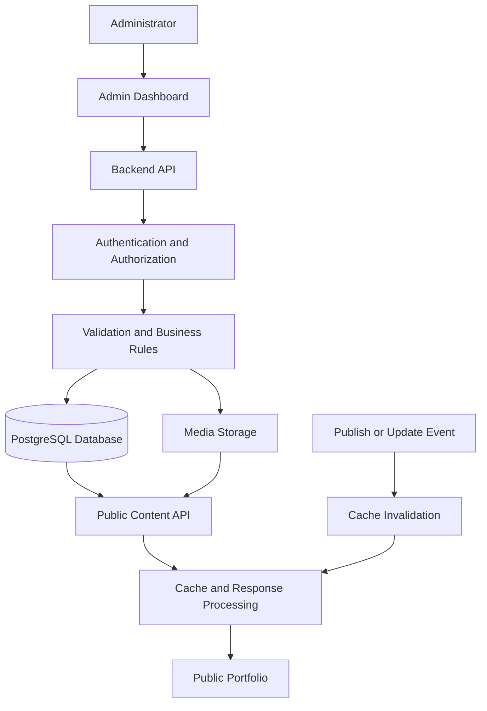

# Dynamic Content and Media Management

## 1. Purpose

This document defines how portfolio content and media move through the system, from administrative input and database storage to the public website.

The system must allow an authorized administrator to manage portfolio content through the Admin Dashboard without requiring code changes for routine content updates.

The public portfolio must retrieve approved content through the backend API. It must not access the database directly or expose unpublished, deleted, or otherwise restricted content.

This document extends:

- `docs/02-portfolio-requirements.md`
- `docs/05-system-architecture.md`
- `docs/07-backend-api.md`
- `docs/08-database-schema.md`
- `docs/09-admin-dashboard.md`
- `docs/10-security.md`
- `docs/11-testing-and-qa.md`
- `docs/12-deployment-and-maintenance.md`
- `docs/13-admin-advanced-features.md`

**Implementation rule:** This document defines expected behaviour. It does not mean every described feature is already implemented. The actual database schema, API contracts, storage configuration, and tested code are the source of truth.

## 2. Core Principles

1. Portfolio content is managed through authorized administrative interfaces.
2. Public content is retrieved through documented backend APIs.
3. Only content meeting the publication rules is publicly visible.
4. Draft previews require authorization and must not become publicly accessible.
5. Uploaded files are validated on the server.
6. Media ownership and content relationships are verified before use.
7. Images are optimized without compromising acceptable visual quality.
8. Deleting content must not accidentally delete media still in use.
9. Caching must not cause unpublished or outdated content to remain publicly visible.
10. Content and media failures must produce graceful, accessible UI states.
11. Personal information and administrative data must not be exposed through public responses.
12. All changes must be testable, maintainable, and documented.

## 3. System Overview

The content-management flow is:



The backend coordinates content validation, publication rules, media relationships, and access control.

The public frontend receives only the fields it needs to render the portfolio.

## 4. Content Types

The initial portfolio may support the following content types.

| Content type | Typical fields | Public visibility |
|---|---|---|
| Profile | Name, biography, professional title, portrait | Published profile fields |
| Projects | Title, description, technologies, links, images | Published projects |
| Project categories | Name, slug, description, display order | Categories used by public content |
| Skills | Name, proficiency label, display order | Approved public skills |
| Skill categories | Name, slug, display order | Categories used by public content |
| Experience | Role, organization, dates, description | Published entries |
| Education | Institution, qualification, dates | Published entries |
| Certifications | Name, issuer, issue date, credential URL | Published entries |
| Homepage content | Hero text, introduction, featured sections | Approved settings |
| SEO metadata | Page title, description, social image | Approved public metadata |
| Media assets | File metadata, storage key, alternative text | Assets permitted for public use |

The actual field definitions must match `docs/08-database-schema.md`.

Do not add fields solely because they appear in this document. Confirm their purpose, validation rules, privacy implications, and schema requirements first.

## 5. Content Lifecycle

### 5.1 Content States

The application must define explicit publication states rather than relying on inconsistent boolean fields across the frontend.

A possible lifecycle is:

- **Draft:** Editable content that is not publicly visible.
- **Published:** Content approved for public display.
- **Unpublished:** Previously published content that is no longer public.
- **Trashed:** Content removed from normal administrative lists and excluded from public responses.

Scheduled publishing may be added as an optional capability, as described in `docs/13-admin-advanced-features.md`.

The final state model must match the actual database design.

### 5.2 Create and Edit Workflow

1. An authorized administrator opens the appropriate editor.
2. The frontend loads the existing content or an empty form.
3. The administrator enters content and selects permitted media.
4. The frontend performs basic validation for usability.
5. The backend independently validates the request.
6. The backend checks authentication, authorization, and related records.
7. The database transaction saves the content.
8. The backend returns the documented response.
9. The frontend displays the result and updates its relevant state.
10. If public content changed, the system invalidates or refreshes affected cached data.

Frontend validation improves usability but does not replace server-side validation.

### 5.3 Publishing Workflow

Before publishing, the backend should verify:

- Required fields are present.
- The content has a valid publication state.
- Slugs and unique values do not conflict.
- Required relationships exist.
- Referenced media is valid and available.
- Required alternative text is supplied for meaningful images.
- URLs meet the application's validation rules.
- The administrator has permission to publish the content.

When publication succeeds:

1. The database state is updated.
2. The change is recorded in the audit system when required.
3. Relevant caches are invalidated or refreshed.
4. Public API responses begin reflecting the new state.
5. The administrator receives a clear success or failure message.

Where content updates and audit events must be consistent, use a transaction or a reliable event-delivery mechanism.

### 5.4 Unpublishing

Unpublishing must remove the content from public API results.

The backend must also consider:

- Cached API responses.
- Cached HTML or page output.
- Featured project collections.
- Category counts and related content.
- Public sitemap entries.
- Search indexes, if used.
- Social preview or generated metadata caches.

The system must not rely only on hiding a card in the frontend.

## 6. Public API Behaviour

### 6.1 API Responsibilities

Public endpoints should return only content intended for public display.

Possible endpoints include:

- `GET /api/v1/public/profile`
- `GET /api/v1/public/projects`
- `GET /api/v1/public/projects/:slug`
- `GET /api/v1/public/project-categories`
- `GET /api/v1/public/skills`
- `GET /api/v1/public/skill-categories`
- `GET /api/v1/public/experience`
- `GET /api/v1/public/education`
- `GET /api/v1/public/certifications`
- `GET /api/v1/public/site-settings`

These are proposed endpoint names. Use the actual routes defined in `docs/07-backend-api.md`.

### 6.2 Publication Filtering

Public database queries must apply publication rules on the server.

Conceptually:

```ts
const projects = await prisma.project.findMany({
  where: {
    status: "PUBLISHED",
    deletedAt: null,
  },
  orderBy: [
    { displayOrder: "asc" },
    { createdAt: "desc" },
  ],
});
```

This is illustrative Prisma code, not a guaranteed drop-in implementation. Field names, enum values, soft-deletion support, and ordering rules must match the real schema.

If the schema uses a different publication model, apply the equivalent conditions consistently.

### 6.3 Response Minimization

Public responses must not include:

- Administrator account information.
- Password hashes.
- Session records or session identifiers.
- Internal audit data.
- Draft content.
- Private contact messages.
- Internal storage credentials.
- Internal error details.
- Private administrative notes.

Use explicit response DTOs or equivalent serialization rules rather than returning unrestricted database records.

### 6.4 Error Behaviour

Public API errors should be consistent and safe.

- Return an appropriate not-found response for inaccessible content.
- Do not reveal whether a private draft exists to an unauthorized requester.
- Return a service-unavailable response when the backend cannot safely serve content.
- Log technical details on the server without exposing secrets to clients.

## 7. Draft Preview

Draft preview allows administrators to review content before publishing.

### 7.1 Requirements

- Preview requests must require authentication.
- The backend must verify permission to preview the requested content.
- Preview data must be clearly separated from ordinary public API responses.
- Preview URLs must not expose reusable credentials.
- Preview pages must not be indexed by search engines.
- Preview content must not enter public caches.
- Expired or revoked preview access must stop working.

### 7.2 Preview Architecture

A preferred approach is an authenticated preview endpoint that returns content only after checking the administrator's session and permissions.

If token-based preview is required, use short-lived, scoped, cryptographically secure tokens and validate them server-side. Do not put permanent secrets in query parameters.

The preview interface should indicate that the content is unpublished.

### 7.3 Acceptance Criteria

- An unauthenticated user cannot preview drafts.
- An administrator without the necessary permission cannot preview restricted content.
- Previewing a draft does not publish it.
- Draft content does not appear in public project lists, sitemaps, or public search.
- Preview responses are not stored in shared public caches.

## 8. Media Management Overview

Media management covers uploading, validating, storing, associating, displaying, and removing images or other supported assets.

Potential media types include:

- Profile portraits.
- Project thumbnails.
- Project gallery images.
- Certification images, when appropriate.
- Open Graph and social preview images.
- Optional downloadable public documents.

The application should support only file types it actually needs.

## 9. Upload Workflow

### 9.1 Upload Sequence

1. The administrator selects a file.
2. The frontend checks basic file size and format for immediate feedback.
3. The request is authenticated.
4. The backend verifies upload permission.
5. The server validates file size, extension, MIME type, and actual file content.
6. The system generates a safe storage key.
7. The file is stored in the configured storage system.
8. The database records its metadata.
9. The backend returns a safe media representation.
10. The administrator can add alternative text and associate the asset with content.

### 9.2 File Validation

The backend must not trust the filename or browser-supplied MIME type.

Apply appropriate controls:

- Explicit allowlist of supported extensions.
- MIME type inspection.
- File-signature or magic-byte validation.
- Maximum file size.
- Image dimension limits.
- Pixel-count limits to reduce decompression-bomb risks.
- Safe filename generation.
- Rejection of unsupported or malformed content.
- Protection against path traversal.
- Malware scanning where justified by the threat model and infrastructure.

For a portfolio focused on imagery, a reasonable initial allowlist may be JPEG, PNG, and WebP. Add SVG only if there is a defined sanitization and serving strategy. SVG can contain active content and must not be accepted as a harmless image without appropriate controls.

Do not accept executable files or arbitrary archives through the ordinary image-upload endpoint.

### 9.3 Upload Limits

Set configurable limits for:

- Maximum individual file size.
- Maximum image dimensions.
- Maximum number of files per request.
- Total request size.
- Upload rate per administrator.

Choose actual values based on the portfolio's image requirements and hosting capacity. Document them in the deployment configuration.

### 9.4 Storage Failure Handling

If a file upload succeeds but the database write fails, the system must not leave unmanaged files indefinitely.

Use a controlled cleanup or reconciliation process to identify unreferenced objects.

If the database record is created before the upload completes, the system must avoid exposing the incomplete asset and must provide a recovery or cleanup path.

## 10. Media Storage Architecture

### 10.1 Storage Options

The application may use:

- Local persistent storage for development or small deployments.
- Object storage for production environments.
- A compatible media storage service or CDN-backed object store.

The choice depends on hosting, expected traffic, backup requirements, access controls, and operating costs.

### 10.2 Storage Abstraction

Keep storage operations behind a service interface so the application does not depend directly on a specific provider.

Example:

```ts
export interface MediaStorage {
  upload(
    key: string,
    file: Buffer,
    contentType: string
  ): Promise<void>;

  delete(key: string): Promise<void>;

  getPublicUrl(key: string): string;
}
```

This is an illustrative interface. Adjust it to the actual file-streaming, provider, and error-handling requirements.

The backend should not expose storage access keys to the frontend.

### 10.3 Storage Keys

Generate storage keys independently of the original filename.

A key may include a random identifier and a validated extension, for example:

`portfolio/projects/7f3a2d-image.webp`

Do not use untrusted filenames directly as filesystem paths or object-storage keys.

Avoid exposing private filesystem paths in API responses.

### 10.4 Public and Private Assets

Classify media according to its intended access:

- **Public assets:** Approved images used by published portfolio content.
- **Private assets:** Draft-only or otherwise restricted media, if the application supports such files.

Public media can use controlled public URLs or CDN delivery.

Private media must require authorized access or short-lived signed URLs. Do not store sensitive assets in a publicly readable bucket and rely on obscure filenames for protection.

## 11. Media Metadata and Relationships

### 11.1 Recommended Metadata

Depending on the schema, a media asset may include:

- ID.
- Storage key.
- Original filename for administrative reference.
- MIME type.
- File size.
- Width and height.
- Alternative text.
- Caption.
- Upload timestamp.
- Uploader identifier.
- Access classification.
- Processing status.
- Optional checksum.
- Optional generated variants.

Do not store unnecessary personal data.

### 11.2 Content Associations

Media may be associated with:

- A profile.
- A project.
- A project gallery.
- A site-wide social image.
- Other explicitly supported content types.

The database must enforce appropriate relationship integrity.

Use an explicit association model where multiple content types can reference the same media asset. The final schema must define whether sharing is allowed and how deletion affects associations.

### 11.3 Media Library

The Admin Dashboard media library should provide, where implemented:

- Thumbnail grid or list.
- Search by filename or caption.
- Filtering by media type.
- Upload date sorting.
- File details.
- Alternative text editing.
- Association visibility.
- Safe deletion checks.
- Pagination for larger libraries.

The library must display clear loading, empty, upload-progress, and failure states.

## 12. Image Optimization

### 12.1 Objectives

Images should load quickly while preserving acceptable visual quality and the luxury portfolio's visual identity.

Optimization may include:

- Resizing oversized source images.
- Generating thumbnail and display variants.
- Encoding suitable images as WebP or AVIF where supported.
- Preserving an appropriate fallback format.
- Removing unnecessary metadata.
- Setting image dimensions to reduce layout shifts.
- Using responsive image sources.
- Lazy-loading below-the-fold images.

### 12.2 Responsive Delivery

The frontend should use `srcset` and `sizes`, or an equivalent image delivery mechanism, when multiple image sizes are available.

Example:

```html

```

This is an illustrative HTML example. Use URLs and dimensions returned by the actual media API.

### 12.3 Loading Strategy

- Lazy-load below-the-fold images.
- Do not automatically lazy-load the primary Largest Contentful Paint image when it should load eagerly.
- Consider `fetchpriority="high"` for the actual high-priority hero image where appropriate.
- Reserve layout space using dimensions or aspect ratios.
- Provide a graceful fallback for missing images.

### 12.4 Accessibility

- Meaningful images require appropriate alternative text.
- Decorative images should use empty alternative text.
- Avoid duplicating nearby text in alt attributes without purpose.
- Alternative text must be editable by an authorized administrator.
- Do not automatically generate and publish unreliable descriptions without review.

## 13. Media Deletion and Cleanup

### 13.1 Safe Deletion

Before deleting a media asset, the backend must determine whether it is still referenced.

If the asset is referenced by published or draft content, the interface should explain the impact and prevent unsafe deletion.

Where appropriate, allow the administrator to remove an association without deleting the underlying file.

### 13.2 Deletion Workflow

1. The administrator requests deletion.
2. The backend verifies permission.
3. The system checks active associations.
4. The backend applies the documented deletion policy.
5. The database and storage operations are coordinated safely.
6. The result is audited where required.
7. Relevant caches are invalidated.

Because database and object-storage operations usually do not share one transaction, use a reliable retry or reconciliation strategy.

### 13.3 Orphaned Files

A scheduled maintenance job may identify files that are not referenced by any valid media record.

The job must:

- Use a safe grace period.
- Exclude recently uploaded files.
- Verify references before removal.
- Support dry-run reporting where practical.
- Log attempted and completed cleanup.
- Retry transient storage failures.
- Avoid deleting files when database state is uncertain.

## 14. Caching and Content Freshness

### 14.1 Cacheable Data

Public content that changes infrequently may be cached, including:

- Published project lists.
- Public profile information.
- Public skills and categories.
- Experience and education entries.
- Public site settings.
- Optimized public media.

Private data, administrative API responses, and draft previews must not enter shared public caches.

### 14.2 Cache Invalidation

When published content changes, invalidate the relevant cache entries.

Examples:

- Project update: invalidate the project detail and project-list caches.
- Project publication: invalidate lists, categories, featured collections, and sitemap data where applicable.
- Profile update: invalidate profile and homepage caches.
- SEO settings update: invalidate affected page metadata and sitemap caches.
- Media replacement: invalidate references to the old asset or use versioned asset URLs.

Unpublishing must remove the content from public cached responses within the documented freshness window.

### 14.3 Cache-Control

Set caching headers according to the sensitivity and expected freshness of the response.

Public, versioned image assets can generally use longer cache lifetimes.

Dynamic public API responses may use shorter caching windows or revalidation.

Administrative and private responses should use suitable restrictive caching directives, commonly including `private` or `no-store` according to their sensitivity.

Do not cache responses containing authenticated preview data in shared caches.

### 14.4 Cache Failure

If the cache is unavailable, the backend should follow a documented fallback policy.

For example, it may query the database directly within reasonable load limits. The fallback must not bypass authorization or publication filtering.

## 15. Search Engines and Social Metadata

### 15.1 Public SEO

For published content, support relevant metadata such as:

- Page title.
- Meta description.
- Canonical URL.
- Open Graph title and description.
- Social preview image.
- Structured data where appropriate.
- Sitemap inclusion.

Metadata must be derived from validated public content.

### 15.2 Publication Rules

- Include eligible published pages in the sitemap.
- Exclude drafts, trashed content, administrative routes, and protected previews.
- Remove unpublished pages from generated public sitemap output.
- Avoid exposing private content through metadata endpoints.
- Revalidate canonical URLs and external links according to application rules.

A `noindex` directive is not a replacement for access control.

### 15.3 Missing Metadata

When optional metadata is absent, use sensible defaults defined in the site's public settings.

Do not generate empty title tags, broken social image URLs, or misleading structured data.

## 16. Contact Form Data

Contact messages are dynamic application data, but they must not be treated as public portfolio content.

### Requirements

- Store contact submissions separately from public content entities.
- Restrict inbox access to authorized administrators.
- Validate and normalize incoming fields.
- Apply abuse protection and rate limits.
- Avoid exposing messages through public project or content endpoints.
- Do not include message bodies in analytics.
- Define retention and deletion rules.
- Sanitize message previews in the Admin Dashboard.
- Protect notification integrations and avoid logging message contents unnecessarily.

See `docs/07-backend-api.md` and `docs/10-security.md` for related API and security requirements.

## 17. Frontend Architecture

Keep content retrieval, media handling, and presentation concerns separate.

Suggested responsibilities:

```text
src/
├── api/
│   ├── publicContentApi.ts
│   ├── adminContentApi.ts
│   └── mediaApi.ts
├── components/
│   ├── media/
│   │   ├── ResponsiveImage.tsx
│   │   ├── ImageFallback.tsx
│   │   └── MediaPicker.tsx
│   ├── portfolio/
│   │   ├── ProjectCard.tsx
│   │   └── FeaturedProjects.tsx
│   └── admin/
│       ├── ContentEditor.tsx
│       └── MediaLibrary.tsx
├── hooks/
│   ├── usePublicProjects.ts
│   └── useMediaLibrary.ts
├── pages/
├── routes/
├── utils/
└── validators/
```

This is a suggested organization, not a requirement to create every file immediately. Preserve the project's established directory structure and conventions.

### 17.1 API Client

The API layer should handle:

- Typed responses.
- Consistent error normalization.
- Authentication behaviour for protected requests.
- Request cancellation when useful.
- Loading and retry behaviour where appropriate.
- Cache invalidation after successful mutations.

Do not put administrator credentials or long-lived secret tokens in frontend source code.

### 17.2 Content Rendering

Public components should:

- Render only fields returned by the public API.
- Handle missing optional values.
- Avoid trusting content as executable HTML.
- Use safe URL handling.
- Provide image fallbacks.
- Maintain accessible heading order.
- Avoid layout shifts while data loads.

## 18. Backend Architecture

The backend should separate content retrieval, business rules, validation, persistence, and media storage.

A possible flow is:

```text
Route
  -> Authentication / Authorization
  -> Request Validation
  -> Controller
  -> Content or Media Service
  -> Prisma / Storage Adapter
  -> Response DTO
```

The service layer should own publication rules and relationship validation.

The frontend must not be responsible for deciding whether a draft is publicly accessible.

### 18.1 Data Consistency

When saving content with related media:

- Verify media identifiers.
- Validate ownership or permitted reuse.
- Update associations safely.
- Use database transactions for related database changes.
- Coordinate storage operations with retryable workflows where necessary.
- Avoid publishing content until required assets are available.

## 19. Performance Requirements

Dynamic content and media should support the portfolio's performance goals.

Where measured at the 75th percentile, the target Core Web Vitals are:

- Largest Contentful Paint (LCP): 2.5 seconds or less.
- Interaction to Next Paint (INP): 200 milliseconds or less.
- Cumulative Layout Shift (CLS): 0.1 or less.

These are targets, not guarantees. Validate them using representative devices, network conditions, and real-user data when available.

Additional requirements:

- Paginate large administrative lists.
- Select only required database fields.
- Add indexes for actual query patterns.
- Avoid N+1 database queries.
- Optimize images before delivery.
- Avoid loading every image in a gallery at once.
- Limit unnecessary API requests.
- Avoid excessive frontend animation and layout work.
- Measure before introducing caching complexity.

## 20. Failure Handling and Observability

The system must handle failures from:

- Database queries.
- File storage.
- Image processing.
- Cache operations.
- External media delivery.
- Background jobs.
- Email or notification integrations.

### Requirements

- Return safe and consistent API errors.
- Show actionable messages to administrators.
- Do not expose stack traces or secrets.
- Record operational errors with correlation identifiers.
- Retry transient failures where safe.
- Avoid retrying destructive operations without idempotency safeguards.
- Provide monitoring for repeated upload or processing failures.
- Make partial failures recoverable.

Do not report an upload, publish operation, cache refresh, or deletion as successful before the corresponding operation has been confirmed.

## 21. Security and Privacy

All content and media functionality must comply with `docs/10-security.md`.

Minimum controls include:

- Server-side authorization.
- Input validation.
- Output encoding.
- Safe URL handling.
- Upload validation.
- File size and dimension limits.
- Restricted draft access.
- CSRF protection where applicable.
- Rate limiting for sensitive operations.
- Secure storage credentials.
- Minimal public response fields.
- Appropriate cache-control policies.
- Safe logging and retention.
- Backup and recovery procedures.

If external media storage is used, restrict access to storage credentials and grant the application only the permissions it needs.

## 22. Testing Strategy

### 22.1 Content API Tests

Test that:

- Published content is returned.
- Draft content is excluded.
- Unpublished content is excluded.
- Trashed content is excluded.
- Unauthorized preview requests are rejected.
- Response DTOs do not expose internal fields.
- Pagination and ordering are consistent.
- Invalid relationships are rejected.

### 22.2 Publishing Tests

Test that:

- Valid drafts can be published by authorized administrators.
- Invalid content cannot be published.
- Unpublishing removes content from public results.
- Publication changes invalidate relevant caches.
- Failed publication does not leave inconsistent state.
- Scheduled publishing, if implemented, is idempotent.

### 22.3 Media Tests

Test that:

- Supported file types are accepted.
- Unsupported and malformed files are rejected.
- File size and image dimensions are enforced.
- Filenames cannot cause path traversal.
- Upload permission is required.
- Storage failures are handled safely.
- Database failures do not create permanent unmanaged files.
- Referenced media cannot be accidentally deleted.
- Missing images render accessible fallbacks.
- Alternative text is preserved.

### 22.4 Cache Tests

Test that:

- Public responses are cached only according to policy.
- Private responses are not placed in shared caches.
- Publishing refreshes affected public content.
- Unpublishing removes content from cached results.
- Cache outages do not bypass publication rules.
- Versioned media URLs serve the intended asset.

### 22.5 End-to-End Tests

Verify that an administrator can:

1. Create a draft project.
2. Upload a project image.
3. Set alternative text.
4. Preview the draft.
5. Publish the project.
6. Confirm it appears on the public portfolio.
7. Edit the project and verify the public update.
8. Unpublish it and verify that it disappears from public listings.
9. Recover trashed content where recovery is supported.
10. Handle upload and API errors without losing unrelated work.

## 23. Implementation Phases

### Phase 1 — Dynamic Public Content

- Public content endpoints.
- Server-side publication filtering.
- Typed frontend data retrieval.
- Loading, empty, and error states.
- Basic cache policy.

### Phase 2 — Administrative Content Workflow

- Content CRUD.
- Draft and publish actions.
- Authenticated preview.
- Category and relationship validation.
- Cache invalidation.

### Phase 3 — Media Management

- Secure upload endpoint.
- Storage adapter.
- Media metadata.
- Media library and picker.
- Alternative text.
- Responsive image delivery.
- Safe deletion and cleanup.

### Phase 4 — Optimization and Operations

- Image variants and processing.
- Cache improvements.
- Orphaned-file reconciliation.
- SEO and sitemap synchronization.
- Observability and performance testing.
- Optional external object storage or CDN integration.

## 24. Definition of Done

A content or media feature is complete when:

- [ ] Requirements match the actual application design.
- [ ] Database models and migrations are reviewed.
- [ ] API contracts are documented.
- [ ] Server-side validation and authorization are implemented.
- [ ] Publication rules are enforced on the backend.
- [ ] Private content is excluded from public responses.
- [ ] Media uploads use safe validation and storage handling.
- [ ] Related media cannot be deleted accidentally.
- [ ] Cache behaviour is documented and tested.
- [ ] Loading, empty, error, and fallback states are implemented.
- [ ] Accessibility and responsive behaviour are checked.
- [ ] Unit, integration, and relevant end-to-end tests pass.
- [ ] Logs and retention policies avoid unnecessary sensitive data.
- [ ] Deployment and recovery requirements are documented.
- [ ] Documentation accurately reflects implemented behaviour.

## 25. Final Principle

The public portfolio should remain fast, polished, and reliable while the administrator can manage content without code changes.

Dynamic content must never weaken access control. Media optimization must never bypass upload security. Caching must never override publication rules.

**Database schema, API contracts, storage configuration, and verified application behaviour remain the source of truth.** Update this document whenever implementation decisions change.
